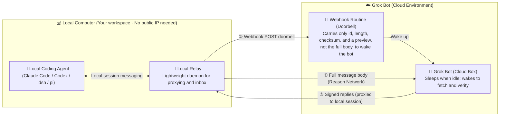
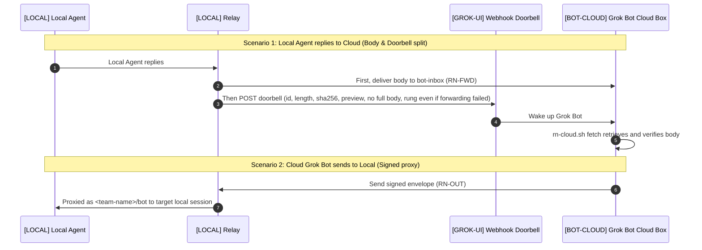

# agent-mesh

**English** | [简体中文](README.zh-CN.md)

Connect a cloud Grok Bot with active Claude Code, Codex, pi, and DeepSeek Harness (dsh) sessions running on your local computer, in one private [Reason Network](https://github.com/reason-machines/reason-network) team. The two sides can hold multi-turn conversations: either side can start one, and whoever replies wakes the other.

| | |
|---|---|
| **Version** | agent-mesh **v0.4.0** · [Changelog](CHANGELOG.md) · [Version file](VERSION). Query it offline with `./install.sh --version`; the Reason Network dependency has a separate version. |
| **Platform** | Local: not tied to one OS by design (the engine ships macOS / Linux / Windows builds; the relay is pure Python), but only macOS currently has a one-click installer and has been verified · Python 3.9+ |
| **Network** | No public IP, no dedicated server, no port forwarding required |
| **Not required** | Reason account, Docker, or Node |
| **License** | MIT |

> [!TIP]
> To let an agent install it, give Claude Code or Codex this repository and say: **“Read [AGENT-INSTALL.md](AGENT-INSTALL.md) and install it.”**

**Contents:** [Architecture overview](#architecture-overview) · [What problem it solves](#what-problem-it-solves) · [Key highlights](#key-highlights) · [Execution location labels](#execution-location-labels) · [How it works](#how-it-works) · [Prerequisites](#prerequisites) · [Install](#install) · [Verify](#verify) · [How agents receive messages](#how-agents-receive-messages) · [Security and privacy](#security-and-privacy) · [Troubleshooting](#troubleshooting) · [Uninstall](#uninstall) · [Documentation and language](#documentation-and-language) · [Appendix: message formats](#appendix-message-formats)

## Architecture overview



## What problem it solves

- **Reaching the right person (retaining live conversation context)**: Calling `claude -p "..."` from a remote script executes a one-off command, but it **spawns a brand new, blank process every time**. If you already have an active terminal session with extensive project background, conversation history, and pending edits, `claude -p` cannot touch it. agent-mesh addresses your specific live session directly without losing context.
- **No busy waiting (two-way doorbell wake-up)**: Complex tasks require back-and-forth dialogue (clarifying details, making revisions, and resuming discussions). Without wake-up mechanisms, the cloud must either hang in a busy loop or poll periodically; with agent-mesh, each turn sleeps immediately after sending. A reply rings the "doorbell" to wake the other side (by default the relay waits at least 20 seconds between wake-ups and wakes at most 20 times per hour; whether a local session wakes depends on its [delivery mode](#how-agents-receive-messages)), saving compute and quota on both ends.
- **Zero public exposure (no server, no public IP)**: Built on Reason Network; messages may pass through iroh public relays. Upstream describes message content as encrypted; this project has not independently audited it. Your local computer opens no inbound port and, as long as it can reach the iroh relays, works inside home or corporate networks without a self-hosted server or relay. With a VPN or proxy, allow `iroh.link`; see [Troubleshooting](#troubleshooting).
- **Guarded permissions (communication without privilege escalation)**: The channel transmits text messages only and **grants no extra execution privileges**. Your local agent still asks you to confirm sensitive actions, provided it does not auto-approve: for sessions in modes such as Claude Code's `--dangerously-skip-permissions` or Codex's `--yolo`, incoming text acts as a command. Grok Bot in the cloud is the channel's trust root; if content it reads steers it, it can still send validly signed messages. See [Security and privacy](#security-and-privacy).
- **When you don't need it**: If the entire task can be finished inside Grok Bot's cloud computer (running scripts, conducting research, writing standalone files), install the needed CLIs directly on the cloud box; you do not need this project.

## Key highlights

- 📦 **No need to migrate local code and environments**: Your code, documents, dependencies, and session history stay where they are. You do not need to pack and upload projects to a cloud machine to get cloud collaboration.
- ⚡ **Save tokens and avoid idle burn**: The cloud bot sleeps immediately after dispatching; your local agent works and rings the doorbell when finished. Neither side busy-polls (the local side runs only a lightweight relay that long-polls for mail), saving Grok quotas while utilizing your existing local agent subscriptions.
- 🤝 **Multi-session team collaboration**: Not limited to 1-on-1. Open multiple terminal sessions locally for different roles (e.g. refactoring code, auditing docs, inspecting logs); the cloud bot can communicate with them simultaneously, and local sessions can even cross-check discrepancies before reporting back.
- 🔒 **No self-hosted relay, clear permission boundary**: Built on Reason Network with no server to host or rent (messages may pass through iroh public relays); the channel carries task conversation only and grants no extra execution rights, so what runs locally is still governed by the agent's own approval settings.

## Execution location labels

This guide, the runbook, and the prompts use these labels. They are instructions, not text to enter in a terminal.

| Label | Location | What runs or happens there |
|---|---|---|
| `[LOCAL]` | User's local computer (default machine name `mac`) | Local coding agents, the Reason Network engine, and relay; `install.sh`, `check.sh`, `uninstall.sh` |
| `[BOT-CLOUD]` | Grok Bot's cloud computer, named `cloud` | Grok Bot runs `/workspace/agent-mesh/box/rn-cloud*.sh` and stores cloud state and message bodies |
| `[GROK-UI]` | Grok Bot interface opened by the user | Create or pause routines, paste prompts, and approve CopyToBox; these are not terminal commands |

Each computer has its own repository clone; files do not sync automatically. On `[LOCAL]`, `~` is the user's home directory on their local computer; `/workspace/agent-mesh/` on `[BOT-CLOUD]` is a directory on the Bot's cloud computer. Unless labeled otherwise, terminal commands and `~/…` paths below belong to `[LOCAL]`.

## How it works

There are three roles:

| Role | Availability | What it does |
|---|---|---|
| `[LOCAL]` User's local computer | Kept awake | Runs the engine and relay. The relay listens as `<team-name>/bot`, representing Grok Bot to local agents. The `bot` address belongs to the relay on the local computer, not to the Bot's cloud computer. |
| `[BOT-CLOUD]` Bot's cloud computer | May sleep | Starts the engine on demand during a turn. It sends as `<team-name>/bot-cloud`, receives full bodies as `<team-name>/bot-inbox`, and uses the machine name `cloud`. No always-on service is installed there. |
| `[GROK-UI]` Routine | Woken by webhook | A webhook task created in the Grok Bot interface; when woken, the Bot executes its prompt on `[BOT-CLOUD]`. A POST from the `[LOCAL]` relay wakes it. |



Five design choices make this work:

1. **The always-on machine handles replies.** The local computer sends every cloud-originated message on Grok Bot's behalf, so replies return to the local computer rather than a sleeping cloud computer.
2. **The webhook is a doorbell.** In the original deployment, Grok Bot retained roughly the first 4,000 characters of a wake-up body. Full text therefore travels over Reason Network; the webhook carries an id, length, checksum, and optional preview. The routine fetches and verifies the body. A 10,000-character message can use one wake-up, within the engine's byte limit.
3. **Both ends recover lost mail.** The relay keeps forwarded bodies for seven days. If `fetch` cannot retrieve one, it requests a signed re-forward, at most twice per message. This also recovers a failed initial forward. The cloud also sends the relay a signed receipt (RN-GOT) saying which messages it stored and which were handled; a reply with `reply_to` counts as handled too. A message stays pending on the relay until it is handled. With no stored receipt `GOT_TIMEOUT_SECONDS` (default 15 minutes) after its doorbell, the relay re-sends the body and rings again; stored but not handled after `GOT_DONE_SECONDS` (default 2 hours), it only rings again, and the cloud hands the message out once the earlier turn's claim has expired. At most `GOT_MAX_RERINGS` (2) re-rings per message, not counted against the re-forward limit; after that the relay sends Grok Bot an alert naming the message and repeats it until the Bot confirms it. `GOT_TIMEOUT_SECONDS=0` turns re-ringing off for new mail. Known limitations:
   - If the cloud stops sending receipts (an older cloud script or `RN_GOT=0`), the relay notices after one extra re-ring, sends one alert, and stops watching new mail until the next receipt arrives. Until then, a turn that stops after claiming new mail and before handling it is recovered only by the orphan scan or a resend. Messages already pending are still re-rung until handled or reported one by one.
   - While receipts are off, only a reply proves a message was handled, so one that was only marked `done` ends with an alert: a false alarm, nothing is lost.
   - An alert delivered `GOT_MAX_RERINGS + 1` times without being confirmed is dropped and stays only in the relay log (`ALERT` lines).
   - Past 200 alerts waiting, only their count is sent; the individual alerts are in the relay log.
   - Re-ringing gives up after `GOT_MAX_RERINGS` and reports the message; it never retries forever.
4. **Each message goes to one turn, and an interrupted one is not redone silently.** Wake-ups can overlap, and a retried webhook can ring twice for the same id. `fetch` claims each body it hands out for one hour (`RN_CLAIM_LEASE`), so an overlapping turn gets `claimed` and skips it; a finished message reports `handled`. The Bot runs `rn-cloud.sh working <id>` before acting, and `rn-cloud.sh send` marks a reply as started before the engine sees it. If a turn stops after either point without recording completion, later turns report `uncertain`: the Bot checks its thread notes or asks the user rather than acting again. Every `fetch` also hands out verified bodies from the last seven days that no doorbell asked for and nobody handled, such as after a lost doorbell (`"orphan": true`; `RN_ORPHAN_DAYS` sets the days and `RN_ORPHANS=0` turns this off). This is not exactly-once: a message whose turn stopped before `working` is handed out again after the claim expires, and one whose turn stopped later waits for the user's decision.
5. **Relay protocol messages are signed.** A team session can claim another sender name. Proxy envelopes, forwarded bodies, and re-forward requests therefore use HMAC signatures. Envelopes and requests have a 15-minute freshness window and replay protection. The signing key has one copy on each machine.

## Prerequisites

### `[LOCAL]` Local computer

- **Computer and system:** not tied to one OS by design; the engine ships macOS / Linux / Windows builds, and the relay is pure Python. Currently only macOS (Apple Silicon or Intel) has the one-click installer `./install.sh` and has been verified, running as a regular user signed into the desktop. Do not use `sudo`; a pure SSH/headless login is outside this installation flow. Linux and Windows have no installer support yet and are unverified; in principle systemd or Task Scheduler could replace the macOS login service. Community testing and contributions are welcome.
- **Git and Python 3.9+**, including the `ssl` and `sqlite3` standard-library modules. Check with:

  ```bash
  git --version
  python3 -c 'import sys, ssl, sqlite3; print(sys.version)'
  ```

  If Git or Python is missing, run `xcode-select --install`, finish installation and check again; if Python is still too old, install a suitable Python and put it on PATH. The installer also checks `curl`, `tar`, `shasum`, `openssl`, `launchctl`, and `plutil`; supply missing tools before retrying. No separate Node installation or pip packages are needed.
- **At least one coding agent:** first install and sign in to at least one of Claude Code, Codex, pi, or DeepSeek Harness and verify it works independently. This project does not install these agents or configure model accounts/subscriptions. The integration plan comes from `reason-network setup --dry-run` on the user's computer, not from the author's configuration.
- **`~/.local/bin` in PATH:** in the current Bash/zsh shell, run `export PATH="$HOME/.local/bin:$PATH"`. For persistence, use `~/.zshrc` for zsh, the appropriate `~/.bash_profile` or `~/.bashrc` for Bash, or `fish_add_path "$HOME/.local/bin"` for fish. Do not always edit `~/.zshrc`. The relay service records the detected Python's absolute path; if that Python is later moved or removed, repair Python and rerun the installer to update the service.
- **Existing Reason Network installations:** review them first. This flow uses `~/.local/bin/reason-network`, the default `~/.reason/network` state directory, and pinned v0.10.7. A different PATH installation, engine version, or custom `REASON_NETWORK_HOME` stops the installer so the existing deployment can be reviewed. An existing team with the same person name can be reused; a different person cannot be renamed in place. Uninstalling with `--all` removes this default engine and its integrations and may affect existing uses; it is not a general troubleshooting step.
- **Stay awake:** keep the local computer powered on and awake during collaboration. On macOS, enable the setting that prevents automatic sleep on power, or run `caffeinate`. Closing a laptop lid stops everything.

### `[BOT-CLOUD]` Bot's cloud computer

- Linux x86_64 or ARM64, Bash, Git, Python 3.9+ with `ssl` and `sqlite3`, `curl`, `tar`, `sha256sum`, and a writable persistent `/workspace/agent-mesh/`.
- The Bot prepares missing tools using the cloud system's package manager and explains any needed permissions to the user; do not install them on the local computer instead. The cloud script checks system, CPU, and runtime dependencies before downloads; the cloud prompt covers Git and directory checks.

### Grok Bot and team name

- Grok Bot must support webhook-triggered routines and CopyToBox from your Mac.
- Choose a team name, also used as your person name: 1–40 lowercase ASCII letters, digits, or hyphens; no leading or trailing hyphen. Use a pseudonym. Renaming requires recreating the team.

### Network

- Both `[LOCAL]` and `[BOT-CLOUD]` need HTTPS access to GitHub repositories and release downloads, plus iroh relay connectivity.
- The default public HTTPS clone URL needs no GitHub account or SSH key. For a public fork, pass `--repo-url https://…` on each installer command that generates a cloud prompt; it must allow credential-free cloud reads. The local clone can live anywhere; the cloud clone must remain at `/workspace/agent-mesh/` because prompts use that fixed path.
- Check connectivity to `*.iroh.link`, especially with a VPN or proxy. This probe should return HTTP 200:

  ```bash
  curl -sS -o /dev/null -m 10 -w 'code=%{http_code}\n' https://aps1-1.relay.n0.iroh.link/
  ```

  If it fails, see [Troubleshooting](#troubleshooting). The probe checks one endpoint, not worldwide availability.

## Install

**`[LOCAL]` Run as the user or local installing agent.** Replace the team-name placeholder:

```bash
git clone https://github.com/xiaozhenliu/agent-mesh.git ~/agent-mesh
cd ~/agent-mesh
./install.sh --name <team-name> --lang en
```

If the destination already exists, check that it is the same repository and review uncommitted changes before proceeding; do not overwrite it or blindly pull. These commands clone the public distribution. The cloud defaults to the same public repository, whose root must contain `box/rn-cloud-setup.sh`; the installer does not infer its URL from the local origin.

The installer handles the local computer (Mac) side and pauses for user actions:

1. Downloads Reason Network v0.10.7, verifies SHA-256, creates your private team, and disables auto-update and LAN broadcasts.
2. Shows `reason-network setup --dry-run` and **waits for confirmation** before wiring local agents.
3. `[LOCAL]` generates the signing key and prints a routine prompt. **In `[GROK-UI]`, the user creates a webhook-triggered routine and pastes that prompt.** Paste its Webhook URL and key into the `[LOCAL]` terminal. The installer writes local configuration and installs the relay as a Mac login service.
4. `[LOCAL]` prints a team invite and cloud setup prompt. **In `[GROK-UI]`, the user sends both to Grok Bot.** On `[BOT-CLOUD]`, the Bot clones the repository and joins the team, then uses CopyToBox to copy the key from `[LOCAL]` to `[BOT-CLOUD]`. The user approves the copy in `[GROK-UI]`.

Reopen Claude Code and Codex sessions that were already running. Codex asks once on first launch; choose “Trust all and continue”.

### Prompt language

Use `--lang en` or `--lang zh-CN` on each installer invocation to select generated prompts. English is the default; `AGENT_MESH_LANG` sets a shell-level default, and `--lang` overrides it. Terminal diagnostics, configuration keys, and protocol fields remain English. Agents speak to users in their preferred language. Language support does not change operating-system or network requirements.

### Optional

- **dsh automatic wake-ups:** run `dsh/mac-install.sh <team-name>`; see the [bridge guide](dsh/README.md).
- **Reply convention:** append the [English template](templates/AGENTS.reason-network.md) or [Chinese template](templates/AGENTS.reason-network.zh-CN.md) to your working repository's `AGENTS.md`. For Claude Code, also add `@AGENTS.md` to `CLAUDE.md`. The template asks for a conclusion followed by four concise status fields.

## Verify

Locations: self-checks, test sends, and relay log inspection run on `[LOCAL]`; Grok Bot uses `/workspace/agent-mesh/box/rn-cloud.sh` on `[BOT-CLOUD]` for `who` and `fetch`.

1. **Self-check.** This is read-only; each `FAIL` includes a suggested fix.

   ```bash
   ./check.sh
   ```

2. **Test message.** Send a message, then wait for the reply in another terminal:

   ```bash
   reason-network send <team-name>/bot "test 1"
   reason-network listen --as terminal --wait 600   # in another terminal
   ```

   Look for `forwarded` and `POST … code=200` in `~/Library/Logs/agent-relay.log`.

3. **Wake a session.** Ask Grok Bot to run `who` and send a sentence to a specific Claude Code session. The session should wake even if idle; its reply should wake Grok Bot again.
4. **Long message.** Send a 10,000-character message. Expect one wake-up and a `complete` fetch result with matching length and SHA-256. The signed message must fit within the relay's 60 KiB forwarding limit; UTF-8 byte size depends on the text.

## How agents receive messages

The last column of `reason-network who` shows the delivery mode:

| Mode | Behavior | Agents |
|---|---|---|
| **push** | Wakes an idle session. | Claude Code receives an injected message; Codex gets it through `codex queue`, which queues it in the open session; pi polls through an extension every five seconds. |
| **turn** | Normally waits for a tool call or the end of a turn. | dsh with the bridge reports `turn`, but starts a turn within roughly five seconds when idle. |
| **pull** | Does not wake automatically. | dsh without the bridge must check its inbox. |

Closed sessions disappear from the roster. Messages remain in the inbox while the recipient is offline. After reopening, you have to tell the agent to check its inbox before it reads them. Keep a session open for prompt delivery.

## Security and privacy

### Grok Bot is the trust root

- There are two copies of the signing key, and one of them is on `[BOT-CLOUD]`. Signatures stop sessions without the key from impersonating the Bot; they do not stop a manipulated Bot. If content Grok Bot reads in a web page or document steers it (prompt injection), it can still produce validly signed RN-OUT envelopes and message any of your local sessions as `<team-name>/bot`. Local agents should therefore treat the Bot's messages as outside input, not as instructions from you.
- Agents running as the same macOS user may still read the keys in `~/.config/agent-relay/`. A project folder is not an access-control boundary.

### Local agent permissions

- This bridge sends text to a local agent; it does not itself give Grok Bot direct file access or bypass the agent's permissions. The receiving session decides whether and how to act. The Mac opens no inbound port. Grok Bot's local always-approve and local-network switches are not required.
- That holds only if the agent does not approve automatically. Even without auto-approval, actions the session's sandbox and permission settings already allow (such as reading files or editing in the working directory) run without asking you; only actions that need human approval wait for you. The following modes let more actions run without asking, so incoming text acts as a command; start such sessions only in a sandbox folder or isolated environment:
  - Claude Code: `--dangerously-skip-permissions`, or `--permission-mode bypassPermissions`.
  - Codex: `--yolo` (that is, `--dangerously-bypass-approvals-and-sandbox`: no prompts and no sandbox); `--sandbox danger-full-access` (no sandbox); `--ask-for-approval never` (never asks: what the sandbox allows runs, the rest fails); and `--approve-for-me`, which hands approvals to automatic review.
- **Unattended wake-ups**: push sessions wake even when you are away. Reason Network v0.10.7 wakes Codex with `codex queue --thread <id> --message`: the message is queued in that already open session and runs as a new turn with the approval and sandbox settings the session started with; no flag loosens them. Tested with Codex 0.166.0 (`--ask-for-approval on-request --sandbox read-only`, where writing a file needs human approval): when the woken turn needed to write a file, the approval prompt appeared in that session's terminal and waited; nothing ran without confirmation, and after about a minute it had not approved itself. Without auto-approval, actions that need human approval therefore wait at the prompt until you return, while actions the sandbox and permission settings already allow still run; with auto-approval, nobody stops them. Claude Code receives the message directly in the open session; this project has not separately tested its approvals while unattended.
- To hold incoming messages, set `[inbound] default = "hold"` in `~/.reason/network/config.toml`, then use `reason-network approve` to release them.

### Message bodies are stored in plain text

Message bodies remain in plain text in the following places, so **do not send keys, passwords, tokens or other secrets through this channel**:

| Location | Content | Kept for |
|---|---|---|
| `[LOCAL]` `~/.reason/network/network.db`, `[BOT-CLOUD]` `/workspace/agent-mesh/box/state/network.db` | Messages each engine received, kept after they are read | Not deleted by the engine |
| `[LOCAL]` `~/Library/Application Support/agent-relay/fwd-copies/` | The relay's copies of forwarded bodies, kept for redelivery | After `FWD_COPY_DAYS` (default 7 days) they are no longer redelivered, but they are deleted only when later mail passes through the relay (checked at most hourly); an idle relay keeps them |
| `[BOT-CLOUD]` `/workspace/agent-mesh/inbox/<id>/full.txt` | Bodies retrieved by `fetch` | Not deleted automatically |
| `[BOT-CLOUD]` `/workspace/agent-mesh/threads/*.md` | Conversation summaries the routine appends each turn | Not deleted automatically |
| `[LOCAL]` `~/Library/Application Support/agent-relay/state.json` | Doorbells waiting for the webhook, each with its body preview | Removed once the webhook delivers them; while the webhook keeps failing they stay, and only the oldest are dropped past `MAX_SPOOL`. Changing `DOORBELL_PREVIEW_CHARS` affects later doorbells only; fix the webhook so the backlog goes out |
| The routine's webhook | A preview of the first 200 characters in each doorbell | Up to Grok Bot; `DOORBELL_PREVIEW_CHARS=0` turns previews off |

The relay log records message ids, lengths and checksums, not bodies. `FWD_COPY_DAYS` and `DOORBELL_PREVIEW_CHARS` are set in `~/.config/agent-relay/env`; restart the relay with `launchctl kickstart -k "gui/$(id -u)/com.local.agent-relay"` for a change to take effect. To clean up:

- On `[LOCAL]`, run `./install.sh --purge-copies` to delete all copies the relay kept. Redelivery requests for those messages then get `no-copy`, and the sender has to send again.
- For `[BOT-CLOUD]`, ask Grok Bot in `[GROK-UI]` to run `/workspace/agent-mesh/box/rn-cloud.sh purge <days>`. It stops the cloud engine, then deletes received messages (the cloud `network.db`), `inbox/<id>/`, misdirected mail logs in `inbox/_stray/`, and `threads/*.md` older than that many days; `0` deletes all of them. The thread notes give the routine its context, so the Bot no longer remembers earlier conversations afterwards. The cloud clone must first be updated to a version that has this command.
- The engine manages the local `network.db`; this project offers no partial cleanup for it. `./uninstall.sh --all` removes all of `~/.reason/network`.

### Team members

- After setup, and periodically afterwards, run `reason-network team` and confirm that only your local computer and `cloud` are listed. `./check.sh` checks this too and reports FAIL for any other member. Remove an unknown person or machine with `reason-network remove <person>/<machine>`, then replace the signing key as described below.
- Team members can see session names, the last working-directory component, repository names, and branches. Avoid starting agents directly in your home directory. Use invite links in the terminal, not a browser.

### Replacing keys

- **Signing key**: on `[LOCAL]`, run `./install.sh --rotate-key --lang en`. It generates a new `outbound.key`, restarts the relay, and prints the CopyToBox steps: in `[GROK-UI]`, have Grok Bot use CopyToBox to copy the new key from `[LOCAL]` `~/.config/agent-relay/outbound.key` to `[BOT-CLOUD]` `/workspace/agent-mesh/box/outbound.key`, approve the copy, and run `chmod 600` on the cloud copy. Until the cloud has the new key, signature checks fail in both directions. Messages forwarded before the rotation that the cloud has not fetched yet keep their old-key signature: after the rotation `fetch` reports them as `mismatch` (bad signature), requests no redelivery, and every scan reports them again. If the old key did not leak, have the Bot fetch pending mail before rotating; otherwise ask the senders to resend, and clean up the old messages with `rn-cloud.sh purge`.
- **Webhook URL or key**: regenerate the routine's key in `[GROK-UI]`; if the interface cannot, delete and recreate the routine. Then run `./install.sh --webhook --lang en` on `[LOCAL]` and enter the new values.
- The complete leak response is in the [security policy](SECURITY.md#if-you-suspect-a-credential-leak).

### Network and usage

- The pinned open-source engine runs locally in account-free mode, and in that mode it sends no data to Reason. Traffic may pass through iroh public relays; upstream describes the content as encrypted. This project has not independently audited those relays. `reason-network relay <URL>` selects a self-hosted relay.
- Each Grok Bot wake-up consumes usage. The relay defaults to at most 20 wake-ups per hour.
- Report security problems privately as described in the [security policy](SECURITY.md), not in a public issue.

## Troubleshooting

- **Cannot reach the iroh relay:** retry the probe with the VPN/proxy disabled. If that resolves it, add a direct/bypass rule covering `iroh.link` and all subdomains, including in TUN, virtual-NIC, enhanced, or global modes. Exclude the domain from HTTPS decryption/MITM too. Check the certificate issuer:

  ```bash
  curl -sv -o /dev/null https://aps1-1.relay.n0.iroh.link/ 2>&1 | grep issuer
  ```

  Expect a public certificate authority (currently Let's Encrypt) rather than your proxy's CA. If it still fails without the proxy, investigate DNS, firewall rules, or the network. The engine can use several relays; allowing only the probe host is insufficient.
- **Cloud join reports `couldn't reach the machine that made the invite`:** usually the Mac's VPN or proxy is intercepting `*.iroh.link` again. Fix it as in the previous item, run `reason-network stop` on the Mac, then have Grok Bot retry with the same invite while valid.
- **Session missing from `who`:** reopen sessions started before `setup`. Codex also needs to complete a turn before appearing.
- **`fetch` reports `missing`:** inspect `refwd`. `ack=resent` means the relay resent it; retry after 60 seconds. `no-copy`, `limit`, `failed`, or `skipped` means recovery did not succeed; ask the sender to resend. No `refwd` field means the Mac was not connected.
- **Message `refused`:** the engine's loop guard refuses more than 12 messages between a pair of agents within ten minutes. Body forwarding uses the exempt terminal identity.
- **`<` became `[`:** version 0.10.7's `listen` rewrites some tags to deter spoofing without changing the character count. Re-forwards use the relay's stored copy.

## Uninstall

All of these commands run on `[LOCAL]`:

| Command | Removes |
|---|---|
| `./uninstall.sh` | The relay service, state, message copies, logs, and `~/.config/agent-relay`. |
| `./uninstall.sh --all` | Everything above; also removes the dsh bridge block if present, runs `leave --force` and `setup --remove`, then removes `~/.reason/network` and the engine binary. |
| `dsh/mac-uninstall.sh` | Only the dsh bridge: puts Reason Network's own block back in `~/.dsh/cordis.patch.yml`. See the [bridge guide](dsh/README.md#uninstall). |

Then, in `[GROK-UI]`, pause or delete the routine, and on `[BOT-CLOUD]`, remove `/workspace/agent-mesh/`.

## Upgrade

The local repository, the clone on the Bot cloud computer and the saved routine prompt are separate: changing files on the Mac does not update the other two. A reply convention already appended to a project's `AGENTS.md` is not updated either; copy the template again. The [changelog](CHANGELOG.md) says which parts each version changes.

### Upgrade with update.sh

In the repository on `[LOCAL]`, run:

```bash
./update.sh --lang <en|zh-CN>
```

It first runs `git pull --ff-only` (skip it with `--no-pull`), then compares each part with what this Mac deployed:

| Part | Compared | When it differs |
|---|---|---|
| Relay | the installed `agent_relay.py` and its login service file against this checkout | installed and restarted after one confirmation (none with `--yes` or outside a terminal); if the new relay does not come up, the previous one is put back |
| dsh plugin | the installed plugin file, if the bridge is installed | the file is replaced; `~/.dsh/cordis.patch.yml` and your bridge settings stay as they are; quit and reopen dsh |
| Cloud scripts | `box/rn-cloud.sh` and `box/rn-fetch.py` against what you last confirmed | guided steps, below |
| Cloud setup | `box/rn-cloud-setup.sh` against what you last confirmed | asks whether the cloud side is set up for this version; the changelog describes any migration |
| Routine prompt | the prompt rendered for the chosen language against what you last confirmed | guided steps, below |

What the Mac last confirmed is kept in `~/.local/lib/agent-mesh/deployed.json`. When only the relay or the dsh plugin changed, the update can run unattended: in a terminal it asks for one confirmation, which `--yes` skips; outside a terminal it asks nothing. When the cloud scripts or the routine prompt changed, it needs a terminal and walks you through the order that keeps old parts from being woken: it stops the relay, asks you to pause the routine in `[GROK-UI]`, prints a message asking Grok Bot to pull this commit on `[BOT-CLOUD]` together with the commit and checksums its reply must show, prints the new routine prompt to paste, asks you to resume the routine, and finally starts the relay. The cloud step needs a committed checkout that matches its upstream, so that the cloud pulls exactly the same files.

- `./update.sh --plan` only shows the comparison and the steps; it changes nothing in the deployment. Without `--no-pull` it may still fast-forward the checkout first.
- Exit code 3 means answers in a terminal are needed; nothing was changed.
- If you answer no, press Ctrl-C or a step fails, the relay that was running before is started again, and you are reminded if the routine is still paused. Run `./update.sh` again to continue from that step; finished steps are not repeated unless the version moved on in between.
- First update from v0.3.0 or earlier: run `git pull` yourself once, because older checkouts have no `update.sh`. Without a record, the cloud scripts and the prompt count as unknown, so the guided steps run once.
- The script cannot see the routine or the cloud computer: it relies on your answers and on the commit and checksums Grok Bot reports.

### Manual upgrade

When the relay, the cloud scripts and the routine prompt all change, update them together in this order, so that no doorbell rings while some parts are old:

1. On `[LOCAL]`, stop the relay: `launchctl bootout "gui/$(id -u)/com.local.agent-relay"`. Messages that reach the Mac from now on stay unread in the local engine and ring no doorbell.
2. In `[GROK-UI]`, pause the routine and wait until no run is active.
3. Have Grok Bot update `/workspace/agent-mesh` on `[BOT-CLOUD]` (ask it directly in chat, not through the routine) and confirm that the `rn-cloud.sh` usage lists `done`, `working` and `RN_GOT`.
4. In `[GROK-UI]`, replace the saved routine prompt and resume the routine. The relay is still stopped, so no doorbell rings yet.
5. On `[LOCAL]`, update the repository and run `./install.sh --restart-relay`, or rerun the full install: `./install.sh --name <team-name> --lang <en|zh-CN>`. An already configured webhook is not asked for again; the installer copies the new `agent_relay.py` and starts the relay service, which first catches up from `network.db` and then picks up the messages that arrived while it was stopped. If the new relay does not come up, the installer puts the previous one back. The full install also shows the agent wiring plan again and asks for confirmation.

While the relay is stopped the Mac gets no pushes, and messages wait in the local engine. Keep the stop short: a reply the cloud signed more than 15 minutes before the relay forwards it is refused as stale and is not delivered. If step 3 or 4 fails, start the old relay again with `launchctl bootstrap "gui/$(id -u)" ~/Library/LaunchAgents/com.local.agent-relay.plist` to return to the state before the upgrade.

To roll back receipts and re-rings later, go in this order so that an old relay never receives a receipt:

1. On `[LOCAL]`, set `GOT_TIMEOUT_SECONDS=0` in `~/.config/agent-relay/env`, restart the relay with `launchctl kickstart -k "gui/$(id -u)/com.local.agent-relay"`, keep the routine running and wait until `~/Library/Logs/agent-relay.log` shows `pending: 0` and `alerts: 0` (while the webhook delivers, at most about `GOT_DONE_SECONDS × (GOT_MAX_RERINGS + 1)`).
2. In `[GROK-UI]`, pause the routine and wait until no run is active.
3. Have Grok Bot roll `/workspace/agent-mesh` back on `[BOT-CLOUD]` and check that the cloud engine's outbox is empty, then wait a few minutes so the relay still handles any receipt on its way.
4. Restore the previous routine prompt and resume the routine.
5. Roll back the relay on `[LOCAL]` last.

## Documentation and language

| Guide | English | 简体中文 |
|---|---|---|
| User guide | [README](README.md) | [使用指南](README.zh-CN.md) |
| Agent installation | [Runbook](AGENT-INSTALL.md) | [安装手册](AGENT-INSTALL.zh-CN.md) |
| DeepSeek Harness | [Bridge](dsh/README.md) | [插件指南](dsh/README.zh-CN.md) |
| Grok Bot routine | [Prompt](prompts/routine.md) | [提示词](prompts/routine.zh-CN.md) |
| Cloud setup | [Prompt](prompts/cloud-setup.md) | [提示词](prompts/cloud-setup.zh-CN.md) |
| Reply convention | [Template](templates/AGENTS.reason-network.md) | [模板](templates/AGENTS.reason-network.zh-CN.md) |
| Maintaining translations | [Contributing](CONTRIBUTING.md) | [维护说明](CONTRIBUTING.zh-CN.md) |
| Security policy | [Security policy](SECURITY.md) | [安全策略](SECURITY.zh-CN.md) |

To choose the language of generated prompts, see [Prompt language](#prompt-language).

## Appendix: message formats

### Signing rules

- The key is the 64-character hex **string** in `outbound.key`, stripped of surrounding whitespace. Use its UTF-8 bytes directly as the HMAC-SHA256 key; do not hex-decode it.
- Signatures are lowercase hex.
- The engine trims message whitespace, so strip trailing body whitespace before signing.
- Avoid the literal `<reason-message` in a body.
- Protocol fields and test-vector text are identical in every language.
- All test vectors below use the same key: `0123456789abcdef` repeated four times.

### RN-OUT v1

`bot-cloud` asks `bot` to send a message:

```text
RN-OUT v1
to: <recipient address>
reply_to: <message id being replied to, or empty>
ts: <Unix seconds>
nonce: <random hex, 12 random bytes recommended; derived as below when reply_to is set>
sig: <hex>
---
<body>
```

Signature: `sig = HMAC(key, "v1\n" + to + "\n" + reply_to + "\n" + ts + "\n" + nonce + "\n" + body)`. Split headers and body at the first `\n---\n`.

Test vector:

- to=`demo/claude-session`, reply_to=`01JTESTREPLYTO0000000000`, ts=`1700000000`, nonce=`0123456789abcdef01234567`
- body = `hello` + newline + `第二行`
- Expected sig=`652fbb03f1fd8626fd4f5db689b5983bdd57c797d5ba1085c340aaf699003088`

With a non-empty `reply_to`, `rn-cloud.sh send` derives the nonce instead of drawing it at random: `nonce = HMAC(key, "idem1\n" + to + "\n" + reply_to + "\n" + body)`, first 24 hex characters, where body is the same stripped body that is signed. Sending the same reply file again gives the same nonce with a new `ts`. A message without `reply_to` keeps a random nonce, because two identical messages that start contact may be intended.

Derived-nonce test vector:

- to=`demo/claude-session`, reply_to=`01JTESTREPLYTO0000000000`, body = `hello` + newline + `第二行`
- Expected nonce=`21dfab75a1eabc427d7655db`

The relay keeps a send record for every nonce it proxies, saved before it calls the engine and kept for `NONCE_KEEP_SECONDS` (default 86400, 24 hours). A repeated nonce that was already sent is dropped silently. A repeated nonce whose result is unknown (the engine timed out, answered `held` or gave no clear answer, or the relay stopped during the send) is not sent; the relay alerts once, and the Bot should check with the recipient, or change the text to send it anyway. A nonce the engine clearly refused, or one the relay refused before sending it (stale, hourly limit, group or own address), may be sent again. Those refusals, failures and unknown results reach the routine as relay alerts.

Deduplication is a safety net; the Bot still should not resend a reply that is only queued. It works only when all of these hold: the relay and the cloud scripts are this version or later, the reply has a `reply_to`, the resend is byte-for-byte the same (the same reply file), and no more than `NONCE_KEEP_SECONDS` have passed since the first proxied send. Otherwise:

| Case | Result |
|---|---|
| The original arrives within 15 minutes and is sent; a resend arrives later | The resend is dropped silently |
| The resend arrives first and is sent; the original arrives later (fresh or stale) | The original is dropped silently |
| The original is held up for more than 15 minutes | The original is refused as stale (alert); nothing is recorded, so the resend is sent normally |
| The relay clearly refuses (engine refusal, hourly limit, group address) | Alert; a resend is handled normally |
| The relay cannot tell whether the send went out | One alert; a resend is not sent; change the text to send it |
| Two different replies to the same `reply_to` | Different nonces; both are sent |
| Messages that start contact (no `reply_to`) | Random nonces; both are sent |
| Resend after `NONCE_KEEP_SECONDS` | Sent as a new message |
| New cloud scripts, old relay | A resend within one hour is refused as a replay, with a notice (one extra wake, no duplicate); after one hour it is delivered twice |
| Old cloud scripts, new relay | Random nonces, as before |
| A nonce the relay recorded in the hour before its upgrade, resent after the upgrade | Treated as unknown: not sent, one alert; change the text to send it |
| The engine answers `held`, or the relay cannot classify its answer | Unknown: one alert; a resend with the same nonce is not sent |
| New routine prompt, old cloud scripts | The prompt does not ask for a resend after a timeout, so this is no worse than before |

### RN-FWD v1

The relay forwards a body to `bot-inbox`:

```text
RN-FWD v1
id: <message id>
from: <sender address>
agent: <sender agent type, e.g. claude-code>
thread: <thread id, or empty>
text_len: <body character count>
text_sha256: <SHA-256 of body>
ts: <Unix seconds>
sig: <hex>
caps: got1
---
<original body>
--- RN-FWD END
```

Signature: `sig = HMAC(key, "fwd1\n" + id + "\n" + from + "\n" + agent + "\n" + thread + "\n" + text_len + "\n" + text_sha256 + "\n" + ts)`. text_len counts Unicode code points (Python len), not bytes or grapheme clusters; SHA-256 uses UTF-8 bytes.

The `caps` line is optional and not signed. The relay adds `caps: got1` to say it accepts RN-GOT receipts; the cloud keeps it in the message's `meta.json` and sends receipts only for messages that carried it. Readers ignore header lines they do not know, so a copy from an older relay simply has no `caps` line.

Test vector:

- id=`01JTESTMSG0000000000000000`, from=`demo/claude-session`, agent=`claude-code`, empty thread, ts=`1700000000`
- text = `你好` + newline + ` x `
- Expected sig=`a48eb3bbb089a3d6b31fed070d76063bb3b3ddabfac08b7651f4093ce358c576`

### RN-REFWD v1

`bot-cloud` requests redelivery from `bot`; no body:

```text
RN-REFWD v1
id: <message id to resend>
ts: <Unix seconds>
nonce: <random hex>
sig: <hex>
```

Signature: `sig = HMAC(key, "refwd1\n" + id + "\n" + ts + "\n" + nonce)`. The first line identifies a re-forward request.

The cloud adds an optional, unsigned `caps: got1` line after `sig:` unless `RN_GOT=0`. With it, the relay only re-sends the copy, because the cloud's own fetch is already waiting for it. Without it (an older cloud or `RN_GOT=0`), the relay also queues a doorbell with `refwd`.

Test vector:

- id=`01JTESTMSG0000000000000000`, ts=`1700000000`, nonce=`0123456789abcdef01234567`
- Expected sig=`eb9e0a80d3126e9f8f026e584927e864871d390c39b5dec8cc02a7a6e2922668`

### RN-REFWD-ACK v1

Relay acknowledgement to `bot-inbox`:

```text
RN-REFWD-ACK v1
id: <message id>
status: <resent | no-copy | limit | failed>
attempt: <re-forward attempt number>
reason: <reason, or empty>
ts: <Unix seconds>
sig: <hex>
```

Signature: `sig = HMAC(key, "refwdack1\n" + id + "\n" + status + "\n" + attempt + "\n" + ts)`.

Test vector:

- Same id as above, status=`resent`, attempt=`1`, ts=`1700000000`
- Expected sig=`faa3cd29c693eb142c3f3bbb38fa0be8c46bcea4869f90ce9842aa41aa83f6ea`

### RN-GOT v1

Cloud receipt to `bot`, sent without `--from` (as a `<team-name>/terminal` session, which the engine may number, for example `terminal-3`); the relay accepts it from `terminal`, `terminal-<n>`, `bot-cloud` and `bot-inbox`:

```text
RN-GOT v1
stored: <comma-separated message ids, no spaces, may be empty>
done: <comma-separated message ids, no spaces, may be empty>
ts: <Unix seconds>
nonce: <random hex; 12 random bytes recommended>
sig: <hex>
```

Signature: `sig = HMAC(key, "got1\n" + stored + "\n" + done + "\n" + ts + "\n" + nonce)`; an empty list is an empty string. Each id matches `[A-Za-z0-9._-]{1,120}`. The two lists hold at most 100 ids together (more are split across messages), and at least one is non-empty; an id in both counts as done. Freshness (15 minutes) and replay protection are as for RN-REFWD. `stored` lists messages that `fetch` verified and stored, handed to a turn, or reported as `uncertain`; `done` lists handled ones. The cloud reports only ids whose RN-FWD carried `caps: got1`, plus relay alert batches (`relay-alerts-…`), which `rn-cloud.sh done` confirms.

Test vector:

- stored=`01JTESTMSG0000000000000000`, done=`01JTESTMSG0000000000000001`, ts=`1700000000`, nonce=`0123456789abcdef01234567`
- Expected sig=`26666d313c6c3dae158d5f8b3a6228f2be554c6ec58401662647f51aca361518`

### Doorbell

JSON POSTed to the routine (abbreviated values):

```text
{
  "source": "reason-network",
  "relay_version": 3,
  "doorbell": true,
  "to": "<team-name>/bot",
  "reply_via": "<team-name>/bot-cloud",
  "inbox": "<team-name>/bot-inbox",
  "messages": [
    {"id": …, "from": …, "agent": …, "thread": …, "text_len": …, "text_sha256": …, "preview": …}
  ]
}
```

An item may also contain `refwd` (re-forward attempt number), `rering` (the relay's own re-ring number for a message that stayed unconfirmed) and `forward_failed` (the reason the forward or re-sent copy failed). `refwd` doorbells appear only when the cloud's request did not declare `caps: got1`. Relay system notices use `doorbell:false` and carry `text` directly in each item. Relay alerts arrive as one notice item whose id starts with `relay-alerts-`; the routine confirms it with `rn-cloud.sh done <id>`, and the relay sends it again until then.
