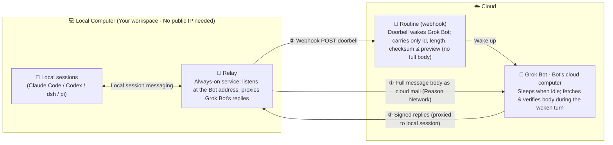
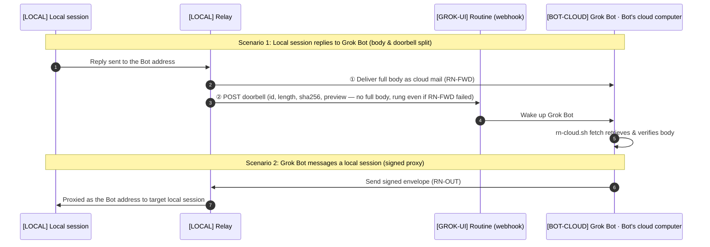

<div align="center">

# agent-mesh

**English** | [简体中文](README.zh-CN.md)

### Two-Way Messaging & Instant Wake-Ups Between Cloud Grok Bot and Local Coding Agents

Connect live **Claude Code**, **Codex**, **pi**, and **DeepSeek Harness (dsh)** sessions on your local computer with a cloud **Grok Bot** in one private [Reason Network](https://github.com/reason-machines/reason-network) team — either side can start a multi-turn conversation and every reply wakes the other, with **no public IP, dedicated server, port forwarding, Reason account, Docker, or Node required**.

[](CHANGELOG.md)
[](https://github.com/reason-machines/reason-network)
[](#prerequisites)
[](#prerequisites)
[](#prerequisites)
[](LICENSE)

Release **v0.11.1** · [Changelog](CHANGELOG.md) · [Version file](VERSION) · Offline query: `./install.sh --version` (Reason Network has a separate version)

**[Install](#install) · [Verify](#verify) · [Architecture](#architecture-overview) · [How It Works](#how-it-works) · [Multi-Bot](#several-grok-bots) · [Security](#security-and-privacy) · [Troubleshooting](#troubleshooting) · [Terms](#terms)**

</div>

> [!TIP]
> **Let an agent install it:** give Claude Code or Codex this repository and say: **“Read [AGENT-INSTALL.md](AGENT-INSTALL.md) and install it.”**

## What problem it solves

Calling `claude -p "..."` from a remote script runs a one-off task in a **new, blank process every time** — it cannot reach the terminal session you already have open with its project context, conversation history, and pending edits. `agent-mesh` bridges your cloud Grok Bot directly to those live local sessions:

- **Reaches the live session** — Addresses your open terminal session directly, keeping project background, conversation history, and uncommitted edits intact.
- **No busy waiting** — Multi-turn work needs questions, revisions, and follow-ups. Both sides sleep right after sending, and a reply rings a webhook "doorbell" to wake the recipient (locally, only a lightweight relay long-polls for mail), saving Grok Bot usage and putting your local agent subscriptions to work. By default, the relay waits at least 20 seconds between wake-ups and wakes Grok Bot at most 20 times per hour; whether a local session wakes automatically depends on its [delivery mode](#how-agents-receive-messages).
- **Code stays where it is** — Source files, documents, dependencies, and session history remain on your local computer; nothing needs to be packaged and uploaded to a cloud computer.
- **Several sessions at once** — Keep multiple local sessions open for distinct roles (refactoring code, auditing docs, inspecting logs). Grok Bot can collaborate with each of them, and local sessions can cross-check disagreements among themselves before reporting back.
- **No public exposure** — Built on [Reason Network](https://github.com/reason-machines/reason-network). Your local computer opens no inbound port and needs no self-hosted or rented server; home and corporate networks work as long as network relays are reachable. Messages may pass through public iroh or Reason network relays, and any VPN or proxy must allow `iroh.link` and `compute.reasonmachines.com` — see [Network](#network), [Network and usage](#network-and-usage), and [Troubleshooting](#troubleshooting).
- **No extra privileges** — The channel carries plain text only and **grants no extra execution privileges**; local execution remains governed by each agent's own approval settings. Two caveats: in auto-approving sessions (Claude Code `--dangerously-skip-permissions`, Codex `--yolo`, and similar modes), incoming text acts as a command; and Grok Bot in the cloud is the channel's trust root, so if external content steers it, it can still send validly signed messages. See [Security and privacy](#security-and-privacy).

> [!NOTE]
> **When you don't need it:** If an entire task can be completed on the Bot's cloud computer (running scripts, research, generating standalone files), install the CLIs you need directly there — you do not need this project.

## Architecture overview



## Execution location labels

This guide, the runbook, and the prompt templates use three labels to mark where each step happens. They are instructions, not text to enter in a terminal:

| Label | Location | What runs or happens there |
|---|---|---|
| `[LOCAL]` | User's local computer (default machine name `mac`) | Runs local coding agents, the Reason Network engine, and the relay; where you run `install.sh`, `check.sh`, `update.sh`, and `uninstall.sh`. |
| `[BOT-CLOUD]` | Bot's cloud computer (Linux machine named `cloud` where Grok Bot runs commands) | Grok Bot runs `/workspace/agent-mesh/box/rn-cloud*.sh` and stores cloud state, message bodies, and thread notes. |
| `[GROK-UI]` | Grok Bot interface opened by the user | Create or pause routines, paste the routine prompt, send the cloud setup prompt, and approve CopyToBox (not terminal commands). |

Each computer keeps its own repository clone; files do not sync automatically. On `[LOCAL]`, `~` is your local home directory; on `[BOT-CLOUD]`, `/workspace/agent-mesh/` is the clone directory on the Bot's cloud computer. Unless labeled otherwise, terminal commands and `~/…` paths below belong to `[LOCAL]`. See [Terms](#terms) for the full glossary.

## Prerequisites

### `[LOCAL]` Local computer

- **macOS desktop user** — One-click `./install.sh` supports macOS (Apple Silicon or Intel) run as a regular desktop user. Do not use `sudo`; pure SSH/headless logins are outside this installer flow. (The engine ships macOS, Linux, and Windows builds and the relay is pure Python; see below for Linux and Windows status.)
- **Git and Python 3.9+** — Including standard-library `ssl` and `sqlite3`, plus `curl`, `tar`, `shasum`, `openssl`, `launchctl`, and `plutil` (no separate Node installation or `pip` packages needed). Check with:

  ```bash
  git --version
  python3 -c 'import sys, ssl, sqlite3; print(sys.version)'
  ```

  If Git or Python is missing, run `xcode-select --install`, finish installation, and check again; if Python is still older than 3.9, install a suitable Python on `PATH`. A new installation binds the relay service to one fixed Python in order: `/opt/homebrew/bin/python3`, `/usr/local/bin/python3`, `/usr/bin/python3` — never one inside a virtual environment or temporary directory. Pass `--python <path>` to `./install.sh` to choose another ([Relay Python](UPGRADE.md#upgrade-with-updatesh)); if that Python is later moved or removed, repair Python and rerun `./install.sh` to update the service.
- **At least one coding agent** — Install, sign in to, and verify at least one of **Claude Code**, **Codex**, **pi**, or **DeepSeek Harness (dsh)** beforehand. This project does not install coding agents or configure model accounts/subscriptions; integration comes from `reason-network setup --dry-run` on your computer.
- **`~/.local/bin` in `PATH`** — In the current Bash/zsh shell, run `export PATH="$HOME/.local/bin:$PATH"`. Persist it in your shell's own profile (`~/.zshrc` for zsh, `~/.bash_profile` or `~/.bashrc` for Bash, or `fish_add_path "$HOME/.local/bin"` for fish — do not blindly edit `~/.zshrc`).
- **Stay awake** — Keep the local computer powered on and awake during collaboration. Enable macOS's setting that prevents automatic sleep on power, or run `caffeinate`. Closing a laptop lid stops everything.

<details>
<summary><strong>Existing Reason Network installations</strong></summary>

Review existing setups before running `./install.sh`:

- This flow uses `~/.local/bin/reason-network`, the default `~/.reason/network` state directory, and pinned **v0.12.17**.
- An older engine at `~/.local/bin/reason-network` stops `./install.sh` and points you to `./update.sh` (which upgrades the engine with a backup and rolls back on failure).
- A different `reason-network` on `PATH`, a newer or unrecognized engine version, or a custom `REASON_NETWORK_HOME` stops `./install.sh` so you can review the existing deployment.
- An existing team with the same person name can be reused; a different person name cannot be renamed in place.
- Uninstalling at `--level identity` or `--level all` removes the default engine's state and agent integrations (`all` also removes the engine binary) and may affect other uses — do not use those levels as general troubleshooting.

</details>

<details>
<summary><strong>Linux and Windows local-machine status</strong></summary>

- **Debian Linux (engine + relay verified, manual setup only):** Creating the team, running the relay, and exchanging real two-way messages with `[BOT-CLOUD]` have been verified on Debian Linux via test scripts, but there is no Linux local installer yet (wiring agents, copying the signing key, or installing a `systemd` service). [AGENT-INSTALL](AGENT-INSTALL.md#linux-by-hand-experimental) documents an experimental manual setup, after which `check.sh`, `update.sh`, and `uninstall.sh` do not work.
- **Windows (unverified):** Task Scheduler could play the role of the macOS login service; community testing and contributions are welcome.

</details>

### `[BOT-CLOUD]` Bot's cloud computer

- **System & tools** — Linux `x86_64` or `ARM64`, `bash`, `git`, `python3` (3.9+ with `ssl` and `sqlite3`), `curl`, `tar`, `sha256sum`, and a writable persistent `/workspace/agent-mesh/`.
- **Prepared on the cloud** — Grok Bot installs missing cloud packages using the Linux package manager and explains any needed permissions to you (never install them on `[LOCAL]` instead). Cloud scripts verify OS, CPU architecture, and runtime tools before downloading; the cloud setup prompt covers Git and directory checks.

### Grok Bot and team name

- **Capabilities & single-cloud rule** — Grok Bot must support webhook-triggered routines and CopyToBox from your Mac. Because all Bots of one Grok account share one cloud computer, one Grok account serves one Mac installation; add more Bots on that Mac with `./install.sh --add-bot` ([Several Grok Bots](#several-grok-bots)).

| Identifier | Flag | Format & rules |
|---|---|---|
| **Team name** `<team-name>` | `--name` | Also your person name in the team. `1–40` lowercase ASCII letters, digits, or single hyphens; no leading, trailing, or repeated hyphens (the engine merges `--` into `-`, so `a--b` is refused for team and machine names). Use a pseudonym; renaming requires recreating the team. |
| **Bot address name** `<name>` | `--relay-name` | Used in `<team-name>/<name>` (`[LOCAL]` relay) and `<name>-cloud` / `<name>-inbox` (`[BOT-CLOUD]`). Use the Bot's own name so agents can tell Bots apart — never your real name. `1–34` lowercase ASCII letters and digits in groups joined by a single hyphen (no leading, trailing, or repeated hyphen), and not `terminal` or `terminal-<n>`. New installs have no default (`bot` was default before v0.8.0; existing installs keep theirs). Fixed while installation is unfinished; later, `agent-mesh rename` changes it without touching Grok ([Rename a Bot](#rename-a-bot)). |
| **Grok name** | `--grok-name` | The Bot's display name in Grok, in any language (`1–64` characters, no leading/trailing spaces, line breaks, or control characters). Stored for display only (never routing) and shown as `<team-name>/<name> → Grok: <its name>` by `install.sh`, `./check.sh`, and the filled-in reply convention. For non-Latin names, pick an ASCII `--relay-name` yourself (e.g. `小助手` → `xiaozhushou`). |

### Network

- **HTTPS & relay reachability** — Both `[LOCAL]` and `[BOT-CLOUD]` need outbound HTTPS access to GitHub repositories/releases (the default public HTTPS clone URL needs no GitHub account or SSH key) and network relay connectivity.
- **Allow both relay domains on VPNs/proxies** — Reason Network 0.12 (pinned at `v0.12.17` since `agent-mesh` 0.7.0) defaults to Reason's network relays (`relay-sfo1`, `relay-iad1`, `relay-fra1`, `relay-sin1` under `compute.reasonmachines.com`) instead of n0's `*.iroh.link`. Engines still on 0.10.7 use `*.iroh.link` until `./update.sh` upgrades them, so allow both `*.compute.reasonmachines.com` and `*.iroh.link`. `./check.sh` probes and names the relay your installed engine uses. Quick single-endpoint probe (expect `code=200`):

  ```bash
  curl -sS -o /dev/null -m 10 -w 'code=%{http_code}\n' https://aps1-1.relay.n0.iroh.link/
  ```

  If it fails, see [Troubleshooting](#troubleshooting) (probes one endpoint, not worldwide availability).
- **Clone paths & public forks** — The `[LOCAL]` clone can live anywhere, while `[BOT-CLOUD]` must remain at `/workspace/agent-mesh/` (prompts hardcode that path). For a public fork, pass `--repo-url https://…` on every `./install.sh` command that generates a cloud prompt and to `./update.sh`; the fork must allow credential-free reads and carry the release tag `v<VERSION>`, because the cloud installs only that published tag.

## Install

**`[LOCAL]` Run as your desktop user (or local installing agent)**, replacing the placeholders:

```bash
git clone https://github.com/xiaozhenliu/agent-mesh.git ~/agent-mesh
cd ~/agent-mesh
./install.sh --name <team-name> --relay-name <name> --grok-name '<its name in Grok>' --lang en
```

- **Name handling:** `--relay-name` sets the Bot address name and `--grok-name` its display name in Grok ([Grok Bot and team name](#grok-bot-and-team-name)). Omitting `--relay-name` on a new install stops before changing anything and suggests an address derived from `--grok-name`. Follow-up runs (`--webhook`, `--cloud-prompt`, `update.sh`) read the recorded name and refuse a different `--relay-name` (only `agent-mesh rename` changes it; with [several Grok Bots](#several-grok-bots), `--relay-name` selects which Bot to act on). `./install.sh --grok-name '<its name in Grok>'` updates the display name of an existing Bot while keeping its address. The installer stops before wiring anything if `<name>` is already taken in the team, and verifies after starting the relay that the engine registered `<team-name>/<name>` exact.
- **Existing checkout:** If `~/agent-mesh` already exists, verify it is the same repository and inspect uncommitted changes before proceeding — do not overwrite it or blindly pull. `[BOT-CLOUD]` defaults to the public distribution repository (containing `box/rn-cloud-setup.sh` at root), never inferred from local `origin`.

**What happens during installation:**

1. **`[LOCAL]` Engine & team** — Downloads Reason Network `v0.12.17`, verifies its pinned SHA-256 checksum, creates your private team, and disables auto-update and LAN broadcasts.
2. **`[LOCAL]` Agent wiring** — Shows `reason-network setup --dry-run` and **waits for confirmation** before wiring local coding agents.
3. **`[LOCAL]` + `[GROK-UI]` Routine & relay** — Generates the signing key and prints the routine prompt: by default, the fixed short [routine stub](UPGRADE.md#routine-stub) that loads rules from `[BOT-CLOUD]` on every run. **In `[GROK-UI]`**, create a webhook-triggered routine and paste that prompt, then paste its Webhook URL and key into the `[LOCAL]` terminal. The installer writes local configuration and installs the relay as a macOS login service.
4. **`[LOCAL]` + `[GROK-UI]` + `[BOT-CLOUD]` Cloud join & key copy** — Prints a team invite and cloud setup prompt. **In `[GROK-UI]`**, send both to Grok Bot. **On `[BOT-CLOUD]`**, the Bot checks the release commit and cloud-script checksums, clones the release, installs the engine, joins the team, and uses CopyToBox to copy the signing key from `[LOCAL]` to `[BOT-CLOUD]`. **Approve CopyToBox in `[GROK-UI]`.**

Reopen any Claude Code and Codex sessions that were already running. Codex asks once on first launch — choose **“Trust all and continue”**.

### Prompt language

Pass `--lang en` (default) or `--lang zh-CN` on each installer invocation to select the language of generated prompts (`AGENT_MESH_LANG` sets a shell default; `--lang` overrides it). Terminal diagnostics, configuration keys, and protocol fields stay in English; agents speak to you in your preferred language.

### Optional

- **dsh automatic wake-ups** — Run `dsh/mac-install.sh <team-name>`; see the [bridge guide](dsh/README.md).
- **Reply convention** — Append the pre-filled copy in `~/.local/lib/agent-mesh/templates/` (`AGENTS.reason-network.md` or `AGENTS.reason-network.zh-CN.md`, written by the installer with your Bot address and Grok name) to your working repository's `AGENTS.md` (the repository [English template](templates/AGENTS.reason-network.md) and [Chinese template](templates/AGENTS.reason-network.zh-CN.md) hold placeholders). For Claude Code, also add `@AGENTS.md` to `CLAUDE.md`. After changing a Grok name, run `python3 scripts/reply_convention.py refresh <repository>/AGENTS.md` to update only the lines between the `agent-mesh:bot-address` markers. The convention asks for a conclusion followed by four concise status fields.

## Verify

Self-checks, test sends, and relay log checks run on `[LOCAL]`; on `[BOT-CLOUD]`, Grok Bot runs `/workspace/agent-mesh/box/rn-cloud.sh` (`who`, `fetch`).

1. **Self-check** — Read-only; every `FAIL` includes a suggested fix:

   ```bash
   ./check.sh
   ```

2. **Test message** — Send a message to your `Bot address:` (printed by `./check.sh`), and listen for the reply in a second terminal:

   ```bash
   reason-network send <team-name>/<name> "test 1"
   reason-network listen --as terminal --wait 600   # in another terminal
   ```

   Confirm `forwarded` and `POST … code=200` appear in `~/Library/Logs/agent-relay.log` (or `~/Library/Logs/agent-relay-<name>.log` for an added Bot).
3. **Wake an idle session** — Ask Grok Bot to run `who` and message a specific open Claude Code session. The idle session should wake automatically, and its reply should wake Grok Bot again.
4. **Long message** — Send a 10,000-character message. Expect one wake-up and a `complete` fetch with matching character count and SHA-256. The signed envelope must fit within the relay's 60 KiB forwarding limit (UTF-8 byte size depends on the text).

## How agents receive messages

The last column of `reason-network who` shows each local session's delivery mode:

| Mode | Behavior | Agents |
|---|---|---|
| **push** | Wakes an idle session automatically. | **Claude Code** receives an injected message; **Codex** gets it via `codex queue` in the open session; **pi** polls via an extension every 5 seconds. |
| **turn** | Normally waits for a tool call or turn end. | **dsh with the bridge** reports `turn`, but starts a turn within ~5 seconds when idle. |
| **pull** | Does not wake automatically. | **dsh without the bridge** must check its inbox manually. |

Closed sessions disappear from `who`. Messages stay in the inbox while a recipient is offline; after reopening a session, ask the agent to check its inbox once, and keep sessions open for prompt delivery.

## How it works

Three components coordinate across local and cloud:

| Role | Availability | What it does |
|---|---|---|
| `[LOCAL]` Local computer | Kept awake | Runs the engine and relay. The relay listens at the Bot address `<team-name>/<name>`, representing Grok Bot to local sessions — that address belongs to the `[LOCAL]` relay, not `[BOT-CLOUD]`. `<name>` is your [Bot address name](#grok-bot-and-team-name) (`bot` was the default before v0.8.0). |
| `[BOT-CLOUD]` Bot's cloud computer | May sleep | Starts the engine on demand during a woken turn under machine name `cloud`. Sends as `<team-name>/<name>-cloud` and receives full bodies at `<team-name>/<name>-inbox`. No always-on service runs there. |
| `[GROK-UI]` Routine | Woken by webhook | A webhook task in the Grok Bot interface; when rung by an HTTP POST (the doorbell) from the `[LOCAL]` relay, Grok Bot executes its routine prompt on `[BOT-CLOUD]`. |



Five design choices make this reliable:

1. **The always-on machine proxies replies** — `[LOCAL]` sends every cloud-originated message on Grok Bot's behalf, so local replies return to the awake Mac rather than a sleeping cloud computer.
2. **The webhook is only a doorbell** — Because Grok Bot webhooks originally truncated payloads around ~4,000 characters, full bodies travel over Reason Network to `<name>-inbox`, while the webhook POST carries only message `id`, `length`, `sha256`, and an optional preview. The routine fetches and verifies the body, so a 10,000-character message uses one wake-up (within the engine's byte limit).
3. **Both ends recover lost mail** — The relay retains forwarded bodies for 7 days. When `fetch` misses a body (including a failed initial forward), the cloud sends a signed re-forward request (up to twice per message). Signed cloud receipts tell the relay which messages are **stored** and **handled**; unconfirmed pending messages re-ring a bounded number of times and then alert Grok Bot rather than retrying forever. See [Recovery and receipts](PROTOCOL.md#recovery-and-receipts).
4. **Single-turn claims & safe interruption handling** — Overlapping wake-ups or retried webhooks cannot silently redo work: `fetch` claims each body it hands out (and also delivers verified bodies whose doorbell was lost). If a turn stops mid-action before recording completion, later turns report `uncertain` so the Bot checks thread notes or asks you instead of acting twice. Not strictly exactly-once — see [Claims and interrupted turns](PROTOCOL.md#claims-and-interrupted-turns).
5. **HMAC-signed relay protocol** — Because any team session could claim another sender name, `RN-OUT` proxy envelopes, `RN-FWD` bodies, and re-forward requests carry HMAC signatures using the shared signing key, with a 15-minute freshness window and replay protection on envelopes and requests.

## Several Grok Bots

Since v0.9.0, one Mac can serve several Grok Bots in the same team. All Bots share the team, engine, cloud computer, signing key, and relay code, while each Bot gets its own address `<team-name>/<name>`, relay service, webhook, routine, and `<name>-cloud` / `<name>-inbox` sessions on `[BOT-CLOUD]`:

| Resource | First Bot | Each added Bot `<name>` |
|---|---|---|
| Relay settings | `~/.config/agent-relay/env` | `~/.config/agent-relay-bots/<name>/env` (`OUTBOUND_KEY_FILE` points to shared `~/.config/agent-relay/outbound.key`) |
| Login service | `com.local.agent-relay` | `com.local.agent-relay.<name>` |
| Relay state | `~/Library/Application Support/agent-relay/` | `~/Library/Application Support/agent-relay-bots/<name>/` |
| Relay log | `~/Library/Logs/agent-relay.log` | `~/Library/Logs/agent-relay-<name>.log` |
| Mail & thread notes on `[BOT-CLOUD]` | `/workspace/agent-mesh/inbox/`, `threads/` | `/workspace/agent-mesh/bots/<name>/inbox/`, `threads/` |

Existing installations do not move: the first Bot keeps its paths, login service, and routine prompt. An added Bot keeps the filesystem and service paths of the name it was added with, even after a rename.

### Add a Bot

Ensure the existing installation is complete and up to date first: every Bot has its webhook, relay, and routine prompt confirmed, the current version's cloud update is confirmed (otherwise the installer says `run ./update.sh first`), no update is unfinished, and no Bot is mid-uninstall. Then run on `[LOCAL]`:

```bash
./install.sh --add-bot --lang en
```

1. **Name & plan** — Prompts for the Bot's name in Grok and proposes an ASCII address name (or the first free `bot-2`, `bot-3`, … for names without Latin letters/digits). Pass `--grok-name '<its name in Grok>' --relay-name <name>` to skip the name prompts (`--name` is optional and must match the existing team). Does not re-wire agents, re-download the engine, or regenerate the key.
2. **Uniqueness check & confirmation** — Verifies `<name>`, `<name>-cloud`, and `<name>-inbox` are not listed in the team (online or offline on any machine), were never used on this Mac, and belong to no current or former sibling Bot (names from uninstalled Bots or earlier setups can be reclaimed after checking evidence — see [Which names a Bot can take](#which-names-a-bot-can-take)). Prints `Add Bot <team-name>/<name> (called “…” in Grok); <the other Bots> stay as they are.` for terminal confirmation (`--add-bot` never accepts `--yes`; outside a terminal it prints the plan and exits without changes).
3. **`[GROK-UI]` Routine setup** — Create a webhook-triggered routine for the new Bot, paste the printed routine prompt, and enter its Webhook URL and key on `[LOCAL]`. This Bot's routine stub passes the Bot name, team, and team hash in its first command, loading rules that prefix every `rn-cloud.sh` call with `RN_BOT=<name>` and store thread notes under `bots/<name>/threads/` (with `--full-prompt`, the prompt includes an extra [step 0](prompts/cloud-add-bot.md) instead).
4. **Automatic cloud registration** — Wakes the new Bot via webhook; `box/rn-cloud-add-bot.sh` verifies the shared cloud computer and registers both sessions without CopyToBox or a new invite. Once both sessions appear in the team, the installer starts the Bot's relay, sends `agent-mesh add-bot <name> <req>`, and waits for confirmation (up to 10 minutes per wait).

If a wait times out, the Bot stays **pending** (its relay does not start until the cloud sessions appear). Later, `./update.sh` checks for the reply automatically; `./install.sh --relay-name <name> --wake-bot` re-wakes the Bot to continue, or `./install.sh --add-bot --relay-name <name>` resumes setup. No other Bot can be added while one addition is unfinished — finish it or remove it with `--level bot`.

### Daily use with several Bots

- **Multi-Bot commands** — `./check.sh`, `./update.sh`, and `./uninstall.sh --plan` cover every Bot automatically (`./check.sh` prints a `Bot address: <team-name>/<name> → Grok: <its name>` section per Bot).
- **Single-Bot commands** — `--webhook`, `--cloud-prompt`, `--purge-copies`, standalone `--grok-name`, and `--wake-bot` target one Bot. With multiple Bots, pass `--relay-name <name>` (otherwise the installer lists the Bots and stops). For an added Bot, `--cloud-prompt` wakes the Bot rather than printing a cloud setup prompt.
- **Shared-resource commands** — `--restart-relay` and `--rotate-key` always cover every configured Bot relay and reject `--relay-name`. If any relay fails to restart, all relays roll back to their previous code, plist, and running state. A rotated key is never rolled back: `--rotate-key` reports which relays started with the new key and which did not, and you still copy the new key to `[BOT-CLOUD]` once.
- **Reply convention** — The pre-filled template lists every Bot address alongside its Grok name.

### Names and removal

`agent-mesh rename` changes a Bot's address while preserving its routine, mail, and paths ([Rename a Bot](#rename-a-bot)). `./uninstall.sh --level bot --relay-name <name>` removes a single Bot: the engine retains its old sessions (where mail to old addresses waits unread), and `[BOT-CLOUD]` records a tombstone for each of its names — reclaimable only via [Which names a Bot can take](#which-names-a-bot-can-take). See the [uninstall guide](UNINSTALL.md#remove-one-bot) for steps and the [security policy](SECURITY.md#known-limitations-not-treated-as-vulnerabilities) for shared-cloud boundaries.

## Rename a Bot

When the installation is complete and up to date (webhook set, relay running, no unfinished update or Bot addition), run on `[LOCAL]`:

```bash
agent-mesh rename <new-name>
```

With several Bots, select one via `--relay-name <current-name>` (`./install.sh --rename <new-name>` in the checkout is identical). Nothing changes in `[GROK-UI]`: the Bot keeps its routine, `[BOT-CLOUD]` mail, thread notes, and history, and an added Bot keeps its original filesystem and service paths.

1. **Check & confirm** — Validates `<new-name>` ([rules below](#which-names-a-bot-can-take)) and shows `Rename Bot <old> to <new>. …` (`--yes` works non-interactively unless reclaiming a former setup/uninstalled Bot's name or when unread mail for `<new-name>` waits on this Mac, which requires a terminal).
2. **Cloud registration** — Sends `agent-mesh rename …` and waits up to 10 minutes (one routine turn) for `[BOT-CLOUD]` to register `<new>-cloud` and `<new>-inbox` (the Bot continues replying as `<old>` until the first message reaches `<new>-inbox`).
3. **Local switchover** — Restarts the relay as `<team-name>/<new>`, verifies engine registration, and updates the deployment record and reply convention (`Bot <old> is now <new>.`). Subsequent Bot replies come from `<new>`, so local agents switch automatically.

**30-day forwarding window:** Messages sent to `<old>` continue reaching the Bot for 30 days (the relay polls `<old>` roughly once a minute and accepts in-flight replies/receipts under `<old>`; `./check.sh` shows the expiration timestamp). After 30 days, mail to `<old>` waits unread in the engine and `./check.sh` shows how to reclaim `<old>`.

<details>
<summary><strong>Timeouts, cancellation, and unfinished renames</strong></summary>

- If the 10-minute wait expires before step 3, nothing has changed on `[LOCAL]`: rerun `agent-mesh rename` to keep waiting, or `agent-mesh rename --cancel` to stop.
- Because `[BOT-CLOUD]` may already have reserved `<new-name>` for this Bot, `<new-name>` remains bound to this Bot even after `--cancel` or a refusal: no other Bot can take it, and rerunning `agent-mesh rename <new-name>` resumes the rename (reclaimed names repeat the verification checks).
- If `[BOT-CLOUD]` refused because it used `<new-name>` previously, the next terminal run displays what was found and asks you to confirm reclaiming it.
- While a rename is unfinished, `agent-mesh update` and other installer commands stop with a notice. Once the relay starts under `<new-name>`, the rename can only be completed, never cancelled — run `agent-mesh rename <old-name>` afterwards if you want to switch back.

</details>

### Which names a Bot can take

- **Brand-new name** — Any valid name never used in the team.
- **Its own former name** — Renaming a Bot back to a name it held earlier.
- **Never another sibling Bot's name** — Never a current or former name of another Bot in this installation, even after its 30-day forwarding window expires.
- **Reclaimed name from an uninstalled Bot or earlier setup** — Permitted after local and cloud ownership checks; existing cloud inbox mail under that name is set aside so old messages are not re-processed (`agent-mesh rename --accept-history` delivers all set-aside batches in one routine turn).

<details>
<summary><strong>Verification rules &amp; unread-mail handling when reclaiming a name</strong></summary>

- **`[LOCAL]` checks:** If `<name>` appears in the team roster, it must belong to this Mac (and be offline if left by an earlier setup); this Mac's engine must not have issued keys for `<name>`, `<name>-cloud`, or `<name>-inbox` to another session; and no local process or login service may use them.
- **`[BOT-CLOUD]` checks:** If `<name>-cloud` or `<name>-inbox` appear in the team roster, the installer displays them for you to confirm they belong to the Bot on `[BOT-CLOUD]`. If the roster omits them (it lists only cloud sessions active since the cloud engine last started), the installer notes this and lets `[BOT-CLOUD]` verify its own sessions during registration. Renaming back runs the same checks.
- **Unread mail queued on `[LOCAL]`:**
  - During `agent-mesh rename`, unread local messages for `<name>` are listed with their senders and delivered to the Bot as new messages once the rename completes.
  - During `./install.sh --add-bot` (which has no former names of its own), unread local messages for a reclaimed earlier-setup name are set aside alongside old cloud mail rather than arriving as new; release them with `agent-mesh rename --accept-history`.

</details>

## Security and privacy

### Grok Bot is the trust root

- Two copies of `outbound.key` exist — one on `[LOCAL]` and one on `[BOT-CLOUD]`. HMAC signatures stop sessions without the key from impersonating Grok Bot, **not** a manipulated Bot: if prompt injection from a web page or document steers Grok Bot, it can still emit validly signed `RN-OUT` envelopes as `<team-name>/<name>` to any local session. Local agents should treat Bot messages as external input rather than direct instructions from you.
- Processes running under the same macOS user account can read `~/.config/agent-relay/`. A project directory is not an OS access-control boundary.

### Local agent permissions

- `agent-mesh` delivers text only; it grants Grok Bot no direct local filesystem access, opens no inbound port on your Mac, and does not require Grok Bot's local always-approve or local-network switches. The receiving local session decides whether and how to act.
- Even without auto-approval, actions already permitted by a session's sandbox and approval rules (such as reading files or editing inside the working directory) execute immediately, while restricted actions wait for human confirmation.

> [!WARNING]
> **Auto-approval modes turn incoming text into immediate commands.** Start sessions with these flags only inside a disposable sandbox or isolated environment:
> - **Claude Code:** `--dangerously-skip-permissions`, `--permission-mode bypassPermissions`
> - **Codex:** `--yolo` (`--dangerously-bypass-approvals-and-sandbox`: no prompts, no sandbox), `--sandbox danger-full-access` (no sandbox), `--ask-for-approval never` (runs whatever the sandbox allows, fails the rest), `--approve-for-me` (delegates approvals to automated review)

- **Unattended wake-ups** — `push` sessions wake even while you are away. Reason Network (`v0.10.7+`) wakes Codex via `codex queue --thread <id> --message`, running a new turn under the exact approval and sandbox settings the session started with. Tested on Codex `0.166.0` (`--ask-for-approval on-request --sandbox read-only`, where file writes require human approval): when the woken turn attempted a write, the terminal prompt waited without executing or self-approving. Claude Code receives messages directly in the open session; unattended approval prompts there have not been tested separately by this project.
- **Hold inbound mail manually** — Set `[inbound] default = "hold"` in `~/.reason/network/config.toml`, then release messages selectively with `reason-network approve`.

### Message bodies are stored in plain text

> [!IMPORTANT]
> **Do not send keys, passwords, tokens, or other secrets through this channel.** Message bodies are stored in plain text across the locations below:

| Location | Plaintext content | Retention |
|---|---|---|
| `[LOCAL]` `~/.reason/network/network.db`<br/>`[BOT-CLOUD]` `/workspace/agent-mesh/box/state/network.db` | Messages received by each engine (retained after reading) | Not deleted by the engine |
| `[LOCAL]` `~/.local/lib/agent-mesh/engine-backup-*/state`<br/>`[BOT-CLOUD]` `/workspace/agent-mesh/box/engine-backup-*/state` | Engine state snapshot (including received mail) created before an engine upgrade | Kept until deleted manually; removed by `./uninstall.sh --level identity` |
| `[LOCAL]` `~/Library/Application Support/agent-relay/fwd-copies/` | Forwarded bodies cached by the relay for re-forwards | Eligible for re-forward for `FWD_COPY_DAYS` (default `7` days); purged at most hourly when new mail passes through (an idle relay retains them) |
| `[BOT-CLOUD]` `/workspace/agent-mesh/inbox/<id>/full.txt` (added Bot: `bots/<name>/inbox/<id>/full.txt`) | Verified message bodies written by `fetch` | Not deleted automatically |
| `[BOT-CLOUD]` `/workspace/agent-mesh/threads/*.md` (added Bot: `bots/<name>/threads/*.md`) | Per-turn conversation summaries appended by the routine | Not deleted automatically |
| `[LOCAL]` `~/Library/Application Support/agent-relay/state.json` | Queued doorbells awaiting webhook delivery (with body preview) | Cleared on webhook `200`; retained while webhook fails (oldest dropped past `MAX_SPOOL`; changing `DOORBELL_PREVIEW_CHARS` affects only future doorbells) |
| Routine webhook | First `200` characters of each body in the doorbell preview | Governed by Grok Bot; set `DOORBELL_PREVIEW_CHARS=0` to disable previews |

Relay logs record only message ids, character lengths, and checksums — never message bodies. Configure `FWD_COPY_DAYS` and `DOORBELL_PREVIEW_CHARS` in `~/.config/agent-relay/env`, then restart the relay with `launchctl kickstart -k "gui/$(id -u)/com.local.agent-relay"` (added Bots use paths in [Several Grok Bots](#several-grok-bots) and service `com.local.agent-relay.<name>`).

**Cleanup commands:**

- **`[LOCAL]` relay cache** — Run `./install.sh --purge-copies` (add `--relay-name <name>` when several Bots exist). Subsequent re-forward requests for purged messages return `no-copy` and require the sender to resend.
- **`[BOT-CLOUD]` mail & notes** — Ask Grok Bot in `[GROK-UI]` to run `/workspace/agent-mesh/box/rn-cloud.sh purge <days>` (`0` deletes everything). Stops the cloud engine and removes cloud `network.db`, `inbox/<id>/`, `inbox/_stray/`, and `threads/*.md` older than `<days>` (deleting thread notes clears the Bot's conversation memory; requires an updated cloud clone; refused when `[BOT-CLOUD]` serves more than one Bot because cloud `network.db` is shared).
- **`[LOCAL]` `network.db`** — Managed by the engine with no partial cleanup; `./uninstall.sh --level identity` or `--level all` removes `~/.reason/network` completely.

### Team members

- **Team = trust boundary** — The relay forwards messages from any team member to Grok Bot and wakes it (preserving the original sender name, subject to the hourly wake-up limit). Keep the team strictly limited to your own machines.
- **Audit membership** — Run `reason-network team` after setup and periodically thereafter to confirm only your local computer and `cloud` appear (`./check.sh` fails if any other member exists). Remove unrecognized members with `reason-network remove <person>/<machine>`, then rotate the signing key immediately.
- **Visible metadata** — Team members can see session names, the final working-directory component, repository names, and Git branches. Avoid starting agents directly in `~`, and use invite links only in terminals, never browsers.

### Replacing keys

- **Signing key** — On `[LOCAL]`, run `./install.sh --rotate-key --lang en`. Generates a new `outbound.key`, restarts all configured relays, and prints CopyToBox instructions: in `[GROK-UI]`, have Grok Bot CopyToBox `[LOCAL]` `~/.config/agent-relay/outbound.key` to `[BOT-CLOUD]` `/workspace/agent-mesh/box/outbound.key`, approve the copy, and run `chmod 600` on the cloud file. Signature verification fails in both directions until `[BOT-CLOUD]` has the new key. Un-fetched messages signed with the old key report `mismatch` without requesting a re-forward (once per unsolicited scan and whenever a doorbell names them): if the old key did not leak, have the Bot fetch pending mail before rotating; otherwise ask senders to resend and run `rn-cloud.sh purge`.
- **Webhook URL or key** — Regenerate the routine key (or recreate the routine) in `[GROK-UI]`, then run `./install.sh --webhook --lang en` on `[LOCAL]`.
- Full incident response: [Security policy](SECURITY.md#if-you-suspect-a-credential-leak).

### Network and usage

- **Account-free E2EE transport** — The pinned open-source engine runs locally in account-free mode and sends no telemetry to Reason. Upstream encrypts messages end-to-end between engines while network relays forward ciphertext (this project has not independently audited the network relays).
- **Custom network relays** — Switch relays across the team with `reason-network relay <URL>` (`reason-network relay default` restores the engine default). Every machine in the team — including `[BOT-CLOUD]` via `REASON_NETWORK_HOME=/workspace/agent-mesh/box/state /workspace/agent-mesh/box/bin/reason-network relay <URL>` — must run the exact command (offline machines when they return). Custom relays require full invite links rather than short invite codes (`./install.sh --cloud-prompt` always prints the full link).
- **Forgotten sessions (Reason Network 0.12 only)** — Once the engine daemon has been running for 6 hours, ordinary agent sessions offline for more than 1 day are pruned along with their unread messages. Mailbox listeners started with `listen --as` (`[LOCAL]` relay and `[BOT-CLOUD]` cloud mailboxes) are exempt; engine 0.10.7 never pruned sessions. Read session mail before leaving an agent offline for over a day.
- **Wake-up cap & security reporting** — Every Grok Bot wake-up consumes usage (capped at 20 wake-ups/hour by default). Report vulnerabilities privately per [SECURITY.md](SECURITY.md), never in public issues.

## Upgrade

Your `[LOCAL]` repository, `[BOT-CLOUD]` clone, and saved routine prompt are separate: editing or pulling on `[LOCAL]` alone does not update the other two, and `./update.sh` does not update reply conventions already appended to a project's `AGENTS.md` (re-copy the template when a release changes it). Check [CHANGELOG.md](CHANGELOG.md) to see what changed in each release, then run on `[LOCAL]`:

```bash
./update.sh --lang <en|zh-CN>
```

- **Coordinated update** — Fast-forwards the checkout to the latest release, compares every component against your local deployment record, and asks once before applying changes. Updates the relay, dsh plugin, and local engine; sends `[BOT-CLOUD]` an update request via Grok Bot and verifies its reply (`--manual` performs the cloud step by hand); and prompts you to re-paste the routine only if the routine stub changed (rule-only changes load automatically from `[BOT-CLOUD]`).
- **Dry-run, global CLI & multi-Bot** — `./update.sh --plan` previews the diff and steps without changing anything. After your first update, `agent-mesh update` and `agent-mesh check` work from any directory. With several Bots, a single run updates all relays, updates `[BOT-CLOUD]` once, and refreshes prompts for any Bot that needs one ([Several Bots](UPGRADE.md#several-bots)).
- **Engine upgrades & rollback** — Since `v0.7.0`, `./update.sh` also upgrades Reason Network to `v0.12.17` on both machines with state backups and automatic rollback on failure — see the [upgrade guide](UPGRADE.md) and [Reason Network engine](UPGRADE.md#reason-network-engine).

## Uninstall

Run `git pull` in this repository first so `./uninstall.sh` matches the current leveled uninstaller (`v0.4.1` and earlier had no `--level`, removed relay config and `outbound.key` even without `--all`, and did not clean up `[BOT-CLOUD]`).

On `[LOCAL]`, `./uninstall.sh` with no flags lists what is installed without removing anything; `./uninstall.sh --plan` previews what each level removes and keeps:

| Level | What it removes |
|---|---|
| `--level program` | Relay program and macOS login service only. Team, keys, and `[BOT-CLOUD]` stay intact (`./install.sh --restart-relay` restores the relay). **Only level an agent may run for you.** |
| `--level bot --relay-name <name>` | Removes a single Bot while at least one other Bot remains: its relay service, config, state, logs, deployment record entry, and `[BOT-CLOUD]` mail/thread notes. Shared team, engine, signing key, and sibling Bots stay (another Bot runs the cloud step; names are tombstoned until reclaimed). |
| `--level identity` | Also removes team identity, `outbound.key`, relay settings, and relay state: both `[LOCAL]` and `[BOT-CLOUD]` leave the team, and `~/.reason/network` is deleted. |
| `--level all` (or `--all`) | Everything above plus relay logs, local engine binary, and `[BOT-CLOUD]` `inbox/`, `threads/`, and `/workspace/agent-mesh`. |

Levels `program`, `identity`, and `all` apply across all Bots on this Mac. Levels `bot`, `identity`, and `all` must be run interactively in your own terminal and include a `[GROK-UI]` cloud step; `identity` and `all` disconnect every local agent on this computer from Reason Network. Read the [uninstall guide](UNINSTALL.md) before running them.

## Troubleshooting

<details>
<summary><strong>Cannot reach the network relay (VPN, proxy, or TLS interception)</strong></summary>

`./check.sh` and `./install.sh` print the exact network relay they probed. Retry with your VPN or proxy disabled first. If that succeeds, add direct/bypass rules for `iroh.link` and `reasonmachines.com` (including all subdomains, TUN/virtual-NIC/enhanced/global modes) and exclude both domains from HTTPS MITM decryption. Verify the certificate issuer (replace `aps1-1...` with the probed relay host):

```bash
curl -sv -o /dev/null https://aps1-1.relay.n0.iroh.link/ 2>&1 | grep issuer
```

Expect a public CA (such as Let's Encrypt) rather than a proxy CA. Because the engine uses multiple relays, whitelisting a single hostname is insufficient. If it still fails without a proxy, check DNS and firewall rules. `./check.sh` reports `SKIP` (`relay reachability unknown`) when a `0.12` engine has not logged a relay yet — allow both domains and re-check later.

</details>

<details>
<summary><strong>Cloud join reports <code>couldn't reach the machine that made the invite</code></strong></summary>

Usually your Mac's VPN or proxy is intercepting `*.iroh.link` or `*.compute.reasonmachines.com`. Apply the direct-bypass rules from the item above, run `reason-network stop` on `[LOCAL]`, and have Grok Bot retry joining with the same invite while it is still valid.

</details>

<details>
<summary><strong>Session missing from <code>who</code></strong></summary>

Reopen any local coding agent sessions that were started before `reason-network setup`. Codex sessions must also complete one turn before appearing in `who`.

</details>

<details>
<summary><strong><code>fetch</code> reports <code>missing</code></strong></summary>

Inspect the `refwd` field:
- `ack=resent` — The relay re-forwarded its cached copy; retry `fetch` after 60 seconds.
- `no-copy`, `limit`, `failed`, or `skipped` — Automatic recovery could not deliver it; ask the sender to resend.
- No `refwd` field — `[LOCAL]` was offline or unreachable.

</details>

<details>
<summary><strong>Relay log shows <code>webhook POST failed: 30x</code></strong></summary>

`WEBHOOK_URL` is redirecting; the relay never follows HTTP redirects. Copy the final webhook URL from the routine in `[GROK-UI]`, then run `./install.sh --webhook --lang en` on `[LOCAL]`.

</details>

<details>
<summary><strong>Message <code>refused</code></strong></summary>

The engine's loop guard blocks more than 12 messages between the same pair of sessions within 10 minutes (`RN-FWD` body forwarding uses the exempt `terminal` identity).

</details>

<details>
<summary><strong>Relay names are not derived from one name, or relay registered as <code>&lt;name&gt;-2</code></strong></summary>

`install.sh`, `update.sh`, or `check.sh` flags this when `LISTEN_NAME`, `CLOUD_NAME`, and `INBOX_NAME` in `~/.config/agent-relay/env` do not match `<name>`, `<name>-cloud`, and `<name>-inbox` (written by the installer — never edit them manually). A registration like `<team-name>/<name>-2` means another session on this computer or in the team already held `<name>`. Because the engine permanently remembers that suffix for the relay even after the other session leaves, uninstall at [level `identity`](UNINSTALL.md#remove-the-identity-or-everything) and reinstall with a fresh `--relay-name`.

</details>

<details>
<summary><strong><code>rn-cloud.sh</code> says <code>box/relay is damaged</code>, or replies vanish after <code>box/relay</code> was deleted</strong></summary>

`/workspace/agent-mesh/box/relay` stores the Bot address name on `[BOT-CLOUD]` (defaulting to `bot` if missing). Run `./install.sh --cloud-prompt --lang en` on `[LOCAL]` and send the printed prompt (containing the full invite link and Bot name) to Grok Bot: `rn-cloud-setup.sh` detects that `[BOT-CLOUD]` is already in the team, skips joining, backs up any damaged file as `box/relay.damaged-<time>`, and rewrites `box/relay` (for names other than `bot`, only if the cloud engine already registered `<name>-inbox` or `<name>-cloud`; otherwise uninstall at `--level identity` or `--level all` and reinstall). Verify with `cat /workspace/agent-mesh/box/relay` and a test message.

</details>

<details>
<summary><strong><code>rn-cloud-setup.sh</code> stops at <code>join</code> on a cloud that already joined</strong></summary>

Provide the **full** invite link (containing `tincan1…`, as printed by `./install.sh --cloud-prompt`). Short invite codes do not carry enough information to confirm `[BOT-CLOUD]` is already in the same team.

</details>

<details>
<summary><strong><code>check.sh</code> reports an older engine, a daemon running a replaced binary, or an unfinished engine upgrade</strong></summary>

Run `./update.sh` in a terminal. It upgrades an older engine, offers to restart a daemon still running a pre-upgrade binary, and rolls back any interrupted switch first — see [Reason Network engine](UPGRADE.md#reason-network-engine).

</details>

<details>
<summary><strong><code>check.sh</code> reports <code>relay not registered on the running engine</code></strong></summary>

Immediately after a daemon or relay restart, `./check.sh` reports `SKIP` for up to 11 minutes while the relay re-registers. If it reports `FAIL` after that window, inspect `tail -n 30 ~/Library/Logs/agent-relay.log` and run `./install.sh --restart-relay` (which automatically restores the previous relay if the restarted one fails to register).

</details>

<details>
<summary><strong><code>install.sh --cloud-prompt</code> or <code>./update.sh</code> says release <code>v&lt;VERSION&gt;</code> could not be fetched or files differ</strong></summary>

`[BOT-CLOUD]` installs only published release tags, so local cloud files (`box/rn-cloud.sh`, `box/rn-fetch.py`, `box/rn-cloud-setup.sh`, `box/rn-engine.py`, `box/rn-cloud-add-bot.sh`, `box/rn-routine.py`, `box/rn-names.py`, `box/rn-cloud-update.sh`, and `prompts/routine-body*.md`) must match `v<VERSION>` byte-for-byte. Check network access and `--repo-url`; if your checkout is ahead of the latest published tag, wait for the release or check out the released tag. Nothing was modified.

</details>

<details>
<summary><strong>Grok Bot's command block prints <code>STOP:</code> instead of <code>READY &lt;tag&gt;</code> or <code>agent-mesh-result</code></strong></summary>

The block either left everything untouched or rolled back to the prior commit (`restored …`). After `the engine step failed`, the repository stays at the verified release and lines above explain the engine error. Share the full output with whoever maintains your setup, and do **not** run cloud scripts if it printed `could not restore`. Inspect any local modifications in `/workspace/agent-mesh` rather than resetting blindly. If an existing tag of the same name points elsewhere, have Grok Bot run `git -C /workspace/agent-mesh tag -d <tag>` and resend the block (commit and checksum verification still run).

</details>

<details>
<summary><strong><code>rn-cloud.sh</code> stops with <code>box/bin/engine/reason-network is not a Reason Network build pinned by agent-mesh</code></strong></summary>

The binary's SHA-256 does not match a pinned build, so `rn-cloud.sh` refuses to execute it. Pause the routine in `[GROK-UI]`, have Grok Bot run `bash /workspace/agent-mesh/box/rn-cloud-setup.sh --upgrade-engine` in chat to install the pinned build without executing the unverified binary, then resume the routine. If it says `the engine has not been moved to box/bin/engine yet`, run `./update.sh` on `[LOCAL]` first.

</details>

<details>
<summary><strong><code>rn-cloud.sh</code> says the launcher had been replaced, or <code>--upgrade-engine</code> prints <code>engine: note: other engine daemons run from box/bin</code></strong></summary>

Another engine daemon started from `box/bin/reason-network` before this version auto-updated itself (`box/bin/engine` stays untouched, and `rn-cloud.sh` restores the launcher wrapper on each run). Stop any unneeded extra daemon with:

```bash
REASON_NETWORK_HOME=<its state directory> REASON_NETWORK_NO_UPDATE=1 /workspace/agent-mesh/box/bin/engine/reason-network stop
```

Use the state directory printed in the note — **never** pass `box/state` (which belongs to the cloud's own engine).

</details>

<details>
<summary><strong><code>&lt;</code> became <code>[</code> in delivered text</strong></summary>

Reason Network `0.10.7`'s `listen` rewrote certain angle-bracket tags to deter spoofing without altering character counts. Re-forwards deliver the relay's unmodified cached copy.

</details>

## Terms

This guide uses the following canonical terms across all documentation and prompts.

**Machines and roles**

| Term | Meaning |
|---|---|
| Local computer `[LOCAL]` | Your Mac (also called *this computer*). Stays awake and runs the engine, relay, and local sessions. |
| Bot's cloud computer `[BOT-CLOUD]` | The Linux machine (`cloud`) where Grok Bot executes commands (*cloud computer* for short). Sleeps when idle; starts the engine only during a woken turn. *The cloud* refers to the whole cloud side: `/workspace/agent-mesh/`, cloud scripts, engine, and state. |
| Grok Bot | Your Bot in Grok (*the Bot* for short) and the channel's trust root. Each Bot in `agent-mesh` has its own Bot address, relay service, routine, and cloud sessions; another routine of the same Grok Bot added under a new Bot address name counts as a separate Bot ([Several Grok Bots](#several-grok-bots)). |
| Grok Bot interface `[GROK-UI]` | Where you manage Grok Bot: create/pause routines, paste routine prompts, send chat prompts, and approve CopyToBox. |
| Local session | A coding agent session on `[LOCAL]` wired into the team (Claude Code, Codex, pi, dsh). |

**Names**

| Term | Meaning |
|---|---|
| Team name `<team-name>` | Name of your private one-person team and your person name inside it; immutable once created. |
| Bot address `<team-name>/<name>` | Address where local sessions message Grok Bot. Owned by the relay on `[LOCAL]`, not `[BOT-CLOUD]`. |
| Bot address name `<name>` | Bot identifier set with `--relay-name` at install and changed later via `agent-mesh rename` (`bot` was default before v0.8.0). Derives `<name>-cloud` (sender) and `<name>-inbox` (body receiver) on `[BOT-CLOUD]`. |
| Grok name | Display-only name of the Bot in Grok, set with `--grok-name` and shown as `<team-name>/<name> → Grok: <Grok name>`. |

**Parts**

| Term | Meaning |
|---|---|
| Engine | Reason Network (pinned `v0.12.17`), installed on both computers to handle team membership, sessions, and encrypted transport. |
| Relay | Always-on `[LOCAL]` service (one per Bot) that listens at the Bot address, forwards bodies to `[BOT-CLOUD]`, rings the webhook doorbell, and proxies signed Bot replies to local sessions. Distinct from upstream network relays (iroh / Reason servers). |
| Routine | Webhook-triggered task in `[GROK-UI]` (one per Bot); each HTTP POST wakes Grok Bot to run its routine prompt. |
| Routine prompt, routine stub | Text saved inside the routine. Defaults to the **routine stub**: a short fixed English text that loads rules from `[BOT-CLOUD]` on every turn so rule updates require no re-pasting ([Routine stub](UPGRADE.md#routine-stub)). `--full-prompt` embeds the full prompt instead. |
| Rules | Turn-by-turn instructions rendered on `[BOT-CLOUD]` from templates in the cloud clone. |
| Cloud setup prompt | Prompt sent with the team invite during installation so Grok Bot clones the verified release, installs the engine, and joins the team. |
| Signing key | `outbound.key` (one copy on `[LOCAL]`, one on `[BOT-CLOUD]`), used for HMAC signatures between relay and cloud. |
| Deployment record | Local metadata tracking deployed versions and confirmation states across components for `./update.sh`. |

**Messages**

| Term | Meaning |
|---|---|
| Doorbell | Single HTTP POST from the relay to the routine webhook carrying message `id`, `length`, `sha256`, and optional preview — never the full body. |
| Wake, turn | One doorbell triggers one routine execution (*turn*), waking Grok Bot. For local session wake-ups, see [delivery mode](#how-agents-receive-messages). |
| Usage | Grok Bot quota consumed per wake-up (capped at 20 wake-ups/hour by default). |
| Cloud mail | Full message bodies sent to `<name>-inbox`, verified and stored by `fetch` under `inbox/<id>/` (added Bot: `bots/<name>/inbox/`). |
| Pending, stored, handled | Relay lifecycle states for forwarded messages, updated via signed cloud receipts; a message stays **pending** until **handled**. |
| Re-forward | Signed cloud request asking the relay to resend a missing body from its 7-day cache (at most twice per message). |
| Thread notes | Per-turn conversation summaries appended under `threads/*.md` (added Bot: `bots/<name>/threads/`) that give Grok Bot cross-turn memory. |
| Delivery mode | How a local session receives inbound mail: `push`, `turn`, or `pull` ([How agents receive messages](#how-agents-receive-messages)). |

## Documentation and language

| Guide | English | 简体中文 |
|---|---|---|
| User guide | [README](README.md) | [使用指南](README.zh-CN.md) |
| Agent installation | [Runbook](AGENT-INSTALL.md) | [安装手册](AGENT-INSTALL.zh-CN.md) |
| Uninstall | [Guide](UNINSTALL.md) | [卸载指南](UNINSTALL.zh-CN.md) |
| Upgrade | [Guide](UPGRADE.md) | [升级指南](UPGRADE.zh-CN.md) |
| Protocol reference | [Reference](PROTOCOL.md) | [协议参考](PROTOCOL.zh-CN.md) |
| DeepSeek Harness | [Bridge](dsh/README.md) | [插件指南](dsh/README.zh-CN.md) |
| Grok Bot routine | [Prompt](prompts/routine.md) | [提示词](prompts/routine.zh-CN.md) |
| Cloud setup | [Prompt](prompts/cloud-setup.md) | [提示词](prompts/cloud-setup.zh-CN.md) |
| Added Bot, step 0 | [Prompt](prompts/cloud-add-bot.md) | [提示词](prompts/cloud-add-bot.zh-CN.md) |
| Cloud uninstall | [Prompt](prompts/cloud-uninstall.md) | [提示词](prompts/cloud-uninstall.zh-CN.md) |
| Reply convention | [Template](templates/AGENTS.reason-network.md) | [模板](templates/AGENTS.reason-network.zh-CN.md) |
| Maintaining translations | [Contributing](CONTRIBUTING.md) | [维护说明](CONTRIBUTING.zh-CN.md) |
| Security policy | [Security policy](SECURITY.md) | [安全策略](SECURITY.zh-CN.md) |

To choose the language of generated prompts, see [Prompt language](#prompt-language).

## Appendix: message formats

The signed message formats (`RN-OUT`, `RN-FWD`, `RN-REFWD`, `RN-REFWD-ACK`, `RN-GOT`), the doorbell JSON payload, and their cryptographic test vectors are documented in the [protocol reference](PROTOCOL.md#message-formats).
