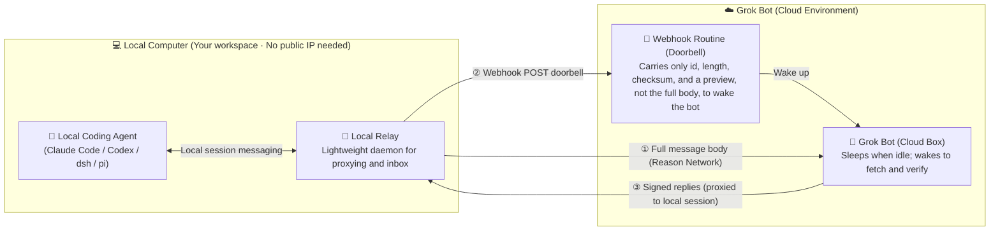
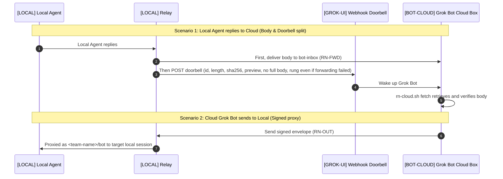

# agent-mesh

**English** | [简体中文](README.zh-CN.md)

Connect a cloud Grok Bot with active Claude Code, Codex, pi, and DeepSeek Harness (dsh) sessions running on your local computer, in one private [Reason Network](https://github.com/reason-machines/reason-network) team. The two sides can hold multi-turn conversations: either side can start one, and whoever replies wakes the other.

| | |
|---|---|
| **Version** | agent-mesh **v0.8.2** · [Changelog](CHANGELOG.md) · [Version file](VERSION). Query it offline with `./install.sh --version`; the Reason Network dependency has a separate version. |
| **Platform** | Local: macOS (Apple Silicon or Intel) with a one-click installer · relay messaging verified on Debian Linux, but local installation on Linux is not supported yet (see [Prerequisites](#prerequisites)) · Bot cloud: Linux x86_64 or ARM64 · Python 3.9+ on both sides |
| **Network** | No public IP, no dedicated server, no port forwarding required |
| **Not required** | Reason account, Docker, or Node |
| **License** | MIT |

> [!TIP]
> To let an agent install it, give Claude Code or Codex this repository and say: **“Read [AGENT-INSTALL.md](AGENT-INSTALL.md) and install it.”**

**Contents:** [Architecture overview](#architecture-overview) · [What problem it solves](#what-problem-it-solves) · [Execution location labels](#execution-location-labels) · [How it works](#how-it-works) · [Prerequisites](#prerequisites) · [Install](#install) · [Verify](#verify) · [How agents receive messages](#how-agents-receive-messages) · [Security and privacy](#security-and-privacy) · [Troubleshooting](#troubleshooting) · [Uninstall](#uninstall) · [Upgrade](#upgrade) · [Documentation and language](#documentation-and-language) · [Appendix: message formats](#appendix-message-formats)

## Architecture overview



## What problem it solves

- **Reaches the live session**: Calling `claude -p "..."` from a remote script runs a one-off task, but it **spawns a new, blank process every time** and cannot touch the terminal session you already have open, with its project background, conversation history and pending edits. agent-mesh addresses that live session directly, so the context stays.
- **No busy waiting**: Complex tasks need back-and-forth: questions, revisions, picking the thread up later. Without a wake-up mechanism the cloud has to hang or poll; with agent-mesh each side sleeps right after sending, and a reply rings the "doorbell" to wake the other. Neither side busy-polls (the local side runs only a lightweight relay that long-polls for mail), which saves Grok quota and puts your existing local agent subscriptions to use. By default the relay waits at least 20 seconds between wake-ups and wakes at most 20 times per hour; whether a local session wakes depends on its [delivery mode](#how-agents-receive-messages).
- **Code stays where it is**: Your code, documents, dependencies and session history stay on the local computer; you do not need to pack a project and upload it to a cloud machine to work with the cloud.
- **Several sessions at once**: Open several local sessions for different roles (e.g. refactoring code, auditing docs, inspecting logs); the cloud bot can talk to all of them, and local sessions can cross-check a disagreement among themselves before reporting back.
- **No public exposure**: Built on Reason Network. Your local computer opens no inbound port and needs no self-hosted or rented server; as long as it can reach the iroh relays, it works inside home or corporate networks. Messages may pass through iroh public relays, and a VPN or proxy must allow `iroh.link`; see [Network and usage](#network-and-usage) and [Troubleshooting](#troubleshooting).
- **No extra privileges**: The channel carries text only and **grants no extra execution privileges**; what runs locally is still governed by the agent's own approval settings. Two caveats: for a session that auto-approves (Claude Code's `--dangerously-skip-permissions`, Codex's `--yolo` and similar modes), incoming text acts as a command; and Grok Bot in the cloud is the channel's trust root, so if content it reads steers it, it can still send validly signed messages. See [Security and privacy](#security-and-privacy).
- **When you don't need it**: If the whole task can be done on Grok Bot's cloud computer (running scripts, research, writing standalone files), install the CLIs you need there; you do not need this project.

## Execution location labels

This guide, the runbook, and the prompts use these labels. They are instructions, not text to enter in a terminal.

| Label | Location | What runs or happens there |
|---|---|---|
| `[LOCAL]` | User's local computer (default machine name `mac`) | Local coding agents, the Reason Network engine, and relay; `install.sh`, `check.sh`, `uninstall.sh` |
| `[BOT-CLOUD]` | Grok Bot's cloud computer, named `cloud` | Grok Bot runs `/workspace/agent-mesh/box/rn-cloud*.sh` and stores cloud state and message bodies |
| `[GROK-UI]` | Grok Bot interface opened by the user | Create or pause routines, paste prompts, and approve CopyToBox; these are not terminal commands |

Each computer has its own repository clone; files do not sync automatically. On `[LOCAL]`, `~` is the user's home directory on their local computer; `/workspace/agent-mesh/` on `[BOT-CLOUD]` is a directory on the Bot's cloud computer. Unless labeled otherwise, terminal commands and `~/…` paths below belong to `[LOCAL]`.

## How it works

There are three roles:

| Role | Availability | What it does |
|---|---|---|
| `[LOCAL]` User's local computer | Kept awake | Runs the engine and relay. The relay listens as `<team-name>/bot`, representing Grok Bot to local agents. The `bot` address belongs to the relay on the local computer, not to the Bot's cloud computer. Here `bot` stands for your [Bot address name](#grok-bot-and-team-name), normally the Bot's own name (`bot` was the default before v0.8.0). |
| `[BOT-CLOUD]` Bot's cloud computer | May sleep | Starts the engine on demand during a turn. It sends as `<team-name>/bot-cloud`, receives full bodies as `<team-name>/bot-inbox` (with another Bot address name `<name>`: `<name>-cloud` and `<name>-inbox`), and uses the machine name `cloud`. No always-on service is installed there. |
| `[GROK-UI]` Routine | Woken by webhook | A webhook task created in the Grok Bot interface; when woken, the Bot executes its prompt on `[BOT-CLOUD]`. A POST from the `[LOCAL]` relay wakes it. |



Five design choices make this work:

1. **The always-on machine handles replies.** The local computer sends every cloud-originated message on Grok Bot's behalf, so replies return to the local computer rather than a sleeping cloud computer.
2. **The webhook is a doorbell.** In the original deployment, Grok Bot retained roughly the first 4,000 characters of a wake-up body. Full text therefore travels over Reason Network; the webhook carries an id, length, checksum, and optional preview. The routine fetches and verifies the body. A 10,000-character message can use one wake-up, within the engine's byte limit.
3. **Both ends recover lost mail.** The relay keeps forwarded bodies for seven days. If `fetch` cannot retrieve one, the cloud requests a signed re-forward, at most twice per message; this also recovers a failed initial forward. The cloud also tells the relay with signed receipts which messages it stored and which were handled. A message stays pending on the relay until it is handled; the relay rings again for one that stays unconfirmed, a limited number of times, and then alerts Grok Bot instead of retrying forever. Timings, settings and known limitations are under [Recovery and receipts](PROTOCOL.md#recovery-and-receipts).
4. **Each message goes to one turn, and an interrupted one is not redone silently.** Wake-ups can overlap, and a retried webhook can ring twice for the same id. `fetch` claims each body it hands out, so an overlapping turn skips it. If a turn stops after it started acting and before it recorded completion, later turns report `uncertain`: the Bot checks its thread notes or asks the user rather than acting again. `fetch` also hands out verified bodies whose doorbell was lost. This is not exactly-once; see [Claims and interrupted turns](PROTOCOL.md#claims-and-interrupted-turns).
5. **Relay protocol messages are signed.** A team session can claim another sender name. Proxy envelopes, forwarded bodies, and re-forward requests therefore use HMAC signatures. Envelopes and requests have a 15-minute freshness window and replay protection. The signing key has one copy on each machine.

## Prerequisites

### `[LOCAL]` Local computer

- **Computer and system:** not tied to one OS by design; the engine ships macOS / Linux / Windows builds, and the relay is pure Python. Only macOS (Apple Silicon or Intel) has the one-click installer `./install.sh`, run as a regular user signed into the desktop. Do not use `sudo`; a pure SSH/headless login is outside this installation flow. On Debian Linux, the relay's messaging has been verified inside an existing team, including real two-way messages with the cloud; installing the local side on Linux (creating the team, wiring agents, generating and copying the signing key, running the relay as a service) is not supported yet. In principle systemd could replace the macOS login service. Windows is unverified; Task Scheduler could play the same role. Community testing and contributions are welcome.
- **Git and Python 3.9+**, including the `ssl` and `sqlite3` standard-library modules. Check with:

  ```bash
  git --version
  python3 -c 'import sys, ssl, sqlite3; print(sys.version)'
  ```

  If Git or Python is missing, run `xcode-select --install`, finish installation and check again; if Python is still too old, install a suitable Python and put it on PATH. The installer also checks `curl`, `tar`, `shasum`, `openssl`, `launchctl`, and `plutil`; supply missing tools before retrying. No separate Node installation or pip packages are needed.
- **At least one coding agent:** first install and sign in to at least one of Claude Code, Codex, pi, or DeepSeek Harness and verify it works independently. This project does not install these agents or configure model accounts/subscriptions. The integration plan comes from `reason-network setup --dry-run` on the user's computer, not from the author's configuration.
- **`~/.local/bin` in PATH:** in the current Bash/zsh shell, run `export PATH="$HOME/.local/bin:$PATH"`. For persistence, use `~/.zshrc` for zsh, the appropriate `~/.bash_profile` or `~/.bashrc` for Bash, or `fish_add_path "$HOME/.local/bin"` for fish. Do not always edit `~/.zshrc`. The relay service records the detected Python's absolute path; if that Python is later moved or removed, repair Python and rerun the installer to update the service.
- **Existing Reason Network installations:** review them first. This flow uses `~/.local/bin/reason-network`, the default `~/.reason/network` state directory, and pinned v0.12.17. An older engine at that path stops the installer, which points to `./update.sh` (it upgrades the engine with a backup and rolls back on failure). A different PATH installation, a newer or unrecognised engine version, or custom `REASON_NETWORK_HOME` stops the installer so the existing deployment can be reviewed. An existing team with the same person name can be reused; a different person cannot be renamed in place. Uninstalling at level `identity` or `all` removes this default engine's state and integrations (level `all` also the engine) and may affect existing uses; it is not a general troubleshooting step.
- **Stay awake:** keep the local computer powered on and awake during collaboration. On macOS, enable the setting that prevents automatic sleep on power, or run `caffeinate`. Closing a laptop lid stops everything.

### `[BOT-CLOUD]` Bot's cloud computer

- Linux x86_64 or ARM64, Bash, Git, Python 3.9+ with `ssl` and `sqlite3`, `curl`, `tar`, `sha256sum`, and a writable persistent `/workspace/agent-mesh/`.
- The Bot prepares missing tools using the cloud system's package manager and explains any needed permissions to the user; do not install them on the local computer instead. The cloud script checks system, CPU, and runtime dependencies before downloads; the cloud prompt covers Git and directory checks.

### Grok Bot and team name

- Grok Bot must support webhook-triggered routines and CopyToBox from your Mac.
- Choose a team name, also used as your person name: 1–40 lowercase ASCII letters, digits, or hyphens; no leading or trailing hyphen. Use a pseudonym. Renaming requires recreating the team.
- Team and machine names use single hyphens only: the engine merges repeated hyphens, so `a--b` would become `a-b`, and the installer refuses such names.
- Choose the Bot address name: use the Bot's own name, so your agents can tell your Grok Bots apart. The relay listens as `<team-name>/<name>`, and the cloud uses `<name>-cloud` and `<name>-inbox`. A new installation has no default (before v0.8.0 it was `bot`; existing installations keep their name). Rules: 1–34 lowercase ASCII letters and digits, in groups joined by a single hyphen (no leading, trailing or repeated hyphen), not `terminal` or `terminal-<n>`. Do not use your real name. The name cannot be changed later, not even for an unfinished installation: queued mail, the routine prompt and the cloud setup all use it. A different name needs an uninstall at level `identity` or `all` and a new install.
- Give the Bot's name as Grok shows it, in any language, with `--grok-name` (up to 64 characters, no spaces at the start or end, no line breaks or other control characters). It is stored as given, not used for routing, and shown next to the address as `<team-name>/<name> → Grok: <its name>` by the installer, `./check.sh` and the filled-in reply convention. For a name without Latin letters, pick an address yourself, for example in pinyin (「小助手」 → `xiaozhushou`).

### Network

- Both `[LOCAL]` and `[BOT-CLOUD]` need HTTPS access to GitHub repositories and release downloads, plus iroh relay connectivity.
- The default public HTTPS clone URL needs no GitHub account or SSH key. For a public fork, pass `--repo-url https://…` on each installer command that generates a cloud prompt, and the same option to `./update.sh`; it must allow credential-free cloud reads and carry the release tag `v<VERSION>`, because the cloud installs only that tag. The local clone can live anywhere; the cloud clone must remain at `/workspace/agent-mesh/` because prompts use that fixed path.
- Check connectivity to `*.iroh.link`, especially with a VPN or proxy. This probe should return HTTP 200:

  ```bash
  curl -sS -o /dev/null -m 10 -w 'code=%{http_code}\n' https://aps1-1.relay.n0.iroh.link/
  ```

  If it fails, see [Troubleshooting](#troubleshooting). The probe checks one endpoint, not worldwide availability.
- Reason Network 0.12 uses Reason's own relays by default (`relay-sfo1`, `relay-iad1`, `relay-fra1` and `relay-sin1` under `compute.reasonmachines.com`) instead of n0's `*.iroh.link`. agent-mesh 0.7.0 pins 0.12.17, so allow `*.compute.reasonmachines.com`; an engine still on 0.10.7 uses n0's relays until `./update.sh` upgrades it, so allow both domains. `./check.sh` probes the relay the installed engine actually uses and names it.

## Install

**`[LOCAL]` Run as the user or local installing agent.** Replace the team-name placeholder:

```bash
git clone https://github.com/xiaozhenliu/agent-mesh.git ~/agent-mesh
cd ~/agent-mesh
./install.sh --name <team-name> --relay-name <name> --grok-name '<its name in Grok>' --lang en
```

`--relay-name` is the Bot address name and `--grok-name` the Bot's name in Grok ([Grok Bot and team name](#grok-bot-and-team-name)). A new installation without `--relay-name` stops before changing anything and suggests an address derived from `--grok-name`. Later runs (`--webhook`, `--cloud-prompt`, `update.sh`) take the name from the installation; a different `--relay-name` is refused. The installer stops before wiring anything if the name is already used in the team, and checks after starting the relay that the engine registered exactly `<team-name>/<name>`. `./install.sh --grok-name '<its name in Grok>'` records or changes the Grok name of an existing installation; the address stays.

If the destination already exists, check that it is the same repository and review uncommitted changes before proceeding; do not overwrite it or blindly pull. The cloud defaults to the same public distribution repository, whose root must contain `box/rn-cloud-setup.sh`; the installer does not infer its URL from the local origin.

The installer handles the local computer (Mac) side and pauses for user actions:

1. Downloads Reason Network v0.12.17, verifies it against the SHA-256 pinned in the installer, creates your private team, and disables auto-update and LAN broadcasts.
2. Shows `reason-network setup --dry-run` and **waits for confirmation** before wiring local agents.
3. `[LOCAL]` generates the signing key and prints a routine prompt. **In `[GROK-UI]`, the user creates a webhook-triggered routine and pastes that prompt.** Paste its Webhook URL and key into the `[LOCAL]` terminal. The installer writes local configuration and installs the relay as a Mac login service.
4. `[LOCAL]` prints a team invite and cloud setup prompt. **In `[GROK-UI]`, the user sends both to Grok Bot.** On `[BOT-CLOUD]`, the Bot clones the release after checking its commit and the cloud scripts' checksums, installs the engine and joins the team, then uses CopyToBox to copy the key from `[LOCAL]` to `[BOT-CLOUD]`. The user approves the copy in `[GROK-UI]`.

Reopen Claude Code and Codex sessions that were already running. Codex asks once on first launch; choose “Trust all and continue”.

### Prompt language

Use `--lang en` or `--lang zh-CN` on each installer invocation to select generated prompts. English is the default; `AGENT_MESH_LANG` sets a shell-level default, and `--lang` overrides it. Terminal diagnostics, configuration keys, and protocol fields remain English. Agents speak to users in their preferred language.

### Optional

- **dsh automatic wake-ups:** run `dsh/mac-install.sh <team-name>`; see the [bridge guide](dsh/README.md).
- **Reply convention:** append the filled-in copy in `~/.local/lib/agent-mesh/templates/` (English `AGENTS.reason-network.md` or Chinese `AGENTS.reason-network.zh-CN.md`; the installer writes them with your Bot address and Grok name) to your working repository's `AGENTS.md`. The [English template](templates/AGENTS.reason-network.md) and [Chinese template](templates/AGENTS.reason-network.zh-CN.md) here have placeholders instead. After changing the Grok name, `python3 scripts/reply_convention.py refresh <repository>/AGENTS.md` updates a copy; it replaces only the lines between the `agent-mesh:bot-address` markers. For Claude Code, also add `@AGENTS.md` to `CLAUDE.md`. The template asks for a conclusion followed by four concise status fields.

## Verify

Locations: self-checks, test sends, and relay log inspection run on `[LOCAL]`; Grok Bot uses `/workspace/agent-mesh/box/rn-cloud.sh` on `[BOT-CLOUD]` for `who` and `fetch`.

1. **Self-check.** This is read-only; each `FAIL` includes a suggested fix.

   ```bash
   ./check.sh
   ```

2. **Test message.** Send a message to the Bot address (`bot` below; use your Bot address name, which `./check.sh` prints as `Bot address:`), then wait for the reply in another terminal:

   ```bash
   reason-network send <team-name>/bot "test 1"
   reason-network listen --as terminal --wait 600   # in another terminal
   ```

   Look for `forwarded` and `POST … code=200` in `~/Library/Logs/agent-relay.log`.

3. **Wake a session.** Ask Grok Bot to run `who` and send a sentence to a specific Claude Code session. The session should wake even if idle; its reply should wake Grok Bot again.
4. **Long message.** Send a 10,000-character message. Expect one wake-up and a `complete` fetch result with matching length and SHA-256. The signed message must fit within the relay's 60 KiB forwarding limit; UTF-8 byte size depends on the text.

## How agents receive messages

The last column of `reason-network who` shows the delivery mode:

| Mode | Behavior | Agents |
|---|---|---|
| **push** | Wakes an idle session. | Claude Code receives an injected message; Codex gets it through `codex queue`, which queues it in the open session; pi polls through an extension every five seconds. |
| **turn** | Normally waits for a tool call or the end of a turn. | dsh with the bridge reports `turn`, but starts a turn within roughly five seconds when idle. |
| **pull** | Does not wake automatically. | dsh without the bridge must check its inbox. |

Closed sessions disappear from the roster. Messages remain in the inbox while the recipient is offline. After reopening, you have to tell the agent to check its inbox before it reads them. Keep a session open for prompt delivery.

## Security and privacy

### Grok Bot is the trust root

- There are two copies of the signing key, and one of them is on `[BOT-CLOUD]`. Signatures stop sessions without the key from impersonating the Bot; they do not stop a manipulated Bot. If content Grok Bot reads in a web page or document steers it (prompt injection), it can still produce validly signed RN-OUT envelopes and message any of your local sessions as `<team-name>/bot`. Local agents should therefore treat the Bot's messages as outside input, not as instructions from you.
- Agents running as the same macOS user may still read the keys in `~/.config/agent-relay/`. A project folder is not an access-control boundary.

### Local agent permissions

- This bridge sends text to a local agent; it does not itself give Grok Bot direct file access or bypass the agent's permissions. The receiving session decides whether and how to act. The Mac opens no inbound port. Grok Bot's local always-approve and local-network switches are not required.
- That holds only if the agent does not approve automatically. Even without auto-approval, actions the session's sandbox and permission settings already allow (such as reading files or editing in the working directory) run without asking you; only actions that need human approval wait for you. The following modes let more actions run without asking, so incoming text acts as a command; start such sessions only in a sandbox folder or isolated environment:
  - Claude Code: `--dangerously-skip-permissions`, or `--permission-mode bypassPermissions`.
  - Codex: `--yolo` (that is, `--dangerously-bypass-approvals-and-sandbox`: no prompts and no sandbox); `--sandbox danger-full-access` (no sandbox); `--ask-for-approval never` (never asks: what the sandbox allows runs, the rest fails); and `--approve-for-me`, which hands approvals to automatic review.
- **Unattended wake-ups**: push sessions wake even when you are away. Reason Network v0.10.7 wakes Codex with `codex queue --thread <id> --message`: the message is queued in that already open session and runs as a new turn with the approval and sandbox settings the session started with; no flag loosens them. Tested with Codex 0.166.0 (`--ask-for-approval on-request --sandbox read-only`, where writing a file needs human approval): when the woken turn needed to write a file, the approval prompt appeared in that session's terminal and waited; nothing ran without confirmation, and after about a minute it had not approved itself. Without auto-approval, actions that need human approval therefore wait at the prompt until you return, while actions the sandbox and permission settings already allow still run; with auto-approval, nobody stops them. Claude Code receives the message directly in the open session; this project has not separately tested its approvals while unattended.
- To hold incoming messages, set `[inbound] default = "hold"` in `~/.reason/network/config.toml`, then use `reason-network approve` to release them.

### Message bodies are stored in plain text

Message bodies remain in plain text in the following places, so **do not send keys, passwords, tokens or other secrets through this channel**:

| Location | Content | Kept for |
|---|---|---|
| `[LOCAL]` `~/.reason/network/network.db`, `[BOT-CLOUD]` `/workspace/agent-mesh/box/state/network.db` | Messages each engine received, kept after they are read | Not deleted by the engine |
| `[LOCAL]` `~/.local/lib/agent-mesh/engine-backup-*/state`, `[BOT-CLOUD]` `/workspace/agent-mesh/box/engine-backup-*/state` | A copy of the engine state, including received messages, taken before an engine upgrade | Until you delete it; `./uninstall.sh --level identity` removes both |
| `[LOCAL]` `~/Library/Application Support/agent-relay/fwd-copies/` | The relay's copies of forwarded bodies, kept for redelivery | After `FWD_COPY_DAYS` (default 7 days) they are no longer redelivered, but they are deleted only when later mail passes through the relay (checked at most hourly); an idle relay keeps them |
| `[BOT-CLOUD]` `/workspace/agent-mesh/inbox/<id>/full.txt` | Bodies retrieved by `fetch` | Not deleted automatically |
| `[BOT-CLOUD]` `/workspace/agent-mesh/threads/*.md` | Conversation summaries the routine appends each turn | Not deleted automatically |
| `[LOCAL]` `~/Library/Application Support/agent-relay/state.json` | Doorbells waiting for the webhook, each with its body preview | Removed once the webhook delivers them; while the webhook keeps failing they stay, and only the oldest are dropped past `MAX_SPOOL`. Changing `DOORBELL_PREVIEW_CHARS` affects later doorbells only; fix the webhook so the backlog goes out |
| The routine's webhook | A preview of the first 200 characters in each doorbell | Up to Grok Bot; `DOORBELL_PREVIEW_CHARS=0` turns previews off |

The relay log records message ids, lengths and checksums, not bodies. `FWD_COPY_DAYS` and `DOORBELL_PREVIEW_CHARS` are set in `~/.config/agent-relay/env`; restart the relay with `launchctl kickstart -k "gui/$(id -u)/com.local.agent-relay"` for a change to take effect. To clean up:

- On `[LOCAL]`, run `./install.sh --purge-copies` to delete all copies the relay kept. Redelivery requests for those messages then get `no-copy`, and the sender has to send again.
- For `[BOT-CLOUD]`, ask Grok Bot in `[GROK-UI]` to run `/workspace/agent-mesh/box/rn-cloud.sh purge <days>`. It stops the cloud engine, then deletes received messages (the cloud `network.db`), `inbox/<id>/`, misdirected mail logs in `inbox/_stray/`, and `threads/*.md` older than that many days; `0` deletes all of them. The thread notes give the routine its context, so the Bot no longer remembers earlier conversations afterwards. The cloud clone must first be updated to a version that has this command.
- The engine manages the local `network.db`; this project offers no partial cleanup for it. `./uninstall.sh --level identity` and `--level all` remove all of `~/.reason/network`.

### Team members

- After setup, and periodically afterwards, run `reason-network team` and confirm that only your local computer and `cloud` are listed. `./check.sh` checks this too and reports FAIL for any other member. Remove an unknown person or machine with `reason-network remove <person>/<machine>`, then replace the signing key as described below.
- Team members can see session names, the last working-directory component, repository names, and branches. Avoid starting agents directly in your home directory. Use invite links in the terminal, not a browser.

### Replacing keys

- **Signing key**: on `[LOCAL]`, run `./install.sh --rotate-key --lang en`. It generates a new `outbound.key`, restarts the relay, and prints the CopyToBox steps: in `[GROK-UI]`, have Grok Bot use CopyToBox to copy the new key from `[LOCAL]` `~/.config/agent-relay/outbound.key` to `[BOT-CLOUD]` `/workspace/agent-mesh/box/outbound.key`, approve the copy, and run `chmod 600` on the cloud copy. Until the cloud has the new key, signature checks fail in both directions. Messages forwarded before the rotation that the cloud has not fetched yet keep their old-key signature: after the rotation `fetch` reports them as `mismatch` (bad signature) and requests no redelivery; each is reported again whenever a doorbell asks for it, and once by the scans no doorbell asked for. If the old key did not leak, have the Bot fetch pending mail before rotating; otherwise ask the senders to resend, and clean up the old messages with `rn-cloud.sh purge`.
- **Webhook URL or key**: regenerate the routine's key in `[GROK-UI]`; if the interface cannot, delete and recreate the routine. Then run `./install.sh --webhook --lang en` on `[LOCAL]` and enter the new values.
- The complete leak response is in the [security policy](SECURITY.md#if-you-suspect-a-credential-leak).

### Network and usage

- The pinned open-source engine runs locally in account-free mode, and in that mode it sends no data to Reason. Messages are end-to-end encrypted between the engines and a relay only forwards them, as upstream describes it; this project has not independently audited the relays.
- Relays: version 0.10.7 uses n0's public iroh relays by default, 0.12 uses Reason's. A team can pick its own relay with `reason-network relay <URL>` (`reason-network relay default` goes back to the engine's default). Every machine in the team, including `[BOT-CLOUD]`, must run the same command (there: `REASON_NETWORK_HOME=/workspace/agent-mesh/box/state /workspace/agent-mesh/box/bin/reason-network relay <URL>`; the engine daemon stops and starts again with the next command); a machine that was offline must run it when it comes back. With an explicit relay, short invite codes do not work; use the long invite form, which `./install.sh --cloud-prompt` prints anyway.
- **Forgotten sessions (Reason Network 0.12 only):** an ordinary agent session that has been offline for more than a day is forgotten, and its unread messages are deleted with it. The engine starts doing this once its daemon has been running for six hours. The relay's mailbox on `[LOCAL]` and the cloud's mailboxes on `[BOT-CLOUD]` (sessions started with `listen --as`) are exempt. Version 0.10.7 never forgets sessions, so the rule applies only after an upgrade. Read a session's messages before leaving it offline for long.
- Each Grok Bot wake-up consumes usage. The relay defaults to at most 20 wake-ups per hour.
- Report security problems privately as described in the [security policy](SECURITY.md), not in a public issue.

## Troubleshooting

- **Cannot reach the relay:** `./check.sh` and `install.sh` name the relay they probed. Retry the probe with the VPN/proxy disabled. If that resolves it, add a direct/bypass rule covering `iroh.link` and `reasonmachines.com` with all subdomains, including in TUN, virtual-NIC, enhanced, or global modes. Exclude both domains from HTTPS decryption/MITM too. Check the certificate issuer (use the probed relay's address in place of `aps1-1`):

  ```bash
  curl -sv -o /dev/null https://aps1-1.relay.n0.iroh.link/ 2>&1 | grep issuer
  ```

  Expect a public certificate authority (currently Let's Encrypt) rather than your proxy's CA. If it still fails without the proxy, investigate DNS, firewall rules, or the network. The engine can use several relays; allowing only the probe host is insufficient. `check.sh` reports SKIP `relay reachability unknown` when it cannot tell which relay a 0.12 engine uses (it has not logged one yet); allow both domains and run it again later.
- **Cloud join reports `couldn't reach the machine that made the invite`:** usually the Mac's VPN or proxy is intercepting `*.iroh.link` again. Fix it as in the previous item, run `reason-network stop` on the Mac, then have Grok Bot retry with the same invite while valid.
- **Session missing from `who`:** reopen sessions started before `setup`. Codex also needs to complete a turn before appearing.
- **`fetch` reports `missing`:** inspect `refwd`. `ack=resent` means the relay resent it; retry after 60 seconds. `no-copy`, `limit`, `failed`, or `skipped` means recovery did not succeed; ask the sender to resend. No `refwd` field means the Mac was not connected.
- **Relay log shows `webhook POST failed: 30x`:** `WEBHOOK_URL` is not the final address; the relay does not follow redirects. Copy the webhook URL again from the routine in `[GROK-UI]`, then run `./install.sh --webhook --lang en` on `[LOCAL]`.
- **Message `refused`:** the engine's loop guard refuses more than 12 messages between a pair of agents within ten minutes. Body forwarding uses the exempt terminal identity.
- **The relay names are not derived from one name, or the relay registered under another name:** `install.sh`, `update.sh` or `check.sh` says so. The three names in `~/.config/agent-relay/env` (`LISTEN_NAME`, `CLOUD_NAME`, `INBOX_NAME`) must be `<name>`, `<name>-cloud` and `<name>-inbox`; the installer writes them, do not edit them. A registration such as `<team-name>/<name>-2` means another session on this computer or in the team already had the name. The engine keeps that pick for the relay even after the other session is gone, so the check keeps failing; remove the installation including its identity ([level `identity`](UNINSTALL.md#remove-the-identity-or-everything)) and install again with another `--relay-name`.
- **`rn-cloud.sh` says `box/relay is damaged`, or replies never arrive after `box/relay` was deleted:** `/workspace/agent-mesh/box/relay` holds the Bot address name on `[BOT-CLOUD]`; without it the cloud uses `bot`. On `[LOCAL]`, run `./install.sh --cloud-prompt --lang en` and give Grok Bot the printed prompt, which contains the full invite link and your name; `rn-cloud-setup.sh` then sees that the cloud is already in the team, skips joining, and writes the file again (a damaged file is kept as `box/relay.damaged-<time>`). It writes a name other than `bot` only if the cloud engine shows that it already registered `<name>-inbox` or `<name>-cloud`; otherwise only an uninstall at level `identity` or `all` and a new install help. Check with `cat /workspace/agent-mesh/box/relay` and one real message.
- **`rn-cloud-setup.sh` stops at `join` on a cloud that already joined:** give it the full invite link (the one containing `tincan1…`, as `./install.sh --cloud-prompt` prints it). A short invite code cannot show that the cloud is in the same team.
- **`check.sh` reports the engine as older, the daemon as running a replaced binary, or an unfinished engine upgrade:** run `./update.sh` in a terminal. It upgrades an older engine, offers to restart a daemon that started before the binary was replaced, and rolls an unfinished switch back first; the [upgrade guide](UPGRADE.md#reason-network-engine) explains each step and the backup.
- **`check.sh` reports `relay not registered on the running engine`:** right after a daemon or relay restart it reports SKIP for up to 11 minutes while the relay registers again. A FAIL after that means the relay has not listened on the running daemon: see `tail -n 30 ~/Library/Logs/agent-relay.log`, then run `./install.sh --restart-relay`, which fails and puts the previous relay back if the new one does not register.
- **`install.sh --cloud-prompt` or `./update.sh` says the release `v<VERSION>` could not be fetched, or that a file differs from the release:** the cloud installs only a published release tag, and the cloud scripts in this checkout (`box/rn-cloud.sh`, `box/rn-fetch.py`, `box/rn-cloud-setup.sh`, `box/rn-engine.py`, `box/rn-cloud-update.sh`) must match it. Check the network, and that `--repo-url` names the repository the cloud installs from; a checkout ahead of the latest release has to wait for it, or go back to the released files. Nothing was changed.
- **Grok Bot's command block prints a `STOP:` line instead of `READY <tag>` or its `agent-mesh-result` lines:** the block changed nothing, or put the previous commit back (it says `restored …`). After `the engine step failed`, the clone stays at the checked release and the engine step's own lines above say what happened to the engine. Send Grok Bot's full output with the line to whoever maintains your setup, and do not run the cloud scripts while it says `could not restore`. A local change in `/workspace/agent-mesh` has to be looked at first; never reset it blindly. If it says a different tag of the same name is already there, have Grok Bot delete that tag with `git -C /workspace/agent-mesh tag -d <tag>` and send the same block again; the block still checks the commit and the checksums.
- **`rn-cloud.sh` stops with `box/bin/engine/reason-network is not a Reason Network build pinned by agent-mesh`:** the engine's bytes are not a pinned build, and it is not run. Pause the routine in `[GROK-UI]`, have Grok Bot run `bash /workspace/agent-mesh/box/rn-cloud-setup.sh --upgrade-engine` directly in chat, which replaces the engine with the pinned version without running the old one, then resume the routine. If it says `the engine has not been moved to box/bin/engine yet`, run `./update.sh` on `[LOCAL]`; its cloud update moves the engine.
- **`rn-cloud.sh` says the launcher had been replaced, or `--upgrade-engine` prints `engine: note: other engine daemons run from box/bin`:** another engine daemon, started from `box/bin/reason-network` before this version, updated itself. It cannot replace the engine at `box/bin/engine`, and `rn-cloud.sh` puts the launcher back each time. Stop each daemon that is not needed with `REASON_NETWORK_HOME=<its state directory> REASON_NETWORK_NO_UPDATE=1 /workspace/agent-mesh/box/bin/engine/reason-network stop`, using the state the note prints; never point it at `box/state`, which is the cloud's own engine.
- **`<` became `[`:** version 0.10.7's `listen` rewrites some tags to deter spoofing without changing the character count. Re-forwards use the relay's stored copy.

## Uninstall

Update this folder first (`git pull`), so that `./uninstall.sh` is the uninstaller described here; the script in v0.4.1 and earlier has no levels, removes the relay settings and signing key even without `--all`, and does not handle the cloud.

`./uninstall.sh` runs on `[LOCAL]`. Without options it only lists what is installed and removes nothing; `./uninstall.sh --plan` adds what each level would remove and keep.

| Level | What it removes |
|---|---|
| `--level program` | The relay program and its login service only. The team, the keys and the cloud stay as they are, and `./install.sh --restart-relay` brings the relay back. This is the only level an agent may run for you. |
| `--level identity` | Also the team identity, signing key, relay settings and relay state: this computer and the cloud both leave the team, and `~/.reason/network` is removed. |
| `--level all` (or `--all`) | Also the logs, the engine binary, and on `[BOT-CLOUD]` `inbox/`, `threads/` and `/workspace/agent-mesh`. |

Levels `identity` and `all` disconnect every agent on this computer from Reason Network, run only in your own terminal, and include a step in Grok Bot. Read the [uninstall guide](UNINSTALL.md) first: the full list of what each level removes and keeps, what to check beforehand, the steps on both computers, and how to confirm the result.

## Upgrade

The local repository, the clone on the Bot cloud computer and the saved routine prompt are separate: changing files on the Mac does not update the other two. A reply convention already appended to a project's `AGENTS.md` is not updated either; copy the template again. The [changelog](CHANGELOG.md) says which parts each version changes.

In the repository on `[LOCAL]`, run:

```bash
./update.sh --lang <en|zh-CN>
```

It pulls, compares each part with what this computer deployed and asks once before changing anything. It updates the relay, the dsh plugin and the local engine itself; when the routine prompt changed it shows the new one for you to paste; when the cloud changed it sends Grok Bot an update request from this Mac and checks Grok Bot's reply. The first cloud update after v0.8.1 or earlier asks you once in Grok; `./update.sh --manual` does the cloud step by hand. `./update.sh --plan` only shows the comparison and the steps and changes nothing in the deployment. The [upgrade guide](UPGRADE.md) has the details, the manual upgrade order and the rollback order. agent-mesh 0.7.0 also upgrades Reason Network to 0.12.17 on both computers, with a backup and a rollback on failure: see [Reason Network engine](UPGRADE.md#reason-network-engine).

## Documentation and language

| Guide | English | 简体中文 |
|---|---|---|
| User guide | [README](README.md) | [使用指南](README.zh-CN.md) |
| Agent installation | [Runbook](AGENT-INSTALL.md) | [安装手册](AGENT-INSTALL.zh-CN.md) |
| Uninstall | [Guide](UNINSTALL.md) | [卸载指南](UNINSTALL.zh-CN.md) |
| Upgrade | [Guide](UPGRADE.md) | [升级指南](UPGRADE.zh-CN.md) |
| Protocol reference | [Reference](PROTOCOL.md) | [协议参考](PROTOCOL.zh-CN.md) |
| DeepSeek Harness | [Bridge](dsh/README.md) | [插件指南](dsh/README.zh-CN.md) |
| Grok Bot routine | [Prompt](prompts/routine.md) | [提示词](prompts/routine.zh-CN.md) |
| Cloud setup | [Prompt](prompts/cloud-setup.md) | [提示词](prompts/cloud-setup.zh-CN.md) |
| Reply convention | [Template](templates/AGENTS.reason-network.md) | [模板](templates/AGENTS.reason-network.zh-CN.md) |
| Maintaining translations | [Contributing](CONTRIBUTING.md) | [维护说明](CONTRIBUTING.zh-CN.md) |
| Security policy | [Security policy](SECURITY.md) | [安全策略](SECURITY.zh-CN.md) |

To choose the language of generated prompts, see [Prompt language](#prompt-language).

## Appendix: message formats

The signed message formats (RN-OUT, RN-FWD, RN-REFWD, RN-REFWD-ACK, RN-GOT), the doorbell JSON and their test vectors are in the [protocol reference](PROTOCOL.md#message-formats).
