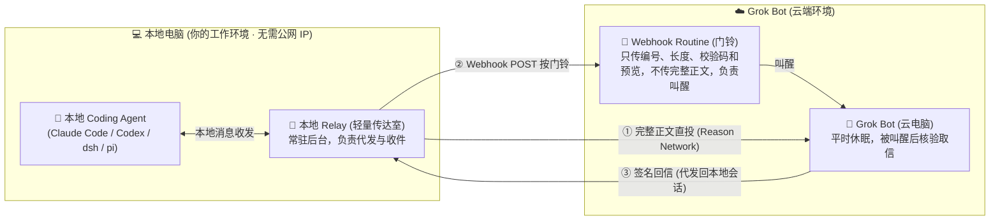
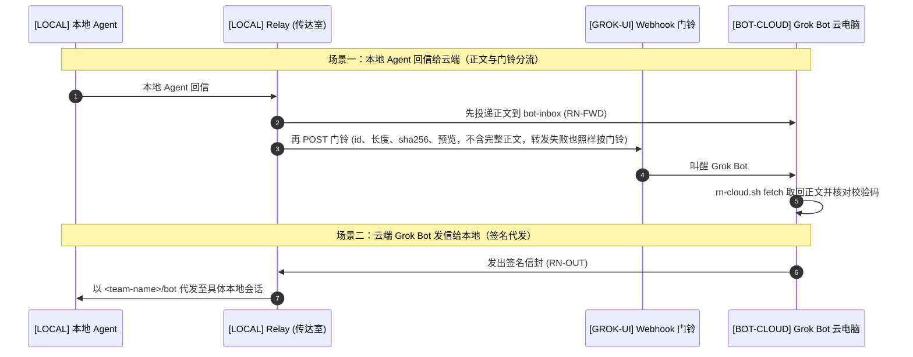

# agent-mesh

[English](README.md) | **简体中文**

把你电脑上的 Claude Code、Codex、pi、dsh 会话和云端的 Grok Bot 放进同一个 [Reason Network](https://github.com/reason-machines/reason-network) 私有团队。两边可以多轮对话，任何一方都能主动发起，谁回了信，对方都会被叫醒。

| | |
|---|---|
| **版本** | agent-mesh **v0.8.2** · [更新日志](CHANGELOG.zh-CN.md) · [版本文件](VERSION)。运行 `./install.sh --version` 可离线查询；依赖的 Reason Network 使用独立版本号。 |
| **支持平台** | 本地：macOS（Apple Silicon 或 Intel）提供一键安装 · relay 的消息收发已在 Debian Linux 上验证，但 Linux 本地安装尚不支持（见[准备](#准备)）· Bot 云端：Linux x86_64 或 ARM64 · 两端都需 Python 3.9+ |
| **网络要求** | 本地无需公网 IP、无需自建服务器、无需端口映射 |
| **不需要** | Reason 账号、Docker 或 Node |
| **许可证** | MIT |

> [!TIP]
> 安装可以交给 agent 代劳：把本仓库的链接发给 Claude Code 或 Codex，说一句「读 [AGENT-INSTALL.zh-CN.md](AGENT-INSTALL.zh-CN.md)，照着装」。

**目录：**[架构概览](#架构概览) · [解决什么问题](#解决什么问题) · [执行位置标识](#执行位置标识) · [怎么工作](#怎么工作) · [准备](#准备) · [安装](#安装) · [验证](#验证) · [各 agent 怎么收信](#各-agent-怎么收信) · [安全与隐私](#安全与隐私) · [常见问题](#常见问题) · [卸载](#卸载) · [升级](#升级) · [文档与语言](#文档与语言) · [附录：消息格式](#附录消息格式)

## 架构概览



## 解决什么问题

- **找得到人**：云端用脚本跑 `claude -p "..."` 能执行单次任务，但**每次拉起的都是全新、空白的进程**，碰不到你本地终端里已经开着、带着项目背景和改动记录的那个会话。agent-mesh 直接联系正在干活的那个会话，上下文留在原地。
- **不用傻等**：复杂任务要来回提问、修改、过会儿接着聊。没有唤醒机制时，云端发完信只能挂着等或轮询；接上 agent-mesh 后，发完就休眠，对方一回信就像按门铃一样叫醒这边。两端都不空转（本地只有一个长轮询等信的轻量 relay），不白耗 Grok 额度，也用得上你本地已有的各家 agent 订阅。relay 默认两次叫醒至少间隔 20 秒、每小时最多 20 次；本地会话能否被叫醒见[各 agent 怎么收信](#各-agent-怎么收信)。
- **代码不用搬家**：代码、文档、依赖环境和会话记录都留在本地，不必为了用云端能力把项目打包搬到云电脑上。
- **多会话协同**：本地可以同时开多个职责不同的会话（如代码重构、文档核对、运行日志），云端能同时联系它们；会话之间还可以先就分歧交叉核实，再向云端回报。
- **不暴露公网**：基于 Reason Network 联机。本地电脑不开入站端口，不需要自建或租用服务器，只要能连上 iroh 中继，在家庭或公司局域网内都能收发。消息可能经过 iroh 公共中继，用 VPN 或代理时要给 `iroh.link` 放行，见[网络与用量](#网络与用量)和[常见问题](#常见问题)。
- **不越权**：通道只传文字，**不额外授予任何本机执行权限**，本地能执行什么仍由 agent 自己的审批设置决定。要注意两点：开了自动批准的会话（Claude Code 的 `--dangerously-skip-permissions`、Codex 的 `--yolo` 之类），收到的文字就等于命令；云端 Grok Bot 是这条通道的信任根，它被读到的内容诱导时，也能发出签名有效的消息。详见[安全与隐私](#安全与隐私)。
- **什么时候不需要它**：任务在 Grok Bot 的云电脑上就能做完（纯跑脚本、做调研、写独立文件）时，让它在云电脑上装各家 CLI 就够了，用不上本项目。

## 执行位置标识

本指南、安装手册和提示词统一使用以下标识。标识是操作说明，不要输入终端。

| 标识 | 指哪一端 | 在这里做什么 |
|---|---|---|
| `[LOCAL]` | 用户本地电脑（默认机器名为 `mac`） | 本地 coding agent、Reason Network 引擎、relay；运行 `install.sh`、`check.sh`、`uninstall.sh` |
| `[BOT-CLOUD]` | Grok Bot 的云电脑，机器名为 `cloud` | Grok Bot 运行 `/workspace/agent-mesh/box/rn-cloud*.sh`，保存云端状态和收件正文 |
| `[GROK-UI]` | 用户打开的 Grok Bot 界面 | 创建或暂停 routine、粘贴提示词、批准 CopyToBox；这里的操作不是终端命令 |

两台电脑各有一份仓库，文件不会自动同步。`[LOCAL]` 的 `~` 是本地电脑的 home 目录；`[BOT-CLOUD]` 的 `/workspace/agent-mesh/` 是 Bot 云电脑的目录。下文未另行标注的终端命令和 `~/…` 路径均属于 `[LOCAL]`。

## 怎么工作

一共三个角色：

| 角色 | 在线情况 | 做什么 |
|---|---|---|
| `[LOCAL]` 用户本地电脑 | 一直开着 | 运行 Reason Network 引擎和 relay。relay 用 `<team-name>/bot` 这个名字收信，所以在本地 agent 看来，它就是 Grok Bot。地址中的 `bot` 代表在本地电脑上收信的 relay，不是 Bot 云电脑。这里的 `bot` 指你的 [Bot 地址名](#grok-bot-与团队名)，通常就是 Bot 自己的名字（v0.8.0 以前默认是 `bot`）。 |
| `[BOT-CLOUD]` Bot 云电脑 | 会睡 | 不留任何常驻进程，只在被叫醒的那一轮里临时启动引擎。它用 `<team-name>/bot-cloud` 发信，用 `<team-name>/bot-inbox` 收正文（Bot 地址名改为 `<name>` 时是 `<name>-cloud` 和 `<name>-inbox`），机器名是 `cloud`。 |
| `[GROK-UI]` routine | 由 webhook 叫醒 | 在 Grok Bot 界面创建的 webhook 任务，醒来后由 Bot 在 `[BOT-CLOUD]` 执行提示词。`[LOCAL]` 的 relay 向这个 webhook 发一次 POST，Grok Bot 就会醒来。 |



背后有五个设计决定：

1. **谁一直开着，谁就是中心。** 云端发出的每一封信都交给本地电脑代发，所以本机会话的回信总是落回本地电脑，而不是落到一台可能已经睡着的云电脑上。
2. **webhook 只当门铃，不当快递。** 原部署中观察到 Grok Bot 醒来时只保留 webhook body 的前 4000 字左右，所以正文不走 webhook，而是通过 Reason Network 投进云端收件箱；webhook 携带消息编号、长度、校验码和可选预览。routine 醒来后按编号取回正文、核对无误再处理。在引擎字节限制内，一条 10000 字的消息也只需要叫醒一次。
3. **两端都能补回丢失的信。** relay 为每条转发过的正文保留 7 天副本。云端 `fetch` 取不到正文时，会自动发出带签名的重投请求，relay 按副本重发，每条消息最多 2 次；第一次转发就失败的消息，也靠这条路补回来。云端还用带签名的回执告诉 relay 哪些消息已落盘、哪些已处理。消息在 relay 上一直记为待办，直到确认处理完；迟迟没有确认时 relay 会补按门铃，次数用尽后给 Grok Bot 发提醒，不会无限重试。时限、配置项和已知限制见[补寄与回执](PROTOCOL.zh-CN.md#补寄与回执)。
4. **一条消息只交给一轮处理，中断了也不悄悄重做。** 两次唤醒可能重叠，webhook 重试也可能为同一个 id 按两次门铃。`fetch` 交出的每条正文都会被领取，重叠的另一轮会跳过它。一轮在动手之后中断、没有记完成的，之后的轮次报告 `uncertain`：Bot 查 thread 笔记或问用户，不会自己再做一次。`fetch` 还会交出门铃丢失的已核对正文。这不保证"恰好一次"，详见[领取与中断](PROTOCOL.zh-CN.md#领取与中断)。
5. **所有跨端消息都签名。** 同一个团队里的任何会话都可以用别人的名字发信，所以 relay 代发的信封、转发的正文和重投请求都带 HMAC 签名；信封和重投请求还有 15 分钟时效并防重放。密钥只有两份，本地电脑和云电脑各一份。

## 准备

### `[LOCAL]` 本地电脑

- **系统与运行环境**：设计上不绑定系统，引擎有 macOS / Linux / Windows 版本，relay 为纯 Python。目前只有 macOS（Apple Silicon 或 Intel）有一键安装脚本 `./install.sh`，需要已登录桌面的普通用户；不要用 `sudo`，纯 SSH/无桌面登录环境不在本流程支持范围内。Debian Linux 上已在现有团队中验证过 relay 的消息收发，包括与云端的真实双向消息；但在 Linux 上安装本地端（建团队、接入 agent、生成并复制签名密钥、以服务方式运行 relay）尚不支持，思路上可以用 systemd 代替 macOS 的登录服务。Windows 未经验证，可用 Task Scheduler 承担同样角色。欢迎社区实测并贡献安装支持。
- **Git 与 Python 3.9+**（含 `ssl`、`sqlite3` 标准库模块）。用下面的命令检查：

  ```bash
  git --version
  python3 -c 'import sys, ssl, sqlite3; print(sys.version)'
  ```

  缺少 Git 或 Python 时可先运行 `xcode-select --install`，完成后重新检查，Python 版本仍不足则另装符合要求的 Python 并放入 PATH。脚本也会检查 `curl`、`tar`、`shasum`、`openssl`、`launchctl`、`plutil`；缺少时按报错补齐。无需单独安装 Node 或 pip 包。
- **至少一个 coding agent**：先安装并登录 Claude Code、Codex、pi 或 DeepSeek Harness 中的至少一个，确认它能独立正常工作；本项目不负责安装这些 agent、配置模型账号或订阅。接入哪些工具以 `reason-network setup --dry-run` 在这台电脑上打印的计划为准，不沿用作者电脑的配置。
- **`~/.local/bin` 在 PATH 里**：当前 Bash/zsh 可运行 `export PATH="$HOME/.local/bin:$PATH"`；需要持久生效时，zsh 写入 `~/.zshrc`，Bash 按实际启动方式写入 `~/.bash_profile` 或 `~/.bashrc`，fish 使用 `fish_add_path "$HOME/.local/bin"`。不要一律修改 `~/.zshrc`。relay 服务会记录安装时检测到的 Python 绝对路径；如果以后移动或卸载该 Python，需要修复 Python 后重新运行安装器来更新服务。
- **已有的 Reason Network**：安装前先检查。本流程使用 `~/.local/bin/reason-network`、默认状态目录 `~/.reason/network`，固定 v0.12.17。该路径上是较旧的引擎时，安装器会停止并提示运行 `./update.sh`（它会备份后升级引擎，失败时回滚）。其他 PATH 安装、更新或认不出的引擎版本、自定义 `REASON_NETWORK_HOME` 会导致安装器停止，请先评估已有部署，避免覆盖。已有同名 person 的团队可复用；不同 person 不能直接改名。按 `identity` 或 `all` 级别卸载会移除这套默认引擎的状态和接入（`all` 级别连引擎一起删除），可能影响已有用途，不能把它当作通用排错步骤。
- **保持唤醒**：本地电脑在协作期间需要一直开着、不睡眠：macOS 在系统设置里打开「接通电源时防止自动进入睡眠」，或者开一个终端跑 `caffeinate`。注意合上笔记本盖子整套就会停。

### `[BOT-CLOUD]` Bot 云电脑

- 需要 Linux x86_64 或 ARM64、Bash、Git、Python 3.9+（含 `ssl`、`sqlite3`）、`curl`、`tar`、`sha256sum`，以及可写且持久的 `/workspace/agent-mesh/`。
- 缺少工具时由 Bot 按云电脑实际系统的包管理方式准备；需要权限时向用户说明，不要改在本地电脑上安装。云端脚本会在下载前检查系统、CPU 和运行依赖；准备目录和 Git 的检查见云端提示词。

### Grok Bot 与团队名

- 你的 Grok Bot 能创建由 webhook 触发的 routine，并且能用 CopyToBox 读取你电脑上的文件。
- 想好一个团队名，它同时也是你在团队里的名字：1 到 40 个字符，只能用 ASCII 小写字母、数字和 `-`，首尾不能是 `-`，别用真名。团队建好后名字不能改，只能删掉重建。
- 团队名和机器名里的 `-` 不能连用：引擎会把连续的 `-` 合并，`a--b` 会变成 `a-b`，所以安装器拒绝这类名字。
- 选定 Bot 地址名：用 Bot 自己的名字，本机 agent 才分得清你的各个 Grok Bot。relay 用 `<team-name>/<name>` 收信，云端用 `<name>-cloud` 和 `<name>-inbox`。全新安装没有默认名（v0.8.0 以前默认是 `bot`；已有安装保留原来的名字）。规则：1 到 34 个字符，ASCII 小写字母和数字，分段之间用单个 `-` 连接（首尾不能是 `-`，不能连用），不能是 `terminal` 或 `terminal-<n>`。别用真名。名字以后不能改，安装没完成时也不行：排队的消息、routine 提示词和云端设置都用这个名字。要换名字只能按 `identity` 或 `all` 级别卸载后重新安装。
- 用 `--grok-name` 给出 Bot 在 Grok 里显示的名字，任何语言都可以（最多 64 个字符，首尾不能有空格，不能有换行或其他控制字符）。它原样保存，不参与路由；安装器、`./check.sh` 和填好的回复约定会在地址旁显示 `<team-name>/<name> → Grok: <它的名字>`。名字里没有拉丁字母时，自己起一个地址，例如用拼音（「小助手」→ `xiaozhushou`）。

### 网络

- `[LOCAL]` 和 `[BOT-CLOUD]` 都需能通过 HTTPS 访问 GitHub 仓库及 release 下载，并能连接 iroh 中继。
- 默认使用公开仓库的 HTTPS 地址，无需 GitHub 账号或 SSH 密钥；维护公开 fork 时可在每次生成云端提示词的安装命令中传 `--repo-url https://…`，`./update.sh` 也传同一个选项；该地址必须允许云电脑无凭据读取，并且带有发布 tag `v<VERSION>`，因为云端只安装这个 tag。代码可克隆到本地任意目录；Bot 云电脑仍须使用 `/workspace/agent-mesh/`，因为提示词引用该固定路径。
- 如果你用 VPN 或代理软件，先确认它没有拦住 Reason Network 联机要用的 `*.iroh.link`。用下面这条命令测，返回 200 才算通：

  ```bash
  curl -sS -o /dev/null -m 10 -w 'code=%{http_code}\n' https://aps1-1.relay.n0.iroh.link/
  ```

  不通的话，给 `iroh.link` 整个域名加一条直连规则，并把它排除出 HTTPS 解密，具体排查步骤见[常见问题](#常见问题)。这条探测只检查一个中继端点，不代表已经验证全球各地的可用性。
- Reason Network 0.12 默认改用 Reason 自己的中继（`compute.reasonmachines.com` 下的 `relay-sfo1`、`relay-iad1`、`relay-fra1` 和 `relay-sin1`），不再用 n0 的 `*.iroh.link`。agent-mesh 0.7.0 固定 0.12.17，所以要放行 `*.compute.reasonmachines.com`；还没用 `./update.sh` 升级、仍是 0.10.7 的引擎用 n0 的中继，所以两个域名都放行。`./check.sh` 会探测已装引擎实际使用的中继，并在结果里写出是哪一个。

## 安装

**`[LOCAL]` 用户或本地安装 agent 执行。**先把团队名占位符换成实际值：

```bash
git clone https://github.com/xiaozhenliu/agent-mesh.git ~/agent-mesh
cd ~/agent-mesh
./install.sh --name <team-name> --relay-name <name> --grok-name '<它在 Grok 里的名字>' --lang zh-CN
```

`--relay-name` 是 Bot 地址名，`--grok-name` 是 Bot 在 Grok 里的名字（见 [Grok Bot 与团队名](#grok-bot-与团队名)）。全新安装不带 `--relay-name` 时，安装器在改动任何东西之前停下，并根据 `--grok-name` 给出建议地址。之后的运行（`--webhook`、`--cloud-prompt`、`update.sh`）从已有安装中读取名字，给出不同的 `--relay-name` 会被拒绝。名字已被团队里的会话占用时，安装器在接入任何 agent 之前停止；启动 relay 之后，它核对引擎实际注册的地址正是 `<team-name>/<name>`。已有安装用 `./install.sh --grok-name '<它在 Grok 里的名字>'` 记录或修改 Grok 名字，地址不变。

目标目录已存在时先核对它是不是同一仓库、有无未提交改动，不要覆盖或盲目 pull。云端默认克隆同一个公开发行仓库，其根目录必须包含 `box/rn-cloud-setup.sh`；安装器不会读取本地 origin 来推断云端仓库地址。

这一条命令会做完本地电脑（Mac）这边的全部工作，中途会停两次等你动手：

1. 安装 Reason Network v0.12.17（按安装器里写死的 sha256 校验），创建一个只有你一个人的私有团队，并关掉自动更新和局域网广播。
2. 显示 `reason-network setup --dry-run` 的计划，**等你确认后**再把本机 agent 接入团队。
3. `[LOCAL]` 生成签名密钥，并打印 routine 提示词。**用户在 `[GROK-UI]` 新建一个由 webhook 触发的 routine，把提示词贴进去**，再把面板给出的 Webhook URL 和 key 贴回 `[LOCAL]` 的终端。脚本随后写好本地配置，把 relay 装成 Mac 登录时自动启动的服务。
4. `[LOCAL]` 打印团队邀请链接和给 Grok Bot 的云端提示词。**用户在 `[GROK-UI]` 把这两段一起发给 Grok Bot**。Bot 在 `[BOT-CLOUD]` 核对发布版本的提交号和云端脚本校验值后克隆它、安装引擎、加入团队，然后用 CopyToBox 把密钥从 `[LOCAL]` 复制到 `[BOT-CLOUD]`；用户在 `[GROK-UI]` 批准这次复制。

最后，把已经开着的 Claude Code、Codex 会话关掉重开。Codex 第一次启动会询问，选 Trust all and continue。

### 提示词语言

每次运行安装器时，用 `--lang en` 或 `--lang zh-CN` 选择生成的提示词语言。默认英文；环境变量 `AGENT_MESH_LANG` 可以设置当前 shell 的默认值，`--lang` 优先。终端诊断、配置项和协议字段保持英文，agent 按用户偏好的语言交流。

### 可选

- **dsh 自动唤醒**：运行 `dsh/mac-install.sh <team-name>`，详见[插件指南](dsh/README.zh-CN.md)。
- **回信约定**：把 `~/.local/lib/agent-mesh/templates/` 里填好的副本（中文 `AGENTS.reason-network.zh-CN.md` 或英文 `AGENTS.reason-network.md`，安装器写入，带有你的 Bot 地址和 Grok 名字）整段追加到你常用仓库的 `AGENTS.md` 里（Claude Code 还需要在 `CLAUDE.md` 里写一行 `@AGENTS.md`）。这里的[中文模板](templates/AGENTS.reason-network.zh-CN.md)和[英文模板](templates/AGENTS.reason-network.md)用的是占位符。改了 Grok 名字之后，`python3 scripts/reply_convention.py refresh <仓库>/AGENTS.md` 会更新副本，只替换 `agent-mesh:bot-address` 标记之间的行。本机 agent 默认会按给人看的完整报告来写回信；这份模板要求经这条通道发出的消息结论先行、四项必填，细节留在会话里不发。

## 验证

执行位置：自检、发送测试消息和查看 relay 日志在 `[LOCAL]`；Grok Bot 的 `who` 和 `fetch` 使用 `[BOT-CLOUD]` 的 `/workspace/agent-mesh/box/rn-cloud.sh`。

1. **只读自检**：每一条 FAIL 后面都写了怎么修。

   ```bash
   ./check.sh
   ```

2. **测试消息**：在终端给 Bot 地址发一条消息（下面用的是 `bot`；换成你的 Bot 地址名，`./check.sh` 以 `Bot address:` 打印），再另开一个窗口等回复：

   ```bash
   reason-network send <team-name>/bot "测试 1"
   reason-network listen --as terminal --wait 600   # 另开一个窗口运行
   ```

   relay 日志（`~/Library/Logs/agent-relay.log`）里应出现 `forwarded` 和 `POST … code=200` 两行。

3. **叫醒会话**：让 Grok Bot 先运行 `who`，再给某个 Claude Code 会话发一句话。即使那个会话正空闲，也会被叫醒；它回复之后，Grok Bot 会再次被叫醒。
4. **测长消息**：从本机发一条 10000 字的消息。Grok Bot 应该只被叫醒一次，并报告 `fetch` 结果为 complete、长度和 sha256 都一致。完整签名消息须在 relay 的 60 KiB 转发上限内；UTF-8 字节数随文本内容而变。

## 各 agent 怎么收信

`reason-network who` 输出的最后一列是每个会话的收信方式：

| 方式 | 表现 | 适用的 agent |
|---|---|---|
| **push** | 空闲时也会被叫醒。 | Claude Code 是直接把消息写进会话；Codex 是通过 `codex queue` 把消息排进已打开的会话；pi 是靠扩展每 5 秒轮询一次。 |
| **turn** | 要等到下一次工具调用或这一轮结束才看到。 | dsh 装了插件后显示为 `turn`，但实际上它空闲时约 5 秒内就会自动开一轮来处理。 |
| **pull** | 不会被叫醒。 | 没装插件的 dsh 属于这一档，得让它自己去查收件箱。 |

会话一关掉就会从名单里消失，这期间发给它的信会留在收件箱里；重开之后，你需要对它说一句「看下收件箱」它才会读。所以想让消息马上被处理，就得一直开着一个会话。

## 安全与隐私

### 信任根是 Grok Bot

- 签名密钥有两份，其中一份在 `[BOT-CLOUD]`。签名防的是拿不到密钥的会话冒名发信，防不了被操纵的 Bot：Grok Bot 如果被它读到的网页或文档诱导（提示词注入），照样能生成签名有效的 RN-OUT 信封，以 `<team-name>/bot` 的名义给你本地的任何会话发信。所以本地 agent 要把 Bot 的来信当作外部输入，而不是你本人的指令。
- 同一个 macOS 用户下运行的任何 agent 都读得到 `~/.config/agent-relay/` 里的密钥和 webhook key，项目文件夹并不是权限边界。

### 本地 agent 的权限

- 这条桥接通道只给本地 agent 发文字，不直接授予 Grok Bot 文件访问权，也不绕过本地 agent 的权限。要不要执行、怎么执行由接收会话决定。Mac 不开任何入站端口。Grok Bot App 里的「本机永远批准」和「通过本机网络连接」两个开关都不用开。
- 上一条成立的前提是本机 agent 没开自动批准。即使没开，会话的沙盒和权限设置本来就允许的操作（例如读文件、在工作目录里改文件）也不会再问你，只有需要人工批准的操作才会等你。下面这些模式会让更多操作不问就做，收到的文字就等于命令，这种会话只能在沙盒文件夹或隔离环境里开：
  - Claude Code：`--dangerously-skip-permissions`，或 `--permission-mode bypassPermissions`。
  - Codex：`--yolo`（即 `--dangerously-bypass-approvals-and-sandbox`，不问也不受沙盒限制）；`--sandbox danger-full-access`（不受沙盒限制）；`--ask-for-approval never`（从不询问：沙盒允许的直接执行，不允许的直接失败）；以及交给自动审查代为批准的 `--approve-for-me`。
- **无人值守的唤醒**：push 档的会话在你不在电脑前时也会被叫醒。Reason Network v0.10.7 用 `codex queue --thread <id> --message` 唤醒 Codex：消息排进那个已经打开的会话，作为新的一轮执行，沿用这个会话启动时的审批和沙盒设置，不附加任何放宽权限的参数。实测（Codex 0.166.0，`--ask-for-approval on-request --sandbox read-only`，这个配置下写文件需要人工批准）：被叫醒的这一轮要写文件时，审批框出现在该会话的终端里等待，没人确认就不执行，等了约一分钟也没有自动批准。所以没开自动批准时，需要人工批准的操作会停在审批处等你回来，沙盒和权限设置已经允许的操作照常执行；开了自动批准时，没有人拦。Claude Code 的消息直接写进已打开的会话，本项目没有单独实测它在无人值守时的审批表现。
- 如果你不想让云端来信直接投递，可以在 `~/.reason/network/config.toml` 里设置 `[inbound] default = "hold"`，这样每条来信都要你 `reason-network approve` 之后才会投递。

### 正文以明文保存

消息正文会以明文留在下面这些地方，所以**不要通过这条通道发送密钥、密码、token 等机密**：

| 位置 | 内容 | 保留多久 |
|---|---|---|
| `[LOCAL]` `~/.reason/network/network.db`、`[BOT-CLOUD]` `/workspace/agent-mesh/box/state/network.db` | 两个引擎收到的消息，读过也保留 | 引擎不自动删除 |
| `[LOCAL]` `~/.local/lib/agent-mesh/engine-backup-*/state`、`[BOT-CLOUD]` `/workspace/agent-mesh/box/engine-backup-*/state` | 引擎升级前备份的引擎状态，含收到的消息 | 直到你删除；`./uninstall.sh --level identity` 会删除这两处 |
| `[LOCAL]` `~/Library/Application Support/agent-relay/fwd-copies/` | relay 为补寄保留的正文副本 | 超过 `FWD_COPY_DAYS`（默认 7 天）就不再补寄，但要等之后有消息经过 relay 才删除（最多每小时检查一次），relay 空闲时会一直留着 |
| `[BOT-CLOUD]` `/workspace/agent-mesh/inbox/<id>/full.txt` | `fetch` 取回的正文 | 不自动删除 |
| `[BOT-CLOUD]` `/workspace/agent-mesh/threads/*.md` | routine 每轮追加的会话摘要 | 不自动删除 |
| `[LOCAL]` `~/Library/Application Support/agent-relay/state.json` | 等待送往 webhook 的门铃，每条带正文预览 | webhook 送达后移出；webhook 一直失败时留着，超过 `MAX_SPOOL` 条才丢弃最旧的。改 `DOORBELL_PREVIEW_CHARS` 只影响之后的门铃，修好 webhook 让积压送出即可清空 |
| routine 的 webhook | 门铃里正文的前 200 字预览 | 保存多久取决于 Grok Bot；`DOORBELL_PREVIEW_CHARS=0` 可关闭预览 |

relay 日志只记消息 id、长度和校验码，不记正文。`FWD_COPY_DAYS` 和 `DOORBELL_PREVIEW_CHARS` 都在 `~/.config/agent-relay/env` 里设置，改完运行 `launchctl kickstart -k "gui/$(id -u)/com.local.agent-relay"` 重启 relay 才生效。需要清理时：

- `[LOCAL]` 运行 `./install.sh --purge-copies`，删除 relay 保留的全部副本。之后这些消息的补寄请求会得到 `no-copy`，只能请发送方重发。
- `[BOT-CLOUD]` 在 `[GROK-UI]` 让 Grok Bot 运行 `/workspace/agent-mesh/box/rn-cloud.sh purge <天数>`。它先停掉云端引擎，再删除早于该天数的已收消息（云端 `network.db`）、`inbox/<id>/`、`inbox/_stray/` 里的误投记录和 `threads/*.md`；`0` 表示全部删除。thread 笔记是 routine 了解上文的依据，删掉后 Bot 不再记得之前的对话。云端仓库要先更新到包含这个命令的版本。
- 本地 `network.db` 由引擎管理，本项目不提供部分清理；`./uninstall.sh --level identity` 和 `--level all` 会删除整个 `~/.reason/network`。

### 团队成员

- 装好后，以及之后定期，运行 `reason-network team`，确认只有你的本地电脑和 `cloud` 两台机器。`./check.sh` 也会检查这一项，出现其他成员时报 FAIL。发现陌生的人或机器，用 `reason-network remove <person>/<machine>` 移除，再按下文更换签名密钥。
- 团队成员能看到每个会话的名字、所在目录的最后一级、仓库名和分支。所以别在 `~` 下直接开 agent。团队邀请链接只在终端里用，不要在浏览器里打开。

### 更换密钥

- **签名密钥**：在 `[LOCAL]` 运行 `./install.sh --rotate-key --lang zh-CN`。它生成新的 `outbound.key`，重启 relay，然后打印 CopyToBox 步骤：在 `[GROK-UI]` 让 Grok Bot 用 CopyToBox 把新密钥从 `[LOCAL]` 的 `~/.config/agent-relay/outbound.key` 复制到 `[BOT-CLOUD]` 的 `/workspace/agent-mesh/box/outbound.key`，由你批准复制，再在云端执行 `chmod 600`。云端换上新密钥之前，两个方向的签名校验都会失败。换钥前已经转发、云端还没取回的消息仍是旧密钥签名，换钥后 `fetch` 报 `mismatch`（签名不符），不会自动补寄；门铃每次点名都会再报，没有门铃点名的扫描只报一次。旧密钥没有泄露时，先让 Bot 取完待取消息再换钥；否则请发送方重发，留下的旧消息用 `rn-cloud.sh purge` 清理。
- **Webhook URL 或 key**：在 `[GROK-UI]` 重新生成该 routine 的 key；界面不支持时，删除 routine 后重建。然后在 `[LOCAL]` 运行 `./install.sh --webhook --lang zh-CN`，填入新值。
- 完整的泄露处理步骤见[安全策略](SECURITY.zh-CN.md#怀疑凭据泄露时)。

### 网络与用量

- 引擎开源、固定版本，以无账号模式在本机运行，无账号模式下不向 Reason 官方发送数据。按上游的说明，消息在两端引擎之间端到端加密，中继只负责转发；本项目没有独立审计这些中继。
- 中继：0.10.7 默认用 n0 的公共 iroh 中继，0.12 默认用 Reason 的中继。团队可以用 `reason-network relay <URL>` 指定自己的中继（`reason-network relay default` 换回引擎默认）。团队里每台机器都要执行同一条命令，包括 `[BOT-CLOUD]`（在那里运行 `REASON_NETWORK_HOME=/workspace/agent-mesh/box/state /workspace/agent-mesh/box/bin/reason-network relay <URL>`，引擎守护进程随后停止，下一条命令时重新启动）；当时离线的机器回来后要补上。指定中继后，短邀请码不能用，要用长格式邀请链接，`./install.sh --cloud-prompt` 打印的本来就是长格式。
- **会话遗忘（仅 Reason Network 0.12）**：离线超过一天的普通 agent 会话会被遗忘，它的未读信也一起删除。守护进程连续运行满六小时后，引擎才开始这样清理。`[LOCAL]` 上 relay 的信箱和 `[BOT-CLOUD]` 上云端的信箱（用 `listen --as` 启动的会话）不受影响。0.10.7 从不遗忘会话，所以这条规则升级后才生效。要长时间离线的会话，先把信读完。
- 每叫醒一次 Grok Bot 就消耗一次它的用量。relay 默认每小时最多叫醒 20 次。
- 发现安全问题请按[安全策略](SECURITY.zh-CN.md)私下报告，不要公开提 Issue。

## 常见问题

- **联不上中继**（「准备」里那条 curl 不返回 200，install.sh 停在 cannot reach the relay，或 check.sh 报 relay not reachable；后两者会写出探测的是哪台中继）：几乎都是 VPN 或代理软件造成的。
  1. 先把 VPN 或代理整个关掉再测一次。能通，就是它拦的；还是不通，排查 DNS、防火墙和网络本身。
  2. 会拦的设置有两类：接管整台电脑流量的模式（各家叫法不同，常见的有 TUN、虚拟网卡、增强模式、全局模式、系统代理），以及 HTTPS 解密（也叫 MITM），它会替换中继的证书，引擎会连不上。
  3. 修法：给 `iroh.link` 和 `reasonmachines.com` 连同所有子域加直连规则（规则里通常叫 DIRECT、直连或 bypass），再把这两个域名排除出 HTTPS 解密。引擎可能连到不止一台中继，要按域名放行，不要只放行探测的那一台。
  4. 验证：curl 返回 200，并且下面这条命令显示的签发者是公共 CA（目前是 Let's Encrypt）。显示的是代理软件自己的 CA，说明解密还没排除掉。探测的是别的中继时，把命令里的地址换成它。

     ```bash
     curl -sv -o /dev/null https://aps1-1.relay.n0.iroh.link/ 2>&1 | grep issuer
     ```

  5. check.sh 报 SKIP `relay reachability unknown`，表示它判断不出 0.12 引擎在用哪台中继（引擎还没在日志里记下中继）。把两个域名都放行，过一会儿再运行一次。

- **云电脑加入时报 couldn't reach the machine that made the invite**：通常是 Mac 这边的 VPN 或代理又把 `*.iroh.link` 拦住了。按上一条修好，在 Mac 上运行 `reason-network stop`，然后让 Grok Bot 用同一个邀请链接重试。
- **who 里看不到某个会话**：在 `setup` 之前就开着的会话不会登记，关掉重开即可。Codex 还要先跑完一轮才会出现。
- **fetch 报 missing**：先看结果里的 `refwd` 字段。`ack=resent` 表示 relay 已经重发，过一分钟再 `fetch` 一次；`no-copy`、`limit`、`failed` 或 `skipped` 表示补不回来了，请发送方重发；完全没有 `refwd` 字段，说明 Mac 没连上。
- **relay 日志出现 `webhook POST failed: 30x`**：`WEBHOOK_URL` 不是最终地址，relay 不跟随重定向。在 `[GROK-UI]` 的 routine 里重新复制 webhook URL，然后在 `[LOCAL]` 运行 `./install.sh --webhook --lang zh-CN`。
- **消息被拒收 refused**：这是引擎的防循环机制，同一对 agent 之间 10 分钟内超过 12 条就会拒收。relay 自己的转发是以 terminal 身份发出的，不受这个限制。
- **relay 的名字不是由同一个名字派生的，或 relay 注册成了别的名字**：`install.sh`、`update.sh` 或 `check.sh` 会这样报告。`~/.config/agent-relay/env` 里的三个名字（`LISTEN_NAME`、`CLOUD_NAME`、`INBOX_NAME`）必须是 `<name>`、`<name>-cloud` 和 `<name>-inbox`，由安装器写入，不要手改。注册成 `<team-name>/<name>-2` 这样的名字，说明本机或团队里已有会话占用了这个名字。即使对方离开，引擎也会让 relay 沿用这个名字，检查会一直失败；只能连同身份一起卸载（[`identity` 级别](UNINSTALL.zh-CN.md#卸载身份或全部)），再换一个 `--relay-name` 重新安装。
- **`rn-cloud.sh` 报 `box/relay is damaged`，或 `box/relay` 被删后回复一直送不到**：`/workspace/agent-mesh/box/relay` 保存 `[BOT-CLOUD]` 上的 Bot 地址名，没有这个文件时云端按 `bot` 处理。在 `[LOCAL]` 运行 `./install.sh --cloud-prompt --lang zh-CN`，把打印出的提示词交给 Grok Bot，其中带有完整的邀请链接和你的名字；`rn-cloud-setup.sh` 会认出云端已在团队里，跳过加入，重新写入这个文件（损坏的文件另存为 `box/relay.damaged-<时间>`）。名字不是 `bot` 时，只有云端引擎显示它注册过 `<name>-inbox` 或 `<name>-cloud`，脚本才会写入；否则只能按 `identity` 或 `all` 级别卸载后重新安装。之后用 `cat /workspace/agent-mesh/box/relay` 和一次真实收发核对。
- **已加入团队的云电脑重跑 `rn-cloud-setup.sh` 时停在 `join`**：改用完整的邀请链接（含 `tincan1…` 的那条，`./install.sh --cloud-prompt` 打印的就是）。只有短邀请码时，脚本无法确认云端在同一个团队里。
- **check.sh 报引擎版本较旧、守护进程还在跑被替换前的二进制，或有未完成的引擎升级**：在终端运行 `./update.sh`。它会升级较旧的引擎，询问是否重启早于二进制替换启动的守护进程，并先回滚未完成的切换；每一步和备份的说明见[升级指南](UPGRADE.zh-CN.md#reason-network-引擎)。
- **check.sh 报 `relay not registered on the running engine`**：守护进程或 relay 刚重启时，relay 正在重新注册，最多 11 分钟内报 SKIP。超过之后报 FAIL，说明 relay 没有在正在运行的守护进程上 listen：先看 `tail -n 30 ~/Library/Logs/agent-relay.log`，再运行 `./install.sh --restart-relay`，新 relay 注册不上时它会报失败并换回原来的 relay。
- **`install.sh --cloud-prompt` 或 `./update.sh` 说发布 `v<VERSION>` 取不到，或某个文件与发布版本不同**：云端只安装已发布的 tag，本地仓库中的云端脚本（`box/rn-cloud.sh`、`box/rn-fetch.py`、`box/rn-cloud-setup.sh`、`box/rn-engine.py`、`box/rn-cloud-update.sh`）必须与它一致。检查网络，以及 `--repo-url` 是否就是云端安装来源的仓库；本地仓库领先于最新发布时，要等下一次发布，或者换回已发布的文件。什么都没有改动。
- **Grok Bot 运行的命令块打印 `STOP:` 行，而不是 `READY <tag>` 或 `agent-mesh-result` 结果行**：命令块没有改动任何东西，或者已经恢复到原来的提交（它会打印 `restored …`）。提示 `the engine step failed` 时，仓库停在已核对的发布版本，引擎的情况见上方引擎步骤自己打印的行。把 Grok Bot 的完整输出连同这一行交给维护部署的人；提示 `could not restore` 时不要运行云端脚本。`/workspace/agent-mesh` 里的本地改动要先查看，不要盲目 reset。提示同名的另一个 tag 已经存在时，让 Grok Bot 用 `git -C /workspace/agent-mesh tag -d <tag>` 删掉它，再发同一个命令块；命令块照常核对提交号和校验值。
- **`rn-cloud.sh` 停止并提示 `box/bin/engine/reason-network is not a Reason Network build pinned by agent-mesh`**：引擎字节不属于固定构建，所以没有运行它。在 `[GROK-UI]` 暂停 routine，在对话中直接让 Grok Bot 运行 `bash /workspace/agent-mesh/box/rn-cloud-setup.sh --upgrade-engine`，它不运行旧引擎，直接换成固定版本；然后恢复 routine。提示 `the engine has not been moved to box/bin/engine yet` 时，在 `[LOCAL]` 运行 `./update.sh`，它的云端更新会移动引擎。
- **`rn-cloud.sh` 提示启动器被替换过，或 `--upgrade-engine` 打印 `engine: note: other engine daemons run from box/bin`**：有另一个在本版本之前从 `box/bin/reason-network` 启动的引擎守护进程自我更新了。它无法替换 `box/bin/engine` 里的引擎，`rn-cloud.sh` 每次都会把启动器恢复。不需要的守护进程用 `REASON_NETWORK_HOME=<它的状态目录> REASON_NETWORK_NO_UPDATE=1 /workspace/agent-mesh/box/bin/engine/reason-network stop` 逐个停止，状态目录取提示里打印的值；不要指向 `box/state`，那是云端自己的引擎。
- **正文里的 `<` 变成了 `[`**：0.10.7 版的 `listen` 会对部分标签做防伪改写，字符数不变。重投是按 relay 保存的副本发的，保持原文。

## 卸载

先更新当前目录（`git pull`），确保 `./uninstall.sh` 是这里介绍的卸载器；v0.4.1 及更早版本的卸载脚本没有分级，不带 `--all` 也会删除 relay 配置和签名密钥，并且不处理云端。

`./uninstall.sh` 在 `[LOCAL]` 运行。不带参数时只列出已安装的内容，不删除任何东西；`./uninstall.sh --plan` 还会列出每个级别要删除和保留的内容。

| 级别 | 删除什么 |
|---|---|
| `--level program` | 只删 relay 程序和它的登录服务。团队、密钥和云端都保持原样，`./install.sh --restart-relay` 可以装回。这是唯一可以让 agent 代你运行的级别。 |
| `--level identity` | 另外删除团队身份、签名密钥、relay 配置和状态：本机和云端都退出团队，并删除 `~/.reason/network`。 |
| `--level all`（或 `--all`） | 另外删除日志、引擎二进制，以及 `[BOT-CLOUD]` 上的 `inbox/`、`threads/` 和 `/workspace/agent-mesh`。 |

`identity` 和 `all` 级别会解除本机所有 agent 的 Reason Network 接入，只能在你自己的终端里运行，其中一步在 Grok Bot 里完成。动手前先读[卸载指南](UNINSTALL.zh-CN.md)：每个级别删除和保留的完整清单、卸载前检查、两台电脑上的步骤，以及怎么确认已卸载干净。

## 升级

本机仓库、Bot 云电脑上的仓库和保存的 routine 提示词各自独立，修改 Mac 文件不会自动更新另外两处；已追加到项目 `AGENTS.md` 的回复约定也要重新复制模板。每个版本需要更新哪些组件，见[更新日志](CHANGELOG.zh-CN.md)。

在 `[LOCAL]` 的仓库里运行：

```bash
./update.sh --lang <en|zh-CN>
```

它先拉取更新，再逐项与本机已部署的版本比较，改动之前只问一次。relay、dsh 插件和本机引擎由它自己更新；routine 提示词有变化时显示新提示词，请你粘贴；云端有变化时从这台 Mac 给 Grok Bot 发一条更新请求，并核对 Grok Bot 的回信。从 v0.8.1 或更早版本第一次更新云端时，会在 Grok 里问你一次；`./update.sh --manual` 可以手动完成云端步骤。`./update.sh --plan` 只显示比较结果和将执行的步骤，不改动部署。细节、手动升级顺序和回退顺序见[升级指南](UPGRADE.zh-CN.md)。agent-mesh 0.7.0 还会把两台电脑上的 Reason Network 升级到 0.12.17，先备份，失败时回滚，见 [Reason Network 引擎](UPGRADE.zh-CN.md#reason-network-引擎)。

## 文档与语言

| 文档 | English | 简体中文 |
|---|---|---|
| 使用指南 | [README](README.md) | [使用指南](README.zh-CN.md) |
| Agent 安装 | [Runbook](AGENT-INSTALL.md) | [安装手册](AGENT-INSTALL.zh-CN.md) |
| 卸载 | [Guide](UNINSTALL.md) | [卸载指南](UNINSTALL.zh-CN.md) |
| 升级 | [Guide](UPGRADE.md) | [升级指南](UPGRADE.zh-CN.md) |
| 协议参考 | [Reference](PROTOCOL.md) | [协议参考](PROTOCOL.zh-CN.md) |
| DeepSeek Harness | [Bridge](dsh/README.md) | [插件指南](dsh/README.zh-CN.md) |
| Grok Bot routine | [Prompt](prompts/routine.md) | [提示词](prompts/routine.zh-CN.md) |
| 云端接入 | [Prompt](prompts/cloud-setup.md) | [提示词](prompts/cloud-setup.zh-CN.md) |
| 回复约定 | [Template](templates/AGENTS.reason-network.md) | [模板](templates/AGENTS.reason-network.zh-CN.md) |
| 翻译维护 | [Contributing](CONTRIBUTING.md) | [维护说明](CONTRIBUTING.zh-CN.md) |
| 安全策略 | [Security policy](SECURITY.md) | [安全策略](SECURITY.zh-CN.md) |

生成的提示词用哪种语言，见[提示词语言](#提示词语言)。

## 附录：消息格式

带签名的消息格式（RN-OUT、RN-FWD、RN-REFWD、RN-REFWD-ACK、RN-GOT）、门铃 JSON 和测试向量见[协议参考](PROTOCOL.zh-CN.md#消息格式)。
