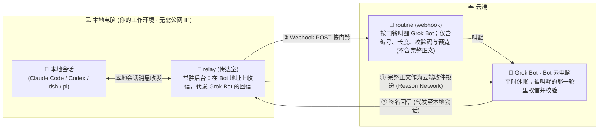
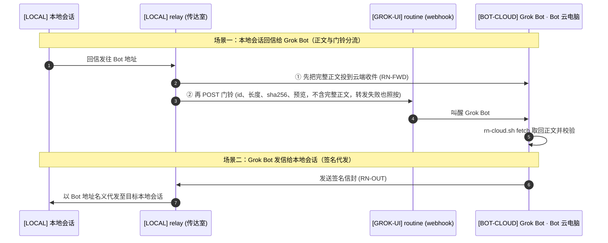

<div align="center">

# agent-mesh

[English](README.md) | **简体中文**

### 连接云端 Grok Bot 与本地 Coding Agent 会话的双向唤醒通道

把你本地电脑上正在运行的 **Claude Code**、**Codex**、**pi**、**DeepSeek Harness (dsh)** 会话与云端 **Grok Bot** 连进同一个 [Reason Network](https://github.com/reason-machines/reason-network) 私有团队——双方随时发起多轮对话，谁回了信都会把对方叫醒，**无需公网 IP、自建服务器、端口映射、Reason 账号、Docker 或 Node**。

[](CHANGELOG.zh-CN.md)
[](https://github.com/reason-machines/reason-network)
[](#准备)
[](#准备)
[](#准备)
[](LICENSE)

当前版本 **v0.11.2** · [更新日志](CHANGELOG.zh-CN.md) · [版本文件](VERSION) · 离线查询：`./install.sh --version`（Reason Network 使用独立版本号）

**[安装](#安装) · [验证](#验证) · [架构概览](#架构概览) · [怎么工作](#怎么工作) · [多个 Bot](#多个-grok-bot) · [安全与隐私](#安全与隐私) · [常见问题](#常见问题) · [术语](#术语)**

</div>

> [!TIP]
> **让 agent 代劳安装：** 把本仓库发给 Claude Code 或 Codex，说一句：**「读 [AGENT-INSTALL.zh-CN.md](AGENT-INSTALL.zh-CN.md)，照着装。」**

## 解决什么问题

从远端脚本跑 `claude -p "..."` 只能执行单次任务，**每次拉起的都是全新、空白的进程**——碰不到你本地终端里已经打开、带着项目上下文、对话历史和未提交改动的那个会话。`agent-mesh` 把云端 Grok Bot 直接连到这些正在干活的本地会话上：

- **直连活跃会话** — 直接联系本地终端里已经打开的会话，项目背景、对话记录和当前改动都留在原地。
- **按门铃唤醒，绝不空转** — 多轮协作免不了追问、修改和后续跟进。接上通道后，两边发完信即休眠，对方回信时像按门铃一样把接收方叫醒（本地仅保留一个长轮询等信的轻量 relay），既省 Grok Bot 用量，又能充分利用本地已有的各家 agent 订阅。relay 默认两次叫醒至少间隔 20 秒、每小时最多叫醒 20 次；本地会话能否自动唤醒取决于[收信方式](#各-agent-怎么收信)。
- **代码留在本地** — 源码、文档、依赖环境和会话历史都留在本地电脑上，不必为了借用云端能力把项目打包搬上云电脑。
- **多会话并行协同** — 本地可同时开启多个职责不同的会话（如代码重构、文档核对、日志排查），Grok Bot 能分别联系它们；本地会话之间也能先交叉核实分歧，再向云端汇报。
- **零公网暴露** — 基于 [Reason Network](https://github.com/reason-machines/reason-network) 联机。本地电脑不开任何入站端口，无需自建或租用服务器，只要能连上网络中继，家庭和公司内网都能收发。消息可能经过公共 iroh 或 Reason 中继，使用 VPN 或代理时需放行 `iroh.link` 和 `compute.reasonmachines.com`，详见[网络](#网络)、[网络与用量](#网络与用量)和[常见问题](#常见问题)。
- **不额外越权** — 通道只传纯文本，**不授予任何额外本机执行权限**，能做什么仍由各 agent 自身的审批设置决定。注意两点：开启自动批准的会话（如 Claude Code `--dangerously-skip-permissions`、Codex `--yolo`）收到文字即视同命令；云端 Grok Bot 是本通道的信任根，一旦被外部内容诱导，同样能发出签名有效的消息。详见[安全与隐私](#安全与隐私)。

> [!NOTE]
> **什么时候不需要它：** 如果任务在 Bot 云电脑上就能独立完成（纯跑脚本、做调研、生成独立文件），直接让 Grok Bot 在云电脑上安装所需 CLI 即可，无需部署本项目。

## 架构概览



## 执行位置标识

本指南、安装手册和提示词模板统一用以下三个标识注明每一步在哪里执行。标识仅作操作说明，不要输入终端：

| 标识 | 指哪一端 | 在这里运行或操作什么 |
|---|---|---|
| `[LOCAL]` | 用户本地电脑（默认机器名为 `mac`） | 运行本地 coding agent、Reason Network 引擎和 relay；执行 `install.sh`、`check.sh`、`update.sh`、`uninstall.sh`。 |
| `[BOT-CLOUD]` | Bot 云电脑（Grok Bot 执行命令的 Linux 电脑，机器名为 `cloud`） | Grok Bot 运行 `/workspace/agent-mesh/box/rn-cloud*.sh`，保存云端状态、云端收件正文和 thread 笔记。 |
| `[GROK-UI]` | 用户打开的 Grok Bot 界面 | 创建或暂停 routine、粘贴 routine 提示词、发送云端提示词、批准 CopyToBox（非终端命令）。 |

两台电脑各自维护一份仓库克隆，文件不会自动同步。`[LOCAL]` 的 `~` 指本地电脑的 home 目录；`[BOT-CLOUD]` 的 `/workspace/agent-mesh/` 指 Bot 云电脑上的克隆目录。下文未另行标注的终端命令和 `~/…` 路径均属于 `[LOCAL]`。完整词汇表见[术语](#术语)。

## 准备

### `[LOCAL]` 本地电脑

- **macOS 桌面普通用户** — 一键脚本 `./install.sh` 支持 macOS（Apple Silicon 或 Intel），须以已登录桌面的普通用户运行；切勿使用 `sudo`，纯 SSH / 无桌面登录环境不在本安装流程支持范围内。（引擎本身提供 macOS、Linux、Windows 构建，relay 为纯 Python；Linux 与 Windows 状态见下方折叠说明。）
- **Git 与 Python 3.9+** — 含标准库模块 `ssl`、`sqlite3`，脚本还会检查 `curl`、`tar`、`shasum`、`openssl`、`launchctl`、`plutil`（无需单独安装 Node 或 `pip` 包）。先运行以下命令自查：

  ```bash
  git --version
  python3 -c 'import sys, ssl, sqlite3; print(sys.version)'
  ```

  缺少 Git 或 Python 时先执行 `xcode-select --install`，装完重查；Python 仍低于 3.9 时另装符合要求的版本并加入 `PATH`。新安装会将 relay 服务固定绑定到一个 Python 解释器，按顺序选取 `/opt/homebrew/bin/python3`、`/usr/local/bin/python3`、`/usr/bin/python3`，绝不使用虚拟环境或临时目录中的解释器。需指定其他路径时给 `./install.sh` 传 `--python <path>`（见 [relay 的 Python](UPGRADE.zh-CN.md#用-updatesh-升级)）；日后若移动或卸载了该解释器，修复后重跑 `./install.sh` 即可更新服务。
- **至少一个 coding agent** — 提前安装、登录并确认 **Claude Code**、**Codex**、**pi** 或 **DeepSeek Harness (dsh)** 中至少一个能独立正常工作。本项目不负责安装这些 agent 或配置模型账号与订阅；实际接入哪些工具以本机 `reason-network setup --dry-run` 打印的计划为准。
- **`~/.local/bin` 已加入 `PATH`** — 当前 Bash/zsh 会话可执行 `export PATH="$HOME/.local/bin:$PATH"`；持久生效需按实际 shell 写入对应启动文件（zsh 写 `~/.zshrc`，Bash 按启动方式写 `~/.bash_profile` 或 `~/.bashrc`，fish 运行 `fish_add_path "$HOME/.local/bin"`，切勿一律改动 `~/.zshrc`）。
- **保持唤醒** — 协作期间本地电脑须保持通电且不睡眠：在 macOS 系统设置中开启「接通电源时防止自动进入睡眠」，或开一个终端运行 `caffeinate`。合上笔记本盖子整套服务都会暂停。

<details>
<summary><strong>已有的 Reason Network 安装</strong></summary>

运行 `./install.sh` 前请先核查本机是否装过 Reason Network：

- 本流程固定使用 `~/.local/bin/reason-network`、默认状态目录 `~/.reason/network` 和固定版本 **v0.12.17**。
- `~/.local/bin/reason-network` 上是较旧引擎时，`./install.sh` 会停下并提示运行 `./update.sh`（先备份再升级引擎，失败自动回滚）。
- `PATH` 其他位置存在 `reason-network`、引擎版本更新或无法识别，或设置了自定义 `REASON_NETWORK_HOME` 时，`./install.sh` 都会停下，请先评估既有部署以免覆盖。
- 已有同名 person 的团队可直接复用；person 名不同时不支持原地改名。
- 按 `--level identity` 或 `--level all` 卸载会移除默认引擎的状态与 agent 接入（`all` 连引擎二进制一并删除），可能波及原有用途——切勿把这两个级别当作常规排错手段。

</details>

<details>
<summary><strong>Linux 与 Windows 本地端支持状态</strong></summary>

- **Debian Linux（引擎与 relay 已验证，仅限手工部署）：** 在 Debian Linux 上建团队、运行 relay 并与 `[BOT-CLOUD]` 完成真实双向收发已通过测试脚本验证，但目前还没有 Linux 本地安装脚本（接入 agent、复制签名密钥、注册 `systemd` 服务）。[AGENT-INSTALL](AGENT-INSTALL.zh-CN.md#linux-手工安装实验性) 提供了实验性的手工安装步骤，装完后不支持 `check.sh`、`update.sh` 和 `uninstall.sh`。
- **Windows（未验证）：** 思路上可用 Task Scheduler 承担 macOS 登录服务的角色；欢迎社区实测并贡献安装支持。

</details>

### `[BOT-CLOUD]` Bot 云电脑

- **系统与工具** — Linux `x86_64` 或 `ARM64`，具备 `bash`、`git`、`python3`（3.9+，含 `ssl` 和 `sqlite3`）、`curl`、`tar`、`sha256sum`，以及可写且持久的 `/workspace/agent-mesh/`。
- **在云端就地准备** — 缺少依赖时由 Grok Bot 用云电脑系统的包管理器补齐，需要权限时向用户说明（切勿改在 `[LOCAL]` 上安装）。云端脚本下载前会校验系统、CPU 架构和运行依赖；目录与 Git 检查见云端提示词。

### Grok Bot 与团队名

- **能力要求与单云电脑规则** — Grok Bot 须支持创建 webhook 触发的 routine，并能用 CopyToBox 读取 Mac 上的文件。同一个 Grok 账号下的所有 Bot 共用一台云电脑，因此一个 Grok 账号对应一台 Mac 上的安装；要接更多 Bot，在已装好的那台 Mac 上运行 `./install.sh --add-bot`（见[多个 Grok Bot](#多个-grok-bot)）。

| 名称项 | 参数 | 格式与规则 |
|---|---|---|
| **团队名** `<team-name>` | `--name` | 同时也是你在团队里的 person 名。`1–40` 个字符，仅限 ASCII 小写字母、数字和单个 `-`；首尾不能是 `-`，也不能连续出现 `--`（引擎会把 `--` 合并成 `-`，因此团队名和机器名均拒绝 `a--b`）。请用代号，勿用真名；建好后不能改名，只能删掉重建。 |
| **Bot 地址名** `<name>` | `--relay-name` | 用于 `[LOCAL]` relay 的 `<team-name>/<name>` 以及 `[BOT-CLOUD]` 的 `<name>-cloud` / `<name>-inbox`。建议用 Bot 自己的名字以便本机 agent 区分各个 Bot，勿用真名。`1–34` 个字符，ASCII 小写字母和数字分段间用单个 `-` 连接（首尾不带 `-`，不连用），且不能是 `terminal` 或 `terminal-<n>`。全新安装无默认名（v0.8.0 前默认为 `bot`，已有安装保留原名）。安装未完成期间不可更改；安装完成后可用 `agent-mesh rename` 改名，无需改动 Grok（见[给 Bot 改名](#给-bot-改名)）。 |
| **Grok 名字** | `--grok-name` | Bot 在 Grok 界面显示的名字，不限语言（`1–64` 个字符，首尾无空格，不含换行或控制字符）。原样保存，仅作展示、不参与路由；`install.sh`、`./check.sh` 和填好的回复约定会显示 `<team-name>/<name> → Grok: <它的名字>`。名字不含拉丁字母时请自行拟一个 ASCII `--relay-name`（如「小助手」→ `xiaozhushou`）。 |

### 网络

- **HTTPS 与中继连通性** — `[LOCAL]` 和 `[BOT-CLOUD]` 均需能经 HTTPS 访问 GitHub 仓库与 release 下载（默认使用公开 HTTPS 克隆地址，无需 GitHub 账号或 SSH 密钥），并能连接网络中继。
- **VPN / 代理须同时放行两个中继域名** — Reason Network 0.12（`agent-mesh` 0.7.0 起固定为 `v0.12.17`）默认使用 Reason 自己的网络中继（`compute.reasonmachines.com` 下的 `relay-sfo1`、`relay-iad1`、`relay-fra1`、`relay-sin1`），不再使用 n0 的 `*.iroh.link`。尚未用 `./update.sh` 升级、仍停在 0.10.7 的引擎仍走 `*.iroh.link`，因此请将 `*.compute.reasonmachines.com` 和 `*.iroh.link` 一并设为直连并排除出 HTTPS 解密。`./check.sh` 会探测已装引擎实际使用的中继并打印名称。快速单端点探测（返回 `code=200` 才算通）：

  ```bash
  curl -sS -o /dev/null -m 10 -w 'code=%{http_code}\n' https://aps1-1.relay.n0.iroh.link/
  ```

  不通时按[常见问题](#常见问题)排查（该命令仅探测单个端点，不代表全球可用性）。
- **克隆路径与公开 fork** — `[LOCAL]` 仓库可放在任意本地目录，但 `[BOT-CLOUD]` 必须固定在 `/workspace/agent-mesh/`（提示词硬编码了该路径）。维护公开 fork 时，每次生成云端提示词的 `./install.sh` 命令及 `./update.sh` 均需传入 `--repo-url https://…`；该仓库必须允许云电脑免凭据读取，并打有发布 tag `v<VERSION>`（云端只安装已发布的 tag）。

## 安装

**`[LOCAL]` 由桌面用户（或本地安装 agent）执行**，先把占位符换成实际值：

```bash
git clone https://github.com/xiaozhenliu/agent-mesh.git ~/agent-mesh
cd ~/agent-mesh
./install.sh --name <team-name> --relay-name <name> --grok-name '<它在 Grok 里的名字>' --lang zh-CN
```

- **名字处理：** `--relay-name` 设定 Bot 地址名，`--grok-name` 设定它在 Grok 里的显示名（见 [Grok Bot 与团队名](#grok-bot-与团队名)）。全新安装省略 `--relay-name` 时，安装器会在改动任何文件前停下，并根据 `--grok-name` 给出地址建议。后续命令（`--webhook`、`--cloud-prompt`、`update.sh`）直接读取已记录的名字，传入不同的 `--relay-name` 会被拒绝（改名只能用 `agent-mesh rename`；接了[多个 Grok Bot](#多个-grok-bot) 时，`--relay-name` 用来指定操作哪一个 Bot）。已有安装运行 `./install.sh --grok-name '<它在 Grok 里的名字>'` 只更新显示名，地址不变。若 `<name>` 已被团队内其他会话占用，安装器会在接入任何 agent 前停下；启动 relay 后还会核对引擎实际注册的地址确为 `<team-name>/<name>`。
- **目录已存在时：** 若 `~/agent-mesh` 已存在，先核对是否为同一仓库、有无未提交改动，切勿直接覆盖或盲目 `git pull`。`[BOT-CLOUD]` 默认克隆公开发行仓库（根目录须含 `box/rn-cloud-setup.sh`），不会从本地 `origin` 推断云端仓库地址。

**安装过程一共四步（中途停两次等你操作）：**

1. **`[LOCAL]` 安装引擎与建团队** — 下载 Reason Network `v0.12.17`（校验内置固定 SHA-256），创建只有你一人的私有团队，并关闭自动更新与局域网广播。
2. **`[LOCAL]` 接入本地 agent** — 展示 `reason-network setup --dry-run` 计划，**等你确认后**再把本机 coding agent 接入团队。
3. **`[LOCAL]` + `[GROK-UI]` 配置 routine 与本地 relay** — 生成签名密钥并打印 routine 提示词：默认为简短固定的 [routine 桩](UPGRADE.zh-CN.md#routine-桩)，每次运行时从 `[BOT-CLOUD]` 动态加载规则。**用户在 `[GROK-UI]` 新建一个由 webhook 触发的 routine 并粘贴提示词**，再把界面给出的 Webhook URL 和 key 贴回 `[LOCAL]` 终端。安装器随即写入本地配置，并将 relay 注册为 macOS 登录自启服务。
4. **`[LOCAL]` + `[GROK-UI]` + `[BOT-CLOUD]` 云端入队与密钥复制** — 打印团队邀请链接和云端提示词。**用户在 `[GROK-UI]` 把这两段一并发给 Grok Bot**。**在 `[BOT-CLOUD]` 上**，Bot 核对发布提交号与云端脚本校验值后克隆该发布版、安装引擎、加入团队，再用 CopyToBox 把签名密钥从 `[LOCAL]` 复制到 `[BOT-CLOUD]`；**用户在 `[GROK-UI]` 批准这次复制**。

最后，关掉并重开安装前已打开的 Claude Code 和 Codex 会话。Codex 首次启动会弹出确认，选择 **“Trust all and continue”**。

### 提示词语言

每次调用安装器时可用 `--lang en`（默认）或 `--lang zh-CN` 选择生成的提示词语言（环境变量 `AGENT_MESH_LANG` 可设当前 shell 默认值，`--lang` 优先）。终端诊断、配置键名和协议字段保持英文；agent 按你偏好的语言与你交流。

### 可选

- **dsh 自动叫醒** — 运行 `dsh/mac-install.sh <team-name>`，详见[插件指南](dsh/README.zh-CN.md)。
- **回复约定** — 把安装器在 `~/.local/lib/agent-mesh/templates/` 下生成的填好副本（中文 `AGENTS.reason-network.zh-CN.md` 或英文 `AGENTS.reason-network.md`，已填入你的 Bot 地址和 Grok 名字）整段追加到常用仓库的 `AGENTS.md`（仓库内的[中文模板](templates/AGENTS.reason-network.zh-CN.md)和[英文模板](templates/AGENTS.reason-network.md)仅含占位符；Claude Code 还需在 `CLAUDE.md` 里加一行 `@AGENTS.md`）。修改 Grok 名字后，运行 `python3 scripts/reply_convention.py refresh <仓库>/AGENTS.md` 即可只替换 `agent-mesh:bot-address` 标记之间的行。本机 agent 默认常按给人看的长篇报告回信；该约定要求经此通道发出的消息结论先行、四项必填，繁琐细节留在会话本地不外发。

## 验证

自检、测试发信和查看 relay 日志在 `[LOCAL]` 执行；`[BOT-CLOUD]` 上由 Grok Bot 调用 `/workspace/agent-mesh/box/rn-cloud.sh`（`who`、`fetch`）。

1. **只读自检** — 每一项 `FAIL` 都会附带修复方法：

   ```bash
   ./check.sh
   ```

2. **收发测试消息** — 向你的 `Bot address:`（`./check.sh` 会打印）发一条消息，并在另一个终端窗口监听回信：

   ```bash
   reason-network send <team-name>/<name> "测试 1"
   reason-network listen --as terminal --wait 600   # 另开一个终端运行
   ```

   确认 `~/Library/Logs/agent-relay.log`（添加的 Bot 为 `~/Library/Logs/agent-relay-<name>.log`）中出现 `forwarded` 和 `POST … code=200` 两行。
3. **唤醒空闲会话** — 让 Grok Bot 先跑 `who`，再给某个正开着的空闲 Claude Code 会话发一句话。该会话应自动醒来，它回信后也会再次叫醒 Grok Bot。
4. **长消息校验** — 从本机发送一条 10,000 字的消息。Grok Bot 应只被叫醒一次，且 `fetch` 报告 `complete`、字数和 SHA-256 完全一致。完整签名信封须在 relay 的 60 KiB 转发上限之内（UTF-8 字节数随文本内容变化）。

## 各 agent 怎么收信

`reason-network who` 输出的最后一列表示各本地会话的收信方式：

| 方式 | 表现 | 适用的 agent |
|---|---|---|
| **push** | 空闲时也会自动被叫醒。 | **Claude Code** 直接将消息注入已打开的会话；**Codex** 通过 `codex queue` 排入已打开的会话；**pi** 通过扩展每 5 秒轮询一次。 |
| **turn** | 通常等到下一次工具调用或当前轮结束才收到。 | **装了插件的 dsh** 虽然显示为 `turn`，但空闲时约 5 秒内就会自动开启新一轮处理来信。 |
| **pull** | 不会自动叫醒。 | **未装插件的 dsh** 属于这一档，需要你让它主动检查收件箱。 |

会话关闭后会从 `who` 名单中消失，离线期间发来的信会留在收件箱里；重开会话后需对它说一句「看下收件箱」才会读取。想让来信被即时处理，请保持目标会话常开。

## 怎么工作

整套通道由本地和云端三个角色配合完成：

| 角色 | 在线状态 | 职责 |
|---|---|---|
| `[LOCAL]` 本地电脑 | 保持唤醒 | 运行引擎和 relay。relay 在 Bot 地址 `<team-name>/<name>` 上收信，因此在本地会话看来它就是 Grok Bot——该地址归属 `[LOCAL]` 上的 relay，而非 `[BOT-CLOUD]`。`<name>` 是你的 [Bot 地址名](#grok-bot-与团队名)（v0.8.0 前默认为 `bot`）。 |
| `[BOT-CLOUD]` Bot 云电脑 | 空闲休眠 | 无常驻后台进程，仅在被叫醒的那一轮里以机器名 `cloud` 临时拉起引擎；用 `<team-name>/<name>-cloud` 发信，用 `<team-name>/<name>-inbox` 接收正文。 |
| `[GROK-UI]` routine | 由 webhook 唤醒 | 在 Grok Bot 界面创建的 webhook 任务；`[LOCAL]` relay 向其发送一次 HTTP POST（按门铃），Grok Bot 就醒来在 `[BOT-CLOUD]` 执行 routine 提示词。 |



背后的五项核心设计确保投递可靠：

1. **常驻端代发，回信不落空** — 云端发出的每封信都交给一直开着的 `[LOCAL]` 代发，因此本地会话的回信总是回到在线的 Mac，而不会投向可能已休眠的云电脑。
2. **webhook 只当门铃，不运正文** — 早先实测发现 Grok Bot 醒来时 webhook 请求体大约在 4,000 字处被截断，因此完整正文改走 Reason Network 投向 `<name>-inbox`，webhook POST 仅携带消息 `id`、`length`、`sha256` 和可选预览。routine 醒来后按编号取回正文并核对校验值，在引擎字节上限内发一条 10,000 字长信也只需叫醒一次。
3. **双向补寄与回执闭环** — relay 为每条已转发正文保留 7 天副本。云端 `fetch` 未取到正文（含首次转发失败）时自动发出签名补寄请求，每条消息最多补寄 2 次。云端通过签名回执告知 relay 哪些消息**已落盘**、哪些**已处理**；未确认处理完的消息一直记为**待办**，迟迟无回执时有限次补按门铃，耗尽后向 Grok Bot 发提醒而不会死循环重试。详见[补寄与回执](PROTOCOL.zh-CN.md#补寄与回执)。
4. **单轮领取，中断不盲目重做** — 面对重叠唤醒或 webhook 重复投递，`fetch` 会为交出的每条正文登记领取（同时也会交出门铃丢失但已核对无误的正文），重叠轮次直接跳过。若某一轮在动手后意外中断、未记录完成，后续轮次会报告 `uncertain`，由 Bot 查阅 thread 笔记或询问用户，绝不悄悄重做一遍。这并非严格的「恰好一次」，详见[领取与中断](PROTOCOL.zh-CN.md#领取与中断)。
5. **跨端消息全程 HMAC 签名** — 同一团队内的任何会话都能借用他人名字发信，因此 `RN-OUT` 代发信封、`RN-FWD` 转发正文和补寄请求均附带共享密钥生成的 HMAC 签名；信封与补寄请求还设有 15 分钟时效窗口与防重放校验。

## 多个 Grok Bot

自 v0.9.0 起，一台 Mac 可在同一个团队内接入多个 Grok Bot。所有 Bot 共用团队、引擎、云电脑、签名密钥和 relay 代码；每个 Bot 各自拥有独立地址 `<team-name>/<name>`、relay 服务、webhook、routine，以及 `[BOT-CLOUD]` 上的 `<name>-cloud` / `<name>-inbox` 会话：

| 资源 | 第一个 Bot | 之后添加的每个 Bot `<name>` |
|---|---|---|
| relay 配置 | `~/.config/agent-relay/env` | `~/.config/agent-relay-bots/<name>/env`（其中 `OUTBOUND_KEY_FILE` 指向共用的 `~/.config/agent-relay/outbound.key`） |
| 登录服务 | `com.local.agent-relay` | `com.local.agent-relay.<name>` |
| relay 状态 | `~/Library/Application Support/agent-relay/` | `~/Library/Application Support/agent-relay-bots/<name>/` |
| relay 日志 | `~/Library/Logs/agent-relay.log` | `~/Library/Logs/agent-relay-<name>.log` |
| `[BOT-CLOUD]` 收件与 thread 笔记 | `/workspace/agent-mesh/inbox/`、`threads/` | `/workspace/agent-mesh/bots/<name>/inbox/`、`threads/` |

已有安装无需迁移：第一个 Bot 的目录路径、登录服务和 routine 提示词保持原样。新添加的 Bot 始终沿用添加时那个名字的文件路径和服务名，即使日后改名也不变。

### 添加一个 Bot

先确认现有安装完整且已是最新：每个已有 Bot 的 webhook、relay 和 routine 提示词均已确认，当前版本的云端更新已确认（否则安装器提示 `请先运行 ./update.sh，再添加 Bot`），且没有未完成的更新或正在卸载的 Bot。随后在 `[LOCAL]` 运行：

```bash
./install.sh --add-bot --lang zh-CN
```

1. **命名与生成计划** — 询问新 Bot 在 Grok 里的名字并据此给出 ASCII 地址建议（名字不含拉丁字母和数字时，建议第一个空闲的 `bot-2`、`bot-3`……）。也可传入 `--grok-name '<它在 Grok 里的名字>' --relay-name <name>` 一步给全（无需 `--name`，若传则必须与现有团队一致）。此流程不重新接入 agent、不重下引擎，也不重新生成密钥。
2. **唯一性核查与确认** — 核对 `<name>`、`<name>-cloud`、`<name>-inbox` 均不在团队名单中（无论任何机器、在线或离线）、未在本机用过，且不属于其他兄弟 Bot 的当前名或曾用名（已卸载 Bot 或早先部署留下的名字在核对证据后可收回，见 [Bot 能用哪些名字](#bot-能用哪些名字)）。随后打印计划 `添加 Bot <team-name>/<name>（在 Grok 里叫「…」）；<其他 Bot> 保持不变。` 请你在终端确认（`--add-bot` 绝不接受 `--yes`；非交互终端下仅打印计划并退出，不做任何改动）。
3. **`[GROK-UI]` 配置新 routine** — 为新 Bot 创建 webhook 触发的 routine，粘贴安装器打印的 routine 提示词，再将 Webhook URL 和 key 贴回 `[LOCAL]` 终端。该 Bot 的 routine 桩在首条命令里写明 Bot 名、团队名和团队哈希，加载出的规则会给每条 `rn-cloud.sh` 命令加上 `RN_BOT=<name>` 前缀，并将 thread 笔记存入 `bots/<name>/threads/`（使用 `--full-prompt` 时改为附带[第 0 步](prompts/cloud-add-bot.zh-CN.md)）。
4. **云端自动登记** — 安装器通过新 webhook 叫醒新 Bot；桩的首条命令先调用 `box/rn-cloud-add-bot.sh` 核对共用云电脑并登记该 Bot 的两个云端会话，无需 CopyToBox 或新邀请链接。待两个会话出现在团队中后，安装器才启动该 Bot 的 relay，发送 `agent-mesh add-bot <name> <req>` 并等待确认回信（每步最多等待 10 分钟）。

若等待超时，新 Bot 保持 **pending** 状态（云端会话出现前其 relay 不会启动）。之后运行 `./update.sh` 会自动检查回信；运行 `./install.sh --relay-name <name> --wake-bot` 可重新叫醒 Bot 并从断点继续，或运行 `./install.sh --add-bot --relay-name <name>` 续接添加流程。存在未完成的添加时不能再添加其他 Bot——请先完成它，或用 `--level bot` 将其卸载。

### 多个 Bot 时的日常使用

- **覆盖全部 Bot 的命令** — `./check.sh`、`./update.sh` 和 `./uninstall.sh --plan` 自动覆盖所有 Bot，无需额外参数（`./check.sh` 按每个 Bot 分节输出 `Bot address: <team-name>/<name> → Grok: <它的名字>`）。
- **针对单个 Bot 的命令** — `--webhook`、`--cloud-prompt`、`--purge-copies`、单独的 `--grok-name` 和 `--wake-bot` 仅作用于一个 Bot。有多个 Bot 时须加 `--relay-name <name>` 指定，否则安装器列出名单并停下。对后添加的 Bot，`--cloud-prompt` 会直接叫醒它，而不打印云端安装提示词。
- **共用资源命令** — `--restart-relay` 和 `--rotate-key` 因共用 relay 代码与签名密钥，始终作用于所有已配置 relay 的 Bot，且拒绝 `--relay-name`。任一 relay 启动失败时，所有 relay 一并回滚至原代码、plist 和运行状态；但新生成的密钥不会回滚——`--rotate-key` 会列出哪些 relay 已用上新密钥、哪些未能启动，新密钥仍需向 `[BOT-CLOUD]` 复制一次。
- **回复约定** — 填好的回复约定模板会一并列出每个 Bot 的地址及其 Grok 名字。

### 名字与卸载

`agent-mesh rename` 原地更改 Bot 地址，保留其 routine、云端收件和本地路径（见[给 Bot 改名](#给-bot-改名)）。`./uninstall.sh --level bot --relay-name <name>` 只卸载单个 Bot：引擎会一直保留它的旧会话（发往旧地址的信在那里排队、无人读取），`[BOT-CLOUD]` 也会为它的每个名字记录 tombstone，此后只能通过收回流程再次使用（见 [Bot 能用哪些名字](#bot-能用哪些名字)）。详细步骤见[卸载指南](UNINSTALL.zh-CN.md#只卸载一个-bot)，共用云电脑的安全边界见[安全策略](SECURITY.zh-CN.md#已知限制不按漏洞处理)。

## 给 Bot 改名

现有安装完整且最新（该 Bot 已设好 webhook、relay 正在运行，且无未完成的更新或添加）时，在 `[LOCAL]` 运行：

```bash
agent-mesh rename <新名字>
```

有多个 Bot 时加 `--relay-name <当前名字>` 指定（在仓库目录运行 `./install.sh --rename <新名字>` 等效）。`[GROK-UI]` 里无需任何操作：Bot 保留原有的 routine、`[BOT-CLOUD]` 收件、thread 笔记与历史记录，添加的 Bot 也继续使用最初添加时的目录路径与登录服务。

1. **校验与确认** — 按[下方规则](#bot-能用哪些名字)检查 `<新名字>`，显示计划 `把 Bot <旧名字> 改名为 <新名字>。……` 请你确认（非交互环境下可加 `--yes`；但收回已卸载 Bot 或早先部署留下的名字，或本机有发往 `<新名字>` 的未读消息时，必须在终端交互确认）。
2. **云端登记** — 向 Bot 发送一行 `agent-mesh rename …`，最多等 10 分钟（1 次 routine 运行），由 `[BOT-CLOUD]` 登记 `<新名字>-cloud` 和 `<新名字>-inbox`（首条消息到达 `<新名字>-inbox` 之前，Bot 仍用旧名字回信）。
3. **本机切换** — 以新名字重启 relay，核对引擎实际注册地址确为 `<team-name>/<新名字>`，再更新部署记录与回复约定（`Bot <旧名字> 已改名为 <新名字>。`）。此后 Bot 回信改从新地址发出，本地各 agent 会自动切换过去。

**30 天旧地址转发期：** 发往旧地址的信在 30 天内仍会送达 Bot（relay 约每分钟轮询一次旧地址并照常转发，在途的旧名字回信和回执也照常识别；`./check.sh` 会显示到期时间）。满 30 天后，发往旧地址的信留在引擎里排队、无人读取，`./check.sh` 会给出提醒及收回旧名字的命令。

<details>
<summary><strong>等待超时、取消与未完成的改名</strong></summary>

- 若第 3 步之前 10 分钟等待超时，`[LOCAL]` 尚未做任何改动：重跑 `agent-mesh rename` 继续等待，或运行 `agent-mesh rename --cancel` 停止。
- 由于 `[BOT-CLOUD]` 可能已将该新名字登记在此 Bot 名下，取消或被拒后该名字仍绑定给此 Bot：其他 Bot 不能占用，日后重跑 `agent-mesh rename <新名字>` 会续接完成改名（收回的名字会重新执行核对）。
- 若 `[BOT-CLOUD]` 因之前用过该名字而拒绝，下次在终端运行时安装器会列出检查证据，请你确认收回。
- 改名未完成期间，`agent-mesh update` 及其他安装命令会停下并提示原因。一旦 relay 已用新名字启动，改名就只能走完、不能取消；想换回旧名字，等完成后再改回去即可。

</details>

### Bot 能用哪些名字

- **全新名字** — 团队里从未用过的合规名字。
- **自己的曾用名** — 把这个 Bot 改回它以前用过的名字。
- **绝不能用兄弟 Bot 的名字** — 同一套安装里其他 Bot 的当前名字或曾用名一律不可用，30 天转发期满后也不行。
- **收回已卸载 Bot 或早先部署的名字** — 通过本机与云端归属核对后可以收回；云端收件箱里该名字下原有的旧消息会被搁置，避免 Bot 重复处理（运行 `agent-mesh rename --accept-history` 可在 1 次 routine 运行中把所有仍搁置的批次一并交给 Bot）。

<details>
<summary><strong>收回名字时的核对规则与未读消息处理</strong></summary>

- **`[LOCAL]` 本机核对：** 若 `<name>` 出现在团队名单中，它必须属于这台 Mac（早先部署留下的名字还须处于离线状态）；本机引擎未将 `<name>`、`<name>-cloud`、`<name>-inbox` 的密钥发给其他会话；本机也没有进程或登录服务正在占用它们。
- **`[BOT-CLOUD]` 云端核对：** 若团队名单列出了 `<name>-cloud` 或 `<name>-inbox`，安装器会打印出来请你确认是否属于该 Bot 的云端会话（它们必须位于 Bot 云电脑上）。若名单未列出（名单仅显示云端引擎上次启动以来活跃过的会话），安装器会注明后继续，由 `[BOT-CLOUD]` 在登记时自行核对云端会话。改回曾用名时同样执行这套检查。
- **`[LOCAL]` 本机排队的未读消息：**
  - 执行 `agent-mesh rename` 时，本机排队发往该名字的未读消息会连同发件人一并列出；改名完成后 Bot 将其作为新消息接收。
  - 执行 `./install.sh --add-bot`（新 Bot 没有曾用名）收回早先安装留下的名字时，本机排队的未读消息会同云端旧消息一起被搁置，不作新消息投递；需要时运行 `agent-mesh rename --accept-history` 交给 Bot。

</details>

## 安全与隐私

### 信任根是 Grok Bot

- 签名密钥 `outbound.key` 共有两份，`[LOCAL]` 和 `[BOT-CLOUD]` 各执一份。HMAC 签名防的是拿不到密钥的会话冒名发信，**防不了被诱导的 Bot 本身**：若 Grok Bot 读到含提示词注入的网页或文档而被操纵，它依然能签出合法的 `RN-OUT` 信封，以 `<team-name>/<name>` 的名义向任意本地会话发信。因此本地 agent 应把 Bot 来信视作外部输入，而非你本人的直接指令。
- 同一 macOS 登录用户下运行的任何进程都能读取 `~/.config/agent-relay/` 中的密钥与 webhook key，项目目录并非系统级权限边界。

### 本地 agent 的权限

- 本通道仅向本地 agent 投递纯文本，不直接授予 Grok Bot 本地文件访问权，不在 Mac 上开任何入站端口，也无需开启 Grok Bot App 里的「本机永远批准」或「通过本机网络连接」开关。是否执行、如何执行完全取决于接收会话自身的审批设置。
- 即使未开自动批准，会话沙盒和权限规则原本就放行的操作（如读文件、在工作目录内改文件）仍会直接执行，只有需要人工确认的操作才会停下来等你批准。

> [!WARNING]
> **自动批准模式会让收到的文字直接变成待执行命令。** 带有以下参数的会话只应在一次性沙盒目录或隔离环境中启动：
> - **Claude Code：** `--dangerously-skip-permissions`、`--permission-mode bypassPermissions`
> - **Codex：** `--yolo`（即 `--dangerously-bypass-approvals-and-sandbox`，不询问且无沙盒限制）、`--sandbox danger-full-access`（无沙盒限制）、`--ask-for-approval never`（沙盒允许的直接跑，不允许的直接报错失败）、`--approve-for-me`（交由自动审查代为批准）

- **无人值守时的唤醒** — `push` 档会话在你离开电脑时也会被唤醒。Reason Network（`v0.10.7+`）通过 `codex queue --thread <id> --message` 唤醒 Codex，消息排入已打开的会话作为新一轮运行，严格沿用该会话启动时的审批和沙盒设置，不附加任何放宽权限的参数。实测（Codex `0.166.0`，`--ask-for-approval on-request --sandbox read-only`，写文件需人工批准）：被唤醒的那一轮尝试写文件时，终端弹出审批框一直等待，无人确认就不会执行或自动放行。Claude Code 的消息直接注入已打开会话，本项目未单独实测其无人值守时的审批表现。
- **手动拦截入站来信** — 若不希望云端来信自动投递，可在 `~/.reason/network/config.toml` 中设置 `[inbound] default = "hold"`，每条来信须经你运行 `reason-network approve` 后才会放行。

### 正文以明文保存

> [!IMPORTANT]
> **切勿通过本通道发送密钥、密码、token 等机密信息。** 消息正文会以明文保存在以下位置：

| 存放位置 | 明文内容 | 保留策略 |
|---|---|---|
| `[LOCAL]` `~/.reason/network/network.db`<br/>`[BOT-CLOUD]` `/workspace/agent-mesh/box/state/network.db` | 两端引擎收到的消息（已读后仍保留） | 引擎不自动删除 |
| `[LOCAL]` `~/.local/lib/agent-mesh/engine-backup-*/state`<br/>`[BOT-CLOUD]` `/workspace/agent-mesh/box/engine-backup-*/state` | 引擎升级前备份的状态快照（含已收消息） | 保留至手动删除；`./uninstall.sh --level identity` 会一并删除 |
| `[LOCAL]` `~/Library/Application Support/agent-relay/fwd-copies/` | relay 为补寄缓存的正文副本 | 超过 `FWD_COPY_DAYS`（默认 `7` 天）不再补寄；后续有新消息经过 relay 时才清理（最多每小时检查一次，relay 空闲时一直保留） |
| `[BOT-CLOUD]` `/workspace/agent-mesh/inbox/<id>/full.txt`（添加的 Bot：`bots/<name>/inbox/<id>/full.txt`） | `fetch` 校验落盘的完整正文 | 不自动删除 |
| `[BOT-CLOUD]` `/workspace/agent-mesh/threads/*.md`（添加的 Bot：`bots/<name>/threads/*.md`） | routine 每轮追加的会话摘要（thread 笔记） | 不自动删除 |
| `[LOCAL]` `~/Library/Application Support/agent-relay/state.json` | 等待送往 webhook 的门铃队列（含正文预览） | webhook 返回 `200` 后移出；持续失败时保留，超出 `MAX_SPOOL` 条才丢弃最旧记录（修改 `DOORBELL_PREVIEW_CHARS` 仅对新门铃生效） |
| routine 的 webhook | 门铃中携带的正文前 `200` 字预览 | 由 Grok Bot 决定保留时长；设 `DOORBELL_PREVIEW_CHARS=0` 可关闭预览 |

relay 日志仅记录消息 id、字符长度和校验码，绝不记录正文。`FWD_COPY_DAYS` 和 `DOORBELL_PREVIEW_CHARS` 均在 `~/.config/agent-relay/env` 中设置，改后运行 `launchctl kickstart -k "gui/$(id -u)/com.local.agent-relay"` 重启生效（添加的 Bot 路径见[多个 Grok Bot](#多个-grok-bot)，服务名为 `com.local.agent-relay.<name>`）。

**清理命令：**

- **`[LOCAL]` 清理 relay 副本** — 运行 `./install.sh --purge-copies`（有多个 Bot 时加 `--relay-name <name>` 指定）。清理后针对这些消息的补寄请求将返回 `no-copy`，需请发送方重发。
- **`[BOT-CLOUD]` 清理云端收件与笔记** — 在 `[GROK-UI]` 让 Grok Bot 运行 `/workspace/agent-mesh/box/rn-cloud.sh purge <天数>`（传 `0` 全部删除）。脚本先停掉云端引擎，再清理早于该天数的云端 `network.db` 已收消息、`inbox/<id>/`、`inbox/_stray/` 误投记录及 `threads/*.md`（删掉 thread 笔记会清空 Bot 的历史对话记忆；须先将云端仓库更新至含此命令的版本；云电脑服务多个 Bot 时因共用 `network.db` 会拒绝执行）。
- **`[LOCAL]` 本地 `network.db`** — 由引擎自行管理，不提供部分清理；运行 `./uninstall.sh --level identity` 或 `--level all` 会删除整个 `~/.reason/network`。

### 团队成员

- **团队即信任边界** — relay 会把任何团队成员发来的消息转发给 Grok Bot 并唤醒它（保留原始发件人，同样受每小时叫醒上限约束）。请确保团队里只有你自己的机器。
- **定期核查成员** — 装完后及日常定期运行 `reason-network team`，确认只有你的本地电脑和 `cloud` 两台机器（出现其他成员时 `./check.sh` 会直接报 `FAIL`）。若发现陌生人员或机器，立即运行 `reason-network remove <person>/<machine>` 移除并按下节更换签名密钥。
- **可见元数据** — 团队成员能看到各会话名称、工作目录最后一级目录名、仓库名和 Git 分支名。切勿直接在 `~` 主目录下启动 agent，团队邀请链接也只在终端里使用、不要在浏览器中打开。

### 更换密钥

- **更换签名密钥** — 在 `[LOCAL]` 运行 `./install.sh --rotate-key --lang zh-CN`。脚本生成新的 `outbound.key`、重启所有已配置的 relay（多 Bot 共用同一把密钥），并打印 CopyToBox 指引：在 `[GROK-UI]` 让 Grok Bot 用 CopyToBox 把 `[LOCAL]` 的 `~/.config/agent-relay/outbound.key` 复制到 `[BOT-CLOUD]` 的 `/workspace/agent-mesh/box/outbound.key`，由你批准复制并在云端执行 `chmod 600`。云端换上新密钥前，双向签名校验均会失败。换钥前已转发、云端尚未取回的旧消息仍带旧签名，换钥后 `fetch` 会报 `mismatch` 且不会请求补寄（门铃点名时每次都报，无门铃扫描时只报一次）：若旧密钥并未泄露，先让 Bot 取完待取消息再换钥；否则请发送方重发，并用 `rn-cloud.sh purge` 清理旧消息。
- **更换 Webhook URL 或 key** — 在 `[GROK-UI]` 重新生成该 routine 的 key（不支持重生成时删掉 routine 重建），随后在 `[LOCAL]` 运行 `./install.sh --webhook --lang zh-CN` 填入新值。
- 完整的凭据泄露应急响应步骤见[安全策略](SECURITY.zh-CN.md#怀疑凭据泄露时)。

### 网络与用量

- **无账号端到端加密传输** — 引擎开源且固定版本，在本机以无账号模式运行，不向 Reason 官方发送遥测数据。按上游说明，消息在两端引擎间端到端加密，网络中继仅转发密文（本项目未对网络中继做独立审计）。
- **自定义网络中继** — 团队可通过 `reason-network relay <URL>` 切换自建中继（`reason-network relay default` 恢复默认）。团队内每台机器都必须执行同一条命令，包括 `[BOT-CLOUD]`（运行 `REASON_NETWORK_HOME=/workspace/agent-mesh/box/state /workspace/agent-mesh/box/bin/reason-network relay <URL>`，守护进程随后停止并在下次命令时重拉起；离线机器上线后补跑）。指定自定义中继后短邀请码不可用，须使用完整邀请链接（`./install.sh --cloud-prompt` 默认即打印完整链接）。
- **会话遗忘机制（仅 Reason Network 0.12）** — 引擎守护进程连续运行满 6 小时后，离线超过 1 天的普通 agent 会话会连同其未读消息一并被清理。用 `listen --as` 启动的信箱会话（`[LOCAL]` relay 与 `[BOT-CLOUD]` 云端信箱）不受影响；0.10.7 从不清理会话。准备长时间离线的会话请先把收件箱读完。
- **叫醒上限与漏洞报告** — 每叫醒一次 Grok Bot 消耗一次用量（relay 默认上限为每小时 20 次）。发现安全问题请按[安全策略](SECURITY.zh-CN.md)私下报告，切勿公开提 Issue。

## 升级

`[LOCAL]` 本地仓库、`[BOT-CLOUD]` 云端克隆和已保存的 routine 提示词彼此独立——只改或只拉取本地文件不会自动同步另外两处；已追加到各项目 `AGENTS.md` 中的回复约定也不会由 `./update.sh` 自动更新，模板随版本变更时需重新复制。升级前先看[更新日志](CHANGELOG.zh-CN.md)了解各版需要更新的组件，再在 `[LOCAL]` 仓库目录运行：

```bash
./update.sh --lang <en|zh-CN>
```

- **多端协同更新** — 先将本地检出快进到最新发布版，逐项对比本机部署记录，并在动手改动前只询问一次确认。脚本自动更新本地 relay、dsh 插件和本地引擎；云端有变动时从 Mac 向 Grok Bot 发送更新请求并核对回信（加 `--manual` 可改为手动执行云端步骤）；仅当 routine 桩本身变化时才打印新桩请你重贴并由 Bot 确认（单纯规则变更由桩在运行时自动从 `[BOT-CLOUD]` 加载，无需重贴）。
- **预览计划、全局命令与多 Bot** — `./update.sh --plan` 仅展示差异对比与将执行的步骤，不改动任何部署。首次运行后可在任意目录直接调用 `agent-mesh update` 和 `agent-mesh check`。接有多个 Bot 时，一次运行自动覆盖所有 Bot：所有 relay 同步参与一次引擎切换，云端只更新一次，提示词有变动的 Bot 各自打印新提示词（见[多个 Bot](UPGRADE.zh-CN.md#多个-bot)）。
- **引擎升级与自动回滚** — 自 `v0.7.0` 起，`./update.sh` 还会把两台电脑上的 Reason Network 升级至 `v0.12.17`（先备份状态，失败自动回滚），详见[升级指南](UPGRADE.zh-CN.md)与 [Reason Network 引擎](UPGRADE.zh-CN.md#reason-network-引擎)。

## 卸载

动手前先在仓库目录执行 `git pull`，确保 `./uninstall.sh` 是当前支持分级的卸载器（`v0.4.1` 及更早版本没有 `--level`，不带 `--all` 也会删掉 relay 配置和 `outbound.key`，且不会清理 `[BOT-CLOUD]`）。

在 `[LOCAL]` 直接运行 `./uninstall.sh`（不带参数）只列出已安装内容，不删除任何文件；运行 `./uninstall.sh --plan` 可预览各级别删除与保留的完整清单：

| 级别 | 删除内容 |
|---|---|
| `--level program` | 仅删除 relay 程序及其 macOS 登录服务。团队、密钥与 `[BOT-CLOUD]` 原样保留（运行 `./install.sh --restart-relay` 即可恢复）。**这是唯一允许让 agent 代你执行的级别。** |
| `--level bot --relay-name <name>` | 在至少还剩一个其他 Bot 的前提下，仅删除指定 Bot：其 relay 服务、配置、状态、日志、部署记录条目，以及 `[BOT-CLOUD]` 上的收件与 thread 笔记。共用团队、引擎、签名密钥和其他 Bot 均保留（云端清理由另一个 Bot 代跑；该 Bot 的名字会留存 tombstone，只能通过收回流程再用）。 |
| `--level identity` | 额外删除团队身份、`outbound.key`、relay 配置与状态：`[LOCAL]` 和 `[BOT-CLOUD]` 双双退出团队，并删除 `~/.reason/network`。 |
| `--level all`（或 `--all`） | 包含以上全部，外加删除本地日志、本地引擎二进制，以及 `[BOT-CLOUD]` 上的 `inbox/`、`threads/` 和 `/workspace/agent-mesh`。 |

`program`、`identity`、`all` 三个级别覆盖本机所有 Bot。`bot`、`identity`、`all` 只能在你的交互终端中亲手运行，并包含一步 `[GROK-UI]` 云端操作；其中 `identity` 和 `all` 会解除本机所有 agent 的 Reason Network 接入。执行前请先阅读[卸载指南](UNINSTALL.zh-CN.md)。

## 常见问题

<details>
<summary><strong>联不上网络中继（VPN、代理或 HTTPS 解密拦截）</strong></summary>

`./check.sh` 和 `./install.sh` 报错时会打印所探测的具体中继地址。先彻底关闭 VPN 或代理重测一次：若恢复正常，说明被软件拦截——请将 `iroh.link` 和 `reasonmachines.com`（含全部子域，注意排查 TUN / 虚拟网卡 / 增强模式 / 全局模式 / 系统代理）加入直连（`DIRECT` / bypass）规则，并将这两个域名排除出 HTTPS 解密（MITM）。随后核对证书签发者（把 `aps1-1...` 换成报错打印的中继域名）：

```bash
curl -sv -o /dev/null https://aps1-1.relay.n0.iroh.link/ 2>&1 | grep issuer
```

输出应为公共 CA（如 Let's Encrypt），若仍是代理自签 CA 说明 HTTPS 解密尚未排除。引擎可能连接多台中继，必须按整个域名放行而非只放行单个主机名。关掉代理仍不通时再排查 DNS 与防火墙。若 `./check.sh` 报 `SKIP`（`relay reachability unknown`），表示 `0.12` 引擎尚未在日志中记录中继地址——先把两个域名都放行，稍后再跑一次即可。

</details>

<details>
<summary><strong>云电脑加入时报 <code>couldn't reach the machine that made the invite</code></strong></summary>

多半是 Mac 侧的 VPN 或代理又拦截了 `*.iroh.link` 或 `*.compute.reasonmachines.com`。按上一条配好直连规则后，在 `[LOCAL]` 运行 `reason-network stop`，再让 Grok Bot 用同一个仍在有效期内的邀请链接重试。

</details>

<details>
<summary><strong><code>who</code> 里看不到某个会话</strong></summary>

在 `reason-network setup` 之前就已经打开的会话不会自动登记，关掉重开即可；Codex 会话还需先跑完一轮对话才会出现在 `who` 中。

</details>

<details>
<summary><strong><code>fetch</code> 报 <code>missing</code></strong></summary>

查看返回结果里的 `refwd` 字段：
- `ack=resent` — relay 已按副本补寄，等 1 分钟再执行一次 `fetch`。
- `no-copy`、`limit`、`failed` 或 `skipped` — 自动补寄无法挽回，请发送方重发。
- 完全没有 `refwd` 字段 — `[LOCAL]` 处于离线或未连上状态。

</details>

<details>
<summary><strong>relay 日志出现 <code>webhook POST failed: 30x</code></strong></summary>

`WEBHOOK_URL` 发生了重定向，而 relay 从不跟随 HTTP 重定向。请在 `[GROK-UI]` 的 routine 页面重新复制最终的 webhook URL，然后在 `[LOCAL]` 运行 `./install.sh --webhook --lang zh-CN`。

</details>

<details>
<summary><strong>消息被拒收（<code>refused</code>）</strong></summary>

触发了引擎的防循环保护：同一对会话之间 10 分钟内超过 12 条消息会被拒收（relay 转发 `RN-FWD` 正文使用豁免该限制的 `terminal` 身份）。

</details>

<details>
<summary><strong>relay 的三个名字并非同源派生，或注册成了 <code>&lt;name&gt;-2</code></strong></summary>

当 `~/.config/agent-relay/env` 中的 `LISTEN_NAME`、`CLOUD_NAME`、`INBOX_NAME` 不符合 `<name>`、`<name>-cloud`、`<name>-inbox` 派生关系时，`install.sh`、`update.sh` 或 `check.sh` 会报错（这三个值由安装器写入，切勿手改）。若注册成了 `<team-name>/<name>-2`，说明本机或团队内已有其他会话占用了 `<name>`；即便对方离开，引擎也会让 relay 永久沿用该后缀导致检查持续失败，只能按 [`identity` 级别](UNINSTALL.zh-CN.md#卸载身份或全部)连同身份一起卸载，再换一个新的 `--relay-name` 重装。

</details>

<details>
<summary><strong><code>rn-cloud.sh</code> 报 <code>box/relay is damaged</code>，或 <code>box/relay</code> 被删后回信一直送不到</strong></summary>

`/workspace/agent-mesh/box/relay` 保存着 `[BOT-CLOUD]` 上的 Bot 地址名（缺失时默认按 `bot` 处理）。在 `[LOCAL]` 运行 `./install.sh --cloud-prompt --lang zh-CN`，把打印出的提示词（含完整邀请链接和你的 Bot 名字）发给 Grok Bot：`rn-cloud-setup.sh` 会识别出云端已在团队内，跳过 `join`，将损坏文件另存为 `box/relay.damaged-<时间>` 并重写 `box/relay`（名字非 `bot` 时，仅当云端引擎曾注册过 `<name>-inbox` 或 `<name>-cloud` 才允许写入，否则只能按 `identity` 或 `all` 级别卸载重装）。完成后用 `cat /workspace/agent-mesh/box/relay` 和一次真实收发验证。

</details>

<details>
<summary><strong>已加入团队的云电脑重跑 <code>rn-cloud-setup.sh</code> 时停在 <code>join</code></strong></summary>

请改用**完整**的邀请链接（含 `tincan1…` 的长链接，`./install.sh --cloud-prompt` 打印的就是它）。短邀请码不含团队公钥信息，脚本无法据此确认云端已在同一团队中。

</details>

<details>
<summary><strong><code>check.sh</code> 报引擎版本较旧、守护进程仍在运行旧二进制，或有未完成的引擎升级</strong></summary>

在终端运行 `./update.sh`。它会自动升级较旧引擎、询问是否重启早于二进制替换前启动的守护进程，并优先回滚未完成的切换，详见[升级指南](UPGRADE.zh-CN.md#reason-network-引擎)。

</details>

<details>
<summary><strong><code>check.sh</code> 报 <code>relay not registered on the running engine</code></strong></summary>

守护进程或 relay 刚重启后的 11 分钟内，relay 正在重新注册，`./check.sh` 会报 `SKIP`；超出该时间窗口仍报 `FAIL` 说明 relay 未能在当前运行的引擎守护进程上监听：先看 `tail -n 30 ~/Library/Logs/agent-relay.log`，再运行 `./install.sh --restart-relay`（若重启后仍注册不上，脚本会报错并自动换回原 relay）。

</details>

<details>
<summary><strong><code>install.sh --cloud-prompt</code> 或 <code>./update.sh</code> 提示取不到发布 <code>v&lt;VERSION&gt;</code>，或文件与发布版不一致</strong></summary>

`[BOT-CLOUD]` 只安装已发布的 release tag，因此本地仓库中的云端文件（`box/rn-cloud.sh`、`box/rn-fetch.py`、`box/rn-cloud-setup.sh`、`box/rn-engine.py`、`box/rn-cloud-add-bot.sh`、`box/rn-routine.py`、`box/rn-names.py`、`box/rn-cloud-update.sh` 及规则模板 `prompts/routine-body*.md`）必须与 `v<VERSION>` 逐字节一致。请检查网络与 `--repo-url`；若本地仓库领先于最新发布，请等待下一版发布或切回已发布文件。此时系统未做任何改动。

</details>

<details>
<summary><strong>Grok Bot 运行的命令块打印 <code>STOP:</code>，而非 <code>READY &lt;tag&gt;</code> 或 <code>agent-mesh-result</code></strong></summary>

命令块要么未改动任何内容，要么已回滚至原提交（打印 `restored …`）。若提示 `the engine step failed`，仓库已停在校验通过的发布版本，引擎具体报错见上方引擎步骤的输出。请把完整输出交给维护部署的人；看到 `could not restore` 时切勿继续调用云端脚本。对 `/workspace/agent-mesh` 里的本地改动应先查看，切勿盲目 `git reset`。若报错同名 tag 已存在且指向别处，让 Grok Bot 执行 `git -C /workspace/agent-mesh tag -d <tag>` 后重发同一命令块（提交号与校验值核对照常执行）。

</details>

<details>
<summary><strong><code>rn-cloud.sh</code> 停止并提示 <code>box/bin/engine/reason-network is not a Reason Network build pinned by agent-mesh</code></strong></summary>

引擎二进制的 SHA-256 不属于固定构建，`rn-cloud.sh` 拒绝执行它。请先在 `[GROK-UI]` 暂停 routine，在对话里直接让 Grok Bot 运行 `bash /workspace/agent-mesh/box/rn-cloud-setup.sh --upgrade-engine`（不执行旧二进制，直接替换为固定构建），完成后恢复 routine。若提示 `the engine has not been moved to box/bin/engine yet`，先在 `[LOCAL]` 运行 `./update.sh` 让云端更新完成迁移。

</details>

<details>
<summary><strong><code>rn-cloud.sh</code> 提示启动器被替换，或 <code>--upgrade-engine</code> 打印 <code>engine: note: other engine daemons run from box/bin</code></strong></summary>

有另一个在本版本之前从 `box/bin/reason-network` 启动的引擎守护进程触发了自我更新（它动不了 `box/bin/engine` 里的固定构建，且 `rn-cloud.sh` 每次运行都会自动恢复启动器包装脚本）。用以下命令逐一停掉多余的守护进程：

```bash
REASON_NETWORK_HOME=<提示打印的状态目录> REASON_NETWORK_NO_UPDATE=1 /workspace/agent-mesh/box/bin/engine/reason-network stop
```

状态目录填入提示行打印的具体路径——**切勿**填入云端自身引擎使用的 `box/state`。

</details>

<details>
<summary><strong>收到的正文里 <code>&lt;</code> 变成了 <code>[</code></strong></summary>

Reason Network `0.10.7` 的 `listen` 会将部分尖括号标签做防伪改写（字符数不变）；触发补寄时送达的是 relay 保存的原始未改写副本。

</details>

## 术语

本指南、相关文档与提示词统一按以下含义使用这些标准术语。

**机器与角色**

| 术语 | 含义 |
|---|---|
| 本地电脑 `[LOCAL]` | 你的 Mac（文中也称*本机*）。保持常开，运行引擎、relay 和本地会话。 |
| Bot 云电脑 `[BOT-CLOUD]` | Grok Bot 执行命令的 Linux 电脑（机器名 `cloud`，简称*云电脑*）。空闲时休眠，仅在被叫醒的那一轮里临时启动引擎。*云端*泛指这一整侧：`/workspace/agent-mesh/`、云端脚本、引擎及其状态。 |
| Grok Bot | 你在 Grok 中使用的 Bot（简称 *Bot*），也是本通道的信任根。`agent-mesh` 中每个 Bot 各自拥有独立的 Bot 地址、relay 服务、routine 和云端会话；同一个 Grok Bot 另建一个 routine 并以新 Bot 地址名接入，即视为另一个独立 Bot（见[多个 Grok Bot](#多个-grok-bot)）。 |
| Grok Bot 界面 `[GROK-UI]` | 操作 Grok Bot 的界面：创建或暂停 routine、粘贴 routine 提示词、在对话中发提示词、批准 CopyToBox。 |
| 本地会话 | `[LOCAL]` 上已接入团队的 coding agent 会话（Claude Code、Codex、pi、dsh）。 |

**名字**

| 术语 | 含义 |
|---|---|
| 团队名 `<team-name>` | 只有你一人的私有团队名称，同时也是你在团队内的 person 名；创建后不可更改。 |
| Bot 地址 `<team-name>/<name>` | 本地会话给 Grok Bot 写信的目标地址。在该地址上收信的是 `[LOCAL]` 上的 relay，而非 `[BOT-CLOUD]`。 |
| Bot 地址名 `<name>` | 安装时用 `--relay-name` 设定的 Bot 标识，日后可用 `agent-mesh rename` 修改（v0.8.0 前默认为 `bot`）。`[BOT-CLOUD]` 据此派生 `<name>-cloud`（发信）与 `<name>-inbox`（收正文）。 |
| Grok 名字 | 用 `--grok-name` 记录的 Bot 在 Grok 中的显示名，仅用于展示：`<team-name>/<name> → Grok: <Grok 名字>`。 |

**部件**

| 术语 | 含义 |
|---|---|
| 引擎 | Reason Network（固定 `v0.12.17`），两端电脑各装一份，负责团队成员、会话管理与加密消息投递。 |
| relay（传达室） | `[LOCAL]` 上的常驻后台服务（每个 Bot 一个）：在 Bot 地址上收信、将正文转交 `[BOT-CLOUD]`、按门铃叫醒 Grok Bot，并将 Bot 的签名回信代发给本地会话。注意与上游网络中继（iroh / Reason 服务器）区分。 |
| routine | 在 `[GROK-UI]` 中创建的 webhook 触发任务（每个 Bot 一个）；每收到一次 HTTP POST 就叫醒 Grok Bot 执行 routine 提示词。 |
| routine 提示词、routine 桩 | routine 中保存的文本。默认为 **routine 桩**：一段简短固定的英文文本，每轮运行时先从 `[BOT-CLOUD]` 加载规则，因此规则更新无需重贴（见 [routine 桩](UPGRADE.zh-CN.md#routine-桩)）；传 `--full-prompt` 时保存完整提示词。 |
| 规则 | routine 每一轮执行的处理步骤，由 `[BOT-CLOUD]` 根据云端仓库模板实时渲染。 |
| 云端提示词 | 安装时随团队邀请链接一并发给 Grok Bot 的提示词，指引 Bot 校验并克隆发布版、安装引擎、加入团队。 |
| 签名密钥 | `outbound.key`（`[LOCAL]` 与 `[BOT-CLOUD]` 各一份），用于 relay 与云端之间的消息 HMAC 签名。 |
| 部署记录 | 本机保存的各组件已部署版本与确认状态元数据，供 `./update.sh` 对比升级项。 |

**消息**

| 术语 | 含义 |
|---|---|
| 门铃 | relay 向 routine webhook 发送的单次 HTTP POST，仅携带消息 `id`、`length`、`sha256` 和可选预览，不含完整正文。 |
| 叫醒、一轮 | 一次门铃触发一次 routine 运行（称为*一轮*），把 Grok Bot 叫醒。本地会话的唤醒机制见[收信方式](#各-agent-怎么收信)。 |
| 用量 | 每叫醒一次 Grok Bot 消耗一次其配额用量（relay 默认上限为每小时 20 次）。 |
| 云端收件 | 发往 `<name>-inbox` 的完整正文，经 `fetch` 核对后落盘于 `inbox/<id>/`（添加的 Bot 为 `bots/<name>/inbox/`）。 |
| 待办、已落盘、已处理 | relay 记录的每条转发消息生命周期状态，由云端签名回执更新；确认**已处理**前一直保持**待办**。 |
| 补寄 | 云端取不到正文时发出的签名重发请求，relay 从保留 7 天的副本中重发（每条消息最多 2 次）。 |
| thread 笔记 | routine 每轮追加在 `threads/*.md`（添加的 Bot 为 `bots/<name>/threads/`）下的会话摘要，供 Grok Bot 跨轮延续上下文。 |
| 收信方式 | 本地会话接收新消息的方式：`push`、`turn` 或 `pull`（见[各 agent 怎么收信](#各-agent-怎么收信)）。 |

## 文档与语言

| 文档 | English | 简体中文 |
|---|---|---|
| 使用指南 | [README](README.md) | [使用指南](README.zh-CN.md) |
| Agent 安装 | [Runbook](AGENT-INSTALL.md) | [安装手册](AGENT-INSTALL.zh-CN.md) |
| 卸载 | [Guide](UNINSTALL.md) | [卸载指南](UNINSTALL.zh-CN.md) |
| 升级 | [Guide](UPGRADE.md) | [升级指南](UPGRADE.zh-CN.md) |
| 协议参考 | [Reference](PROTOCOL.md) | [协议参考](PROTOCOL.zh-CN.md) |
| DeepSeek Harness | [Bridge](dsh/README.md) | [插件指南](dsh/README.zh-CN.md) |
| Grok Bot routine | [Prompt](prompts/routine.md) | [提示词](prompts/routine.zh-CN.md) |
| 云端接入 | [Prompt](prompts/cloud-setup.md) | [提示词](prompts/cloud-setup.zh-CN.md) |
| 添加的 Bot 的第 0 步 | [Prompt](prompts/cloud-add-bot.md) | [提示词](prompts/cloud-add-bot.zh-CN.md) |
| 云端卸载 | [Prompt](prompts/cloud-uninstall.md) | [提示词](prompts/cloud-uninstall.zh-CN.md) |
| 回复约定 | [Template](templates/AGENTS.reason-network.md) | [模板](templates/AGENTS.reason-network.zh-CN.md) |
| 翻译维护 | [Contributing](CONTRIBUTING.md) | [维护说明](CONTRIBUTING.zh-CN.md) |
| 安全策略 | [Security policy](SECURITY.md) | [安全策略](SECURITY.zh-CN.md) |

如何选择生成提示词的语言，见[提示词语言](#提示词语言)。

## 附录：消息格式

带签名的消息格式（`RN-OUT`、`RN-FWD`、`RN-REFWD`、`RN-REFWD-ACK`、`RN-GOT`）、门铃 JSON 结构及密码学测试向量见[协议参考](PROTOCOL.zh-CN.md#消息格式)。
