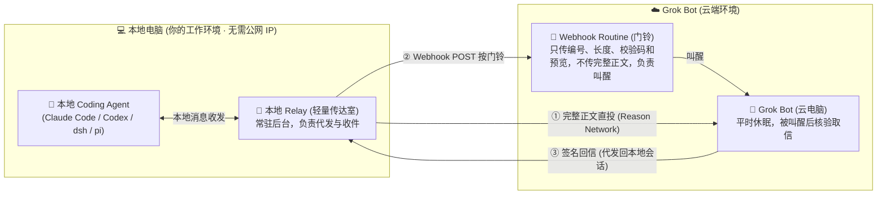
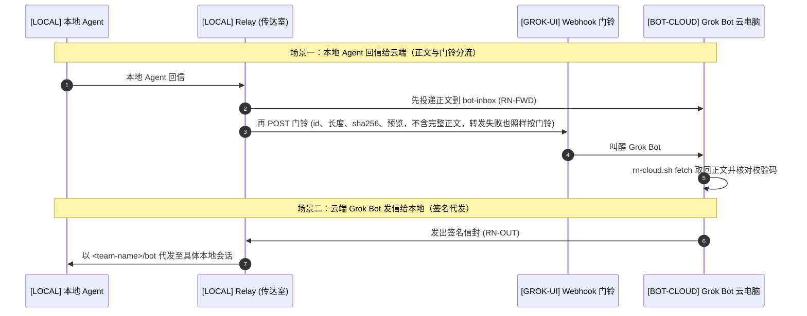

# agent-mesh

[English](README.md) | **简体中文**

把你电脑上的 Claude Code、Codex、pi、dsh 会话和云端的 Grok Bot 放进同一个 [Reason Network](https://github.com/reason-machines/reason-network) 私有团队。两边可以多轮对话，任何一方都能主动发起，谁回了信，对方都会被叫醒。

| | |
|---|---|
| **版本** | agent-mesh **v0.5.0** · [更新日志](CHANGELOG.zh-CN.md) · [版本文件](VERSION)。运行 `./install.sh --version` 可离线查询；依赖的 Reason Network 使用独立版本号。 |
| **支持平台** | 本地：设计上不绑定系统（引擎有 macOS / Linux / Windows 版本，relay 为纯 Python），但目前只有 macOS 提供一键安装并经过验证 · Python 3.9+ |
| **网络要求** | 本地无需公网 IP、无需自建服务器、无需端口映射 |
| **不需要** | Reason 账号、Docker 或 Node |
| **许可证** | MIT |

> [!TIP]
> 安装可以交给 agent 代劳：把本仓库的链接发给 Claude Code 或 Codex，说一句「读 [AGENT-INSTALL.zh-CN.md](AGENT-INSTALL.zh-CN.md)，照着装」。

**目录：**[架构概览](#架构概览) · [解决什么问题](#解决什么问题) · [核心亮点](#核心亮点) · [执行位置标识](#执行位置标识) · [怎么工作](#怎么工作) · [准备](#准备) · [安装](#安装) · [验证](#验证) · [各 agent 怎么收信](#各-agent-怎么收信) · [安全与隐私](#安全与隐私) · [常见问题](#常见问题) · [卸载](#卸载) · [文档与语言](#文档与语言) · [附录：消息格式](#附录消息格式)

## 架构概览



## 解决什么问题

- **找得到人（保留长会话上下文）**：给云端写个脚本跑 `claude -p "..."` 确实能执行单次任务，但它**每次都会拉起一个全新、空白的进程**。如果你本地终端里已经开着一个会话，项目背景、上下文和改动记录都在里面，`claude -p` 根本碰不到它。agent-mesh 能精确联系到正在干活的那个具体会话，把上下文留住。
- **不用傻等（双向门铃唤醒）**：复杂任务中间往往要提问、要修改、过会儿还要接着聊。没有唤醒机制时，云端发完信必须一直挂起等待，或者写脚本每隔几秒轮询查进度；连上 agent-mesh 后，发完消息就可以直接休眠，对方有了结果一回信，像“按门铃”一样叫醒这边（relay 默认两次叫醒至少间隔 20 秒、每小时最多 20 次；本地会话能否被叫醒见[各 agent 怎么收信](#各-agent-怎么收信)），两端都不耗费无谓的算力和挂机额度。
- **免公网暴露（无服务器、无公网 IP）**：底层基于 Reason Network 连接，消息可能经过 iroh 公共中继；上游将消息内容描述为加密传输，本项目未独立审计。本地电脑不开入站端口，只要能连上 iroh 中继，在家庭或公司局域网内都能收发，不需要自建服务器或中转服务；如果用 VPN 或代理，需要给 `iroh.link` 放行，见[常见问题](#常见问题)。
- **守住权限（通道不越权）**：通道只负责传递文字消息，**不额外授予任何本机执行特权**。本地 agent 收到消息后，该找你确认的危险操作依然会找你确认，前提是本地 agent 没开自动批准：开了 Claude Code 的 `--dangerously-skip-permissions`、Codex 的 `--yolo` 之类模式的会话，收到的文字就等于命令。另外，云端 Grok Bot 是这条通道的信任根，它如果被读到的内容诱导，也能发出签名有效的消息，详见[安全与隐私](#安全与隐私)。
- **什么时候不需要它**：如果任务在 Grok Bot 的云电脑上就能完全搞定（比如纯跑脚本、做调研、写独立文件），直接让它在云电脑上装各家 CLI 就够了，用不上本项目。

## 核心亮点

- 📦 **免搬家本地代码与环境**：本地已积累了大量代码、文档、依赖环境和会话记录，不需要为了借助云端能力把整个项目打包备份到云电脑上，直接在原地接入。
- ⚡ **省额度、不空转**：云端任务派发完立刻休眠，本地改完直接回信唤醒。两端都不用轮询空转（本地只有一个长轮询等信的轻量 relay），既不白白消耗 Grok 的高级调用额度，也能充分利用你本地已有的各家 Agent 订阅。
- 🤝 **多会话团队级协同**：不局限于单对单。你可以在本地同时打开多个不同职责的终端会话（如一个负责代码重构，一个负责文档核对，一个负责运行日志），云端可同时与多个会话保持联系，甚至支持会话之间就分歧交叉核实后再向云端回报。
- 🔒 **无需自建中转，权限边界清晰**：基于 Reason Network 组网，不需要自建或租用服务器（消息可能经过 iroh 公共中继）；通道只传达任务对话，不额外授予执行权限，本地能执行什么仍由 agent 自己的审批设置决定。

## 执行位置标识

本指南、安装手册和提示词统一使用以下标识。标识是操作说明，不要输入终端。

| 标识 | 指哪一端 | 在这里做什么 |
|---|---|---|
| `[LOCAL]` | 用户本地电脑（默认机器名为 `mac`） | 本地 coding agent、Reason Network 引擎、relay；运行 `install.sh`、`check.sh`、`uninstall.sh` |
| `[BOT-CLOUD]` | Grok Bot 的云电脑，机器名为 `cloud` | Grok Bot 运行 `/workspace/agent-mesh/box/rn-cloud*.sh`，保存云端状态和收件正文 |
| `[GROK-UI]` | 用户打开的 Grok Bot 界面 | 创建或暂停 routine、粘贴提示词、批准 CopyToBox；这里的操作不是终端命令 |

两台电脑各有一份仓库，文件不会自动同步。`[LOCAL]` 的 `~` 是本地电脑的 home 目录；`[BOT-CLOUD]` 的 `/workspace/agent-mesh/` 是 Bot 云电脑的目录。下文未另行标注的终端命令和 `~/…` 路径均属于 `[LOCAL]`。

## 怎么工作

一共三个角色：

| 角色 | 在线情况 | 做什么 |
|---|---|---|
| `[LOCAL]` 用户本地电脑 | 一直开着 | 运行 Reason Network 引擎和 relay。relay 用 `<team-name>/bot` 这个名字收信，所以在本地 agent 看来，它就是 Grok Bot。地址中的 `bot` 代表在本地电脑上收信的 relay，不是 Bot 云电脑。`bot` 是默认的 [Bot 地址名](#grok-bot-与团队名)。 |
| `[BOT-CLOUD]` Bot 云电脑 | 会睡 | 不留任何常驻进程，只在被叫醒的那一轮里临时启动引擎。它用 `<team-name>/bot-cloud` 发信，用 `<team-name>/bot-inbox` 收正文（Bot 地址名改为 `<name>` 时是 `<name>-cloud` 和 `<name>-inbox`），机器名是 `cloud`。 |
| `[GROK-UI]` routine | 由 webhook 叫醒 | 在 Grok Bot 界面创建的 webhook 任务，醒来后由 Bot 在 `[BOT-CLOUD]` 执行提示词。`[LOCAL]` 的 relay 向这个 webhook 发一次 POST，Grok Bot 就会醒来。 |



背后有五个设计决定：

1. **谁一直开着，谁就是中心。** 云端发出的每一封信都交给本地电脑代发，所以本机会话的回信总是落回本地电脑，而不是落到一台可能已经睡着的云电脑上。
2. **webhook 只当门铃，不当快递。** 原部署中观察到 Grok Bot 醒来时只保留 webhook body 的前 4000 字左右，所以正文不走 webhook，而是通过 Reason Network 投进云端收件箱；webhook 携带消息编号、长度、校验码和可选预览。routine 醒来后按编号取回正文、核对无误再处理。在引擎字节限制内，一条 10000 字的消息也只需要叫醒一次。
3. **两端都能补回丢失的信。** relay 为每条转发过的正文保留 7 天副本。云端 `fetch` 取不到正文时，会自动发出一条带签名的重投请求，relay 按副本重发，每条消息最多重发 2 次。第一次转发就失败的消息，也靠这条路补回来。云端还会给 relay 发带签名的回执（RN-GOT），说明哪些消息已落盘、哪些已处理；带 `reply_to` 的回信也算已处理。消息在 relay 上一直记为待办，直到确认处理完。门铃送达后 `GOT_TIMEOUT_SECONDS`（默认 15 分钟）仍没有落盘回执，relay 重发正文并补按门铃；已落盘但 `GOT_DONE_SECONDS`（默认 2 小时）后仍未处理，只补按门铃，等上一轮的领取过期后由云端重新交出。每条消息最多补按 `GOT_MAX_RERINGS`（2）次，不占重投次数；之后 relay 给 Grok Bot 发一条点名这条消息的提醒，Bot 确认之前会重复发送。`GOT_TIMEOUT_SECONDS=0` 对新来信关闭补按。已知限制：
   - 云端停发回执（云端脚本是旧版或设了 `RN_GOT=0`）时，relay 多补按一次后察觉，发一条提醒，并在收到下一条回执之前不再盯新来信。这期间，某一轮领取了新来信、还没处理就中断的情况，只能靠孤儿扫描或发件人重发补回。当时已有的待办仍会按期补按，直到处理完或逐条提醒。
   - 回执关闭期间，只有回信能证明消息已处理，只记了 `done` 的消息会以一条提醒结束：属于误报，不丢信。
   - 一条提醒送达 `GOT_MAX_RERINGS + 1` 次都没有被确认时删除，只留在 relay 日志里（`ALERT` 行）。
   - 待发提醒超过 200 条时只推送条数，逐条内容在 relay 日志里。
   - 补按次数用尽后放弃并逐条提醒，不会无限重试。
4. **一条消息只交给一轮处理，中断了也不悄悄重做。** 两次唤醒可能重叠，webhook 重试也可能为同一个 id 按两次门铃。`fetch` 交出的每条正文都会被领取一小时（`RN_CLAIM_LEASE`），重叠的另一轮拿到 `claimed` 就跳过；处理完的消息报告 `handled`。Bot 动手之前先运行 `rn-cloud.sh working <id>`，`rn-cloud.sh send` 在交给引擎之前记下"开始回复"。一轮在这两步之后中断、没有记完成的，之后的轮次报告 `uncertain`：Bot 查 thread 笔记或问用户，不会自己再做一次。每次 `fetch` 还会交出最近 7 天内没有门铃要过、也没人处理的已核对正文，例如门铃丢失的信（`"orphan": true`；天数由 `RN_ORPHAN_DAYS` 设置，`RN_ORPHANS=0` 关闭）。这不保证"恰好一次"：在 `working` 之前中断的消息，领取过期后会被再次交出；在那之后中断的，等用户决定。
5. **所有跨端消息都签名。** 同一个团队里的任何会话都可以用别人的名字发信，所以 relay 代发的信封、转发的正文和重投请求都带 HMAC 签名；信封和重投请求还有 15 分钟时效并防重放。密钥只有两份，本地电脑和云电脑各一份。

## 准备

### `[LOCAL]` 本地电脑

- **系统与运行环境**：设计上不绑定系统，引擎有 macOS / Linux / Windows 版本，relay 为纯 Python。但目前只有 macOS（Apple Silicon 或 Intel）有一键安装脚本 `./install.sh` 并经过验证，需要已登录桌面的普通用户；不要用 `sudo`，纯 SSH/无桌面登录环境不在本流程支持范围内。Linux 和 Windows 还没有安装支持，也未经验证；思路上可以用 systemd 或 Task Scheduler 代替 macOS 的登录服务，欢迎社区实测并贡献安装支持。
- **Git 与 Python 3.9+**（含 `ssl`、`sqlite3` 标准库模块）。用下面的命令检查：

  ```bash
  git --version
  python3 -c 'import sys, ssl, sqlite3; print(sys.version)'
  ```

  缺少 Git 或 Python 时可先运行 `xcode-select --install`，完成后重新检查，Python 版本仍不足则另装符合要求的 Python 并放入 PATH。脚本也会检查 `curl`、`tar`、`shasum`、`openssl`、`launchctl`、`plutil`；缺少时按报错补齐。无需单独安装 Node 或 pip 包。
- **至少一个 coding agent**：至少先安装并登录一个要接入的 Claude Code、Codex、pi 或 DeepSeek Harness，确认它能独立正常工作；本项目不负责安装这些 agent、配置模型账号或订阅。接入哪些工具以 `reason-network setup --dry-run` 在这台电脑上打印的计划为准，不沿用作者电脑的配置。
- **`~/.local/bin` 在 PATH 里**：当前 Bash/zsh 可运行 `export PATH="$HOME/.local/bin:$PATH"`；需要持久生效时，zsh 写入 `~/.zshrc`，Bash 按实际启动方式写入 `~/.bash_profile` 或 `~/.bashrc`，fish 使用 `fish_add_path "$HOME/.local/bin"`。不要一律修改 `~/.zshrc`。relay 服务会记录安装时检测到的 Python 绝对路径；如果以后移动或卸载该 Python，需要修复 Python 后重新运行安装器来更新服务。
- **已有的 Reason Network**：安装前先检查。本流程使用 `~/.local/bin/reason-network`、默认状态目录 `~/.reason/network`，固定 v0.10.7。其他 PATH 安装、不同版本或自定义 `REASON_NETWORK_HOME` 会导致安装器停止，请先评估已有部署，避免覆盖。已有同名 person 的团队可复用；不同 person 不能直接改名。按 `identity` 或 `all` 级别卸载会移除这套默认引擎的状态和接入（`all` 级别连引擎一起删除），可能影响已有用途，不能把它当作通用排错步骤。
- **保持唤醒**：本地电脑在协作期间需要一直开着、不睡眠：macOS 在系统设置里打开「接通电源时防止自动进入睡眠」，或者开一个终端跑 `caffeinate`。注意合上笔记本盖子整套就会停。

### `[BOT-CLOUD]` Bot 云电脑

- 需要 Linux x86_64 或 ARM64、Bash、Git、Python 3.9+（含 `ssl`、`sqlite3`）、`curl`、`tar`、`sha256sum`，以及可写且持久的 `/workspace/agent-mesh/`。
- 缺少工具时由 Bot 按云电脑实际系统的包管理方式准备；需要权限时向用户说明，不要改在本地电脑上安装。云端脚本会在下载前检查系统、CPU 和运行依赖；准备目录和 Git 的检查见云端提示词。

### Grok Bot 与团队名

- 你的 Grok Bot 能创建由 webhook 触发的 routine，并且能用 CopyToBox 读取你电脑上的文件。
- 想好一个团队名，它同时也是你在团队里的名字：1 到 40 个字符，只能用 ASCII 小写字母、数字和 `-`，首尾不能是 `-`，别用真名。团队建好后名字不能改，只能删掉重建。
- 团队名和机器名里的 `-` 不能连用：引擎会把连续的 `-` 合并，`a--b` 会变成 `a-b`，所以安装器拒绝这类名字。
- 可以另选 Bot 地址名。relay 用 `<team-name>/<name>` 收信，云端用 `<name>-cloud` 和 `<name>-inbox`，默认是 `bot`。规则：1 到 34 个字符，ASCII 小写字母和数字，分段之间用单个 `-` 连接（首尾不能是 `-`，不能连用），不能是 `terminal` 或 `terminal-<n>`。别用真名。名字以后不能改，安装没完成时也不行：排队的消息、routine 提示词和云端设置都用这个名字。要换名字只能按 `identity` 或 `all` 级别卸载后重新安装。

### 网络

- `[LOCAL]` 和 `[BOT-CLOUD]` 都需能通过 HTTPS 访问 GitHub 仓库及 release 下载，并能连接 iroh 中继。
- 默认使用公开仓库的 HTTPS 地址，无需 GitHub 账号或 SSH 密钥；维护公开 fork 时可在每次生成云端提示词的安装命令中传 `--repo-url https://…`，该地址必须允许云电脑无凭据读取。代码可克隆到本地任意目录；Bot 云电脑仍须使用 `/workspace/agent-mesh/`，因为提示词引用该固定路径。
- 如果你用 VPN 或代理软件，先确认它没有拦住 Reason Network 联机要用的 `*.iroh.link`。用下面这条命令测，返回 200 才算通：

  ```bash
  curl -sS -o /dev/null -m 10 -w 'code=%{http_code}\n' https://aps1-1.relay.n0.iroh.link/
  ```

  不通的话，给 `iroh.link` 整个域名加一条直连规则，并把它排除出 HTTPS 解密，具体排查步骤见[常见问题](#常见问题)。这条探测只检查一个中继端点，不代表已经验证全球各地的可用性。

## 安装

**`[LOCAL]` 用户或本地安装 agent 执行。**先把团队名占位符换成实际值：

```bash
git clone https://github.com/xiaozhenliu/agent-mesh.git ~/agent-mesh
cd ~/agent-mesh
./install.sh --name <team-name> --lang zh-CN
```

想用 `bot` 以外的 Bot 地址名，在第一次运行 `install.sh` 时加上 `--relay-name <name>`。之后的运行（`--webhook`、`--cloud-prompt`、`update.sh`）从已有安装中读取名字，给出不同的 `--relay-name` 会被拒绝。名字已被团队里的会话占用时，安装器在接入任何 agent 之前停止；启动 relay 之后，它核对引擎实际注册的地址正是 `<team-name>/<name>`。

目标目录已存在时先核对它是不是同一仓库、有无未提交改动，不要覆盖或盲目 pull。以上克隆的是公开发行仓库。云端默认克隆同一个公开发行仓库，其根目录必须包含 `box/rn-cloud-setup.sh`；安装器不会读取本地 origin 来推断云端仓库地址。

这一条命令会做完本地电脑（Mac）这边的全部工作，中途会停两次等你动手：

1. 安装 Reason Network v0.10.7（会校验 sha256），创建一个只有你一个人的私有团队，并关掉自动更新和局域网广播。
2. 显示 `reason-network setup --dry-run` 的计划，**等你确认后**再把本机 agent 接入团队。
3. `[LOCAL]` 生成签名密钥，并打印 routine 提示词。**用户在 `[GROK-UI]` 新建一个由 webhook 触发的 routine，把提示词贴进去**，再把面板给出的 Webhook URL 和 key 贴回 `[LOCAL]` 的终端。脚本随后写好本地配置，把 relay 装成 Mac 登录时自动启动的服务。
4. `[LOCAL]` 打印团队邀请链接和给 Grok Bot 的云端提示词。**用户在 `[GROK-UI]` 把这两段一起发给 Grok Bot**。Bot 在 `[BOT-CLOUD]` 克隆仓库、加入团队，然后用 CopyToBox 把密钥从 `[LOCAL]` 复制到 `[BOT-CLOUD]`；用户在 `[GROK-UI]` 批准这次复制。

最后，把已经开着的 Claude Code、Codex 会话关掉重开。Codex 第一次启动会询问，选 Trust all and continue。

### 提示词语言

每次运行安装器时，用 `--lang en` 或 `--lang zh-CN` 选择生成的提示词语言。默认英文；环境变量 `AGENT_MESH_LANG` 可以设置当前 shell 的默认值，`--lang` 优先。终端诊断、配置项和协议字段保持英文，agent 按用户偏好的语言交流。多语言支持不改变操作系统支持范围和网络要求。

### 可选

- **dsh 自动唤醒**：运行 `dsh/mac-install.sh <team-name>`，详见[插件指南](dsh/README.zh-CN.md)。
- **回信约定**：把[中文模板](templates/AGENTS.reason-network.zh-CN.md)或[英文模板](templates/AGENTS.reason-network.md)整段追加到你常用仓库的 `AGENTS.md` 里（Claude Code 还需要在 `CLAUDE.md` 里写一行 `@AGENTS.md`）。本机 agent 默认会按给人看的完整报告来写回信；这份模板要求经这条通道发出的消息结论先行、四项必填，细节留在会话里不发。

## 验证

执行位置：自检、发送测试消息和查看 relay 日志在 `[LOCAL]`；Grok Bot 的 `who` 和 `fetch` 使用 `[BOT-CLOUD]` 的 `/workspace/agent-mesh/box/rn-cloud.sh`。

1. **只读自检**：每一条 FAIL 后面都写了怎么修。

   ```bash
   ./check.sh
   ```

2. **测试消息**：在终端给 Bot 地址发一条消息（下面用的是 `bot`；用了 `--relay-name` 时换成你的名字），再另开一个窗口等回复：

   ```bash
   reason-network send <team-name>/bot "测试 1"
   reason-network listen --as terminal --wait 600   # 另开一个窗口运行
   ```

   relay 日志（`~/Library/Logs/agent-relay.log`）里应出现 `forwarded` 和 `POST … code=200` 两行。

3. **叫醒会话**：让 Grok Bot 先运行 `who`，再给某个 Claude Code 会话发一句话。即使那个会话正空闲，也会被叫醒；它回复之后，Grok Bot 会再次被叫醒。
4. **测长消息**：从本机发一条 10000 字的消息。Grok Bot 应该只被叫醒一次，并报告 `fetch` 结果为 complete、长度和 sha256 都一致。完整签名消息须在 relay 的 60 KiB 转发上限内；UTF-8 字节数随文本内容而变。

## 各 agent 怎么收信

`reason-network who` 输出的最后一列是每个会话的收信方式：

| 方式 | 表现 | 适用的 agent |
|---|---|---|
| **push** | 空闲时也会被叫醒。 | Claude Code 是直接把消息写进会话；Codex 是通过 `codex queue` 把消息排进已打开的会话；pi 是靠扩展每 5 秒轮询一次。 |
| **turn** | 要等到下一次工具调用或这一轮结束才看到。 | dsh 装了插件后显示为 `turn`，但实际上它空闲时约 5 秒内就会自动开一轮来处理。 |
| **pull** | 不会被叫醒。 | 没装插件的 dsh 属于这一档，得让它自己去查收件箱。 |

会话一关掉就会从名单里消失，这期间发给它的信会留在收件箱里；重开之后，你需要对它说一句「看下收件箱」它才会读。所以想让消息马上被处理，就得一直开着一个会话。

## 安全与隐私

### 信任根是 Grok Bot

- 签名密钥有两份，其中一份在 `[BOT-CLOUD]`。签名防的是拿不到密钥的会话冒名发信，防不了被操纵的 Bot：Grok Bot 如果被它读到的网页或文档诱导（提示词注入），照样能生成签名有效的 RN-OUT 信封，以 `<team-name>/bot` 的名义给你本地的任何会话发信。所以本地 agent 要把 Bot 的来信当作外部输入，而不是你本人的指令。
- 同一个 macOS 用户下运行的任何 agent 都读得到 `~/.config/agent-relay/` 里的密钥和 webhook key，项目文件夹并不是权限边界。

### 本地 agent 的权限

- 这条桥接通道只给本地 agent 发文字，不直接授予 Grok Bot 文件访问权，也不绕过本地 agent 的权限。要不要执行、怎么执行由接收会话决定。Mac 不开任何入站端口。Grok Bot App 里的「本机永远批准」和「通过本机网络连接」两个开关都不用开。
- 上一条成立的前提是本机 agent 没开自动批准。即使没开，会话的沙盒和权限设置本来就允许的操作（例如读文件、在工作目录里改文件）也不会再问你，只有需要人工批准的操作才会等你。下面这些模式会让更多操作不问就做，收到的文字就等于命令，这种会话只能在沙盒文件夹或隔离环境里开：
  - Claude Code：`--dangerously-skip-permissions`，或 `--permission-mode bypassPermissions`。
  - Codex：`--yolo`（即 `--dangerously-bypass-approvals-and-sandbox`，不问也不受沙盒限制）；`--sandbox danger-full-access`（不受沙盒限制）；`--ask-for-approval never`（从不询问：沙盒允许的直接执行，不允许的直接失败）；以及交给自动审查代为批准的 `--approve-for-me`。
- **无人值守的唤醒**：push 档的会话在你不在电脑前时也会被叫醒。Reason Network v0.10.7 用 `codex queue --thread <id> --message` 唤醒 Codex：消息排进那个已经打开的会话，作为新的一轮执行，沿用这个会话启动时的审批和沙盒设置，不附加任何放宽权限的参数。实测（Codex 0.166.0，`--ask-for-approval on-request --sandbox read-only`，这个配置下写文件需要人工批准）：被叫醒的这一轮要写文件时，审批框出现在该会话的终端里等待，没人确认就不执行，等了约一分钟也没有自动批准。所以没开自动批准时，需要人工批准的操作会停在审批处等你回来，沙盒和权限设置已经允许的操作照常执行；开了自动批准时，没有人拦。Claude Code 的消息直接写进已打开的会话，本项目没有单独实测它在无人值守时的审批表现。
- 如果你不想让云端来信直接投递，可以在 `~/.reason/network/config.toml` 里设置 `[inbound] default = "hold"`，这样每条来信都要你 `reason-network approve` 之后才会投递。

### 正文以明文保存

消息正文会以明文留在下面这些地方，所以**不要通过这条通道发送密钥、密码、token 等机密**：

| 位置 | 内容 | 保留多久 |
|---|---|---|
| `[LOCAL]` `~/.reason/network/network.db`、`[BOT-CLOUD]` `/workspace/agent-mesh/box/state/network.db` | 两个引擎收到的消息，读过也保留 | 引擎不自动删除 |
| `[LOCAL]` `~/Library/Application Support/agent-relay/fwd-copies/` | relay 为补寄保留的正文副本 | 超过 `FWD_COPY_DAYS`（默认 7 天）就不再补寄，但要等之后有消息经过 relay 才删除（最多每小时检查一次），relay 空闲时会一直留着 |
| `[BOT-CLOUD]` `/workspace/agent-mesh/inbox/<id>/full.txt` | `fetch` 取回的正文 | 不自动删除 |
| `[BOT-CLOUD]` `/workspace/agent-mesh/threads/*.md` | routine 每轮追加的会话摘要 | 不自动删除 |
| `[LOCAL]` `~/Library/Application Support/agent-relay/state.json` | 等待送往 webhook 的门铃，每条带正文预览 | webhook 送达后移出；webhook 一直失败时留着，超过 `MAX_SPOOL` 条才丢弃最旧的。改 `DOORBELL_PREVIEW_CHARS` 只影响之后的门铃，修好 webhook 让积压送出即可清空 |
| routine 的 webhook | 门铃里正文的前 200 字预览 | 保存多久取决于 Grok Bot；`DOORBELL_PREVIEW_CHARS=0` 可关闭预览 |

relay 日志只记消息 id、长度和校验码，不记正文。`FWD_COPY_DAYS` 和 `DOORBELL_PREVIEW_CHARS` 都在 `~/.config/agent-relay/env` 里设置，改完运行 `launchctl kickstart -k "gui/$(id -u)/com.local.agent-relay"` 重启 relay 才生效。需要清理时：

- `[LOCAL]` 运行 `./install.sh --purge-copies`，删除 relay 保留的全部副本。之后这些消息的补寄请求会得到 `no-copy`，只能请发送方重发。
- `[BOT-CLOUD]` 在 `[GROK-UI]` 让 Grok Bot 运行 `/workspace/agent-mesh/box/rn-cloud.sh purge <天数>`。它先停掉云端引擎，再删除早于该天数的已收消息（云端 `network.db`）、`inbox/<id>/`、`inbox/_stray/` 里的误投记录和 `threads/*.md`；`0` 表示全部删除。thread 笔记是 routine 了解上文的依据，删掉后 Bot 不再记得之前的对话。云端仓库要先更新到包含这个命令的版本。
- 本地 `network.db` 由引擎管理，本项目不提供部分清理；`./uninstall.sh --level identity` 和 `--level all` 会删除整个 `~/.reason/network`。

### 团队成员

- 装好后，以及之后定期，运行 `reason-network team`，确认只有你的本地电脑和 `cloud` 两台机器。`./check.sh` 也会检查这一项，出现其他成员时报 FAIL。发现陌生的人或机器，用 `reason-network remove <person>/<machine>` 移除，再按下文更换签名密钥。
- 团队成员能看到每个会话的名字、所在目录的最后一级、仓库名和分支。所以别在 `~` 下直接开 agent。团队邀请链接只在终端里用，不要在浏览器里打开。

### 更换密钥

- **签名密钥**：在 `[LOCAL]` 运行 `./install.sh --rotate-key --lang zh-CN`。它生成新的 `outbound.key`，重启 relay，然后打印 CopyToBox 步骤：在 `[GROK-UI]` 让 Grok Bot 用 CopyToBox 把新密钥从 `[LOCAL]` 的 `~/.config/agent-relay/outbound.key` 复制到 `[BOT-CLOUD]` 的 `/workspace/agent-mesh/box/outbound.key`，由你批准复制，再在云端执行 `chmod 600`。云端换上新密钥之前，两个方向的签名校验都会失败。换钥前已经转发、云端还没取回的消息仍是旧密钥签名，换钥后 `fetch` 报 `mismatch`（签名不符），不会自动补寄，每次扫描都会再报。旧密钥没有泄露时，先让 Bot 取完待取消息再换钥；否则请发送方重发，留下的旧消息用 `rn-cloud.sh purge` 清理。
- **Webhook URL 或 key**：在 `[GROK-UI]` 重新生成该 routine 的 key；界面不支持时，删除 routine 后重建。然后在 `[LOCAL]` 运行 `./install.sh --webhook --lang zh-CN`，填入新值。
- 完整的泄露处理步骤见[安全策略](SECURITY.zh-CN.md#怀疑凭据泄露时)。

### 网络与用量

- 引擎开源、固定版本，以无账号模式在本机运行，无账号模式下不向 Reason 官方发送数据。消息可能经过 iroh 公共中继，上游将消息内容描述为加密传输；本项目没有独立审计这些中继。用 `reason-network relay <URL>` 可以换成自建中继。
- 每叫醒一次 Grok Bot 就消耗一次它的用量。relay 默认每小时最多叫醒 20 次。
- 发现安全问题请按[安全策略](SECURITY.zh-CN.md)私下报告，不要公开提 Issue。

## 常见问题

- **联不上 iroh 中继**（「准备」里那条 curl 不返回 200，或 install.sh 停在 cannot reach the iroh relay）：几乎都是 VPN 或代理软件造成的，按下面的顺序排查。
  1. 先把 VPN 或代理整个关掉再测一次。能通，就确定是它拦的；还是不通，那是网络本身的问题。
  2. 会拦的设置有两类。一类是接管整台电脑流量的模式，各家客户端叫法不同，常见的有 TUN、虚拟网卡、增强模式、全局模式、系统代理；另一类是 HTTPS 解密（也叫 MITM），它会替换中继的证书，引擎会连不上。
  3. 修法：给 `iroh.link` 这个域名连同所有子域加一条直连规则（规则里通常叫 DIRECT、直连或 bypass），再把这个域名排除出 HTTPS 解密。引擎可能连到 `*.iroh.link` 下不止一台中继，所以要按域名放行，不要只放行 aps1-1 这一台。
  4. 验证：curl 返回 200，并且下面这条命令显示的签发者是公共 CA（目前是 Let's Encrypt）。如果显示的是你代理软件自己的 CA，说明解密还没排除掉。关闭代理后仍失败，则排查 DNS、防火墙和网络本身。

     ```bash
     curl -sv -o /dev/null https://aps1-1.relay.n0.iroh.link/ 2>&1 | grep issuer
     ```

- **云电脑加入时报 couldn't reach the machine that made the invite**：通常是 Mac 这边的 VPN 或代理又把 `*.iroh.link` 拦住了。按上一条修好，在 Mac 上运行 `reason-network stop`，然后让 Grok Bot 用同一个邀请链接重试。
- **who 里看不到某个会话**：在 `setup` 之前就开着的会话不会登记，关掉重开即可。Codex 还要先跑完一轮才会出现。
- **fetch 报 missing**：先看结果里的 `refwd` 字段。`ack=resent` 表示 relay 已经重发，过一分钟再 `fetch` 一次；`no-copy`、`limit`、`failed` 或 `skipped` 表示补不回来了，请发送方重发；完全没有 `refwd` 字段，说明 Mac 没连上。
- **relay 日志出现 `webhook POST failed: 30x`**：`WEBHOOK_URL` 不是最终地址，relay 不跟随重定向。在 `[GROK-UI]` 的 routine 里重新复制 webhook URL，然后在 `[LOCAL]` 运行 `./install.sh --webhook --lang zh-CN`。
- **消息被拒收 refused**：这是引擎的防循环机制，同一对 agent 之间 10 分钟内超过 12 条就会拒收。relay 自己的转发是以 terminal 身份发出的，不受这个限制。
- **relay 的名字不是由同一个名字派生的，或 relay 注册成了别的名字**：`install.sh`、`update.sh` 或 `check.sh` 会这样报告。`~/.config/agent-relay/env` 里的三个名字（`LISTEN_NAME`、`CLOUD_NAME`、`INBOX_NAME`）必须是 `<name>`、`<name>-cloud` 和 `<name>-inbox`，由安装器写入，不要手改。注册成 `<team-name>/<name>-2` 这样的名字，说明本机或团队里已有会话占用了这个名字。即使对方离开，引擎也会让 relay 沿用这个名字，检查会一直失败；只能连同身份一起卸载（[`identity` 级别](#卸载身份或全部)），再换一个 `--relay-name` 重新安装。
- **`rn-cloud.sh` 报 `box/relay is damaged`，或 `box/relay` 被删后回复一直送不到**：`/workspace/agent-mesh/box/relay` 保存 `[BOT-CLOUD]` 上的 Bot 地址名，没有这个文件时云端按 `bot` 处理。在 `[LOCAL]` 运行 `./install.sh --cloud-prompt --lang zh-CN`，把打印出的提示词交给 Grok Bot，其中带有完整的邀请链接和你的名字；`rn-cloud-setup.sh` 会认出云端已在团队里，跳过加入，重新写入这个文件（损坏的文件另存为 `box/relay.damaged-<时间>`）。名字不是 `bot` 时，只有云端引擎显示它注册过 `<name>-inbox` 或 `<name>-cloud`，脚本才会写入；否则只能按 `identity` 或 `all` 级别卸载后重新安装。之后用 `cat /workspace/agent-mesh/box/relay` 和一次真实收发核对。
- **已加入团队的云电脑重跑 `rn-cloud-setup.sh` 时停在 `join`**：改用完整的邀请链接（含 `tincan1…` 的那条，`./install.sh --cloud-prompt` 打印的就是）。只有短邀请码时，脚本无法确认云端在同一个团队里。
- **正文里的 `<` 变成了 `[`**：0.10.7 版的 `listen` 会对部分标签做防伪改写，字符数不变。重投是按 relay 保存的副本发的，保持原文。

## 卸载

先更新当前目录（`git pull`），确保 `./uninstall.sh` 是这里介绍的卸载器；v0.4.1 及更早版本的卸载脚本没有分级，不带 `--all` 也会删除 relay 配置和签名密钥，并且不处理云端。

`./uninstall.sh` 在 `[LOCAL]` 运行。不带参数时只列出已安装的内容，不删除任何东西：版本、团队名和本机、云端成员、Bot 地址名、relay 及其队列、dsh 插件、团队里的其他成员，以及不是它安装的部署。`./uninstall.sh --plan` 还会列出每个级别要删除和保留的内容；`--plan --level <级别>` 只看一个级别。两者都不提问，也不改动任何东西。在终端里运行 `./uninstall.sh` 时，列完后会让你选择级别。

| 级别 | 删除 | 保留 |
|---|---|---|
| `--level program` | relay 服务和 plist、relay 程序、它的临时文件和 `rollback/`。 | 其余全部：两台电脑上的团队身份、`~/.config/agent-relay`（webhook 配置和签名密钥）、队列、日志和 Reason Network。 |
| `--level identity` | 另外删除部署记录、`~/.config/agent-relay`、relay 状态（队列、防重放记录、消息副本）和 dsh 插件块；本机退出团队，执行 `setup --remove`，删除 `~/.reason/network`。Bot 退出团队，删除云端的身份、密钥和名字（`box/state`、`box/bin`、`box/person`、`box/relay`、`box/outbound.key`）。 | relay 日志、引擎二进制，以及云端的 `inbox/`、`threads/` 和 `/workspace/agent-mesh`。 |
| `--level all`（或 `--all`） | 另外删除 relay 日志、`~/.local/bin/reason-network`、dsh 插件的备份和日志；`[BOT-CLOUD]` 上另外删除 `inbox/`、`threads/` 和 `/workspace/agent-mesh`。 | 只保留下面列出的内容。 |

任何级别都不会动当前代码目录、shell 启动文件里的 PATH 行、追加到各项目里的回复约定、`[BOT-CLOUD]` 上的外部收件目录，以及 Bot 长期记忆里的内容；`all` 级别会把它们列出来。只运行 `dsh/mac-uninstall.sh` 只会卸载 dsh 插件，见[插件指南](dsh/README.zh-CN.md#卸载)。

### 卸载前检查

1. **`[LOCAL]` 是否还有别的用途共用 Reason Network。** `identity` 和 `all` 级别会退出团队、解除本机所有 agent 的 Reason Network 接入，并删除它的状态。这台电脑如果还用 Reason Network 做别的事，只用 `--level program`。
2. **不是它安装的部署。** 第二个 relay、另一个运行 `*_relay.py` 的登录服务，或手工装的旧布局，会列在 "foreign" 下，并且不会被改动。共用的身份删除后它们就会失效，所以 `identity` 和 `all` 级别会逐个停下，直到你输入 `I accept <编号>`；`--plan` 会把这一点显示为一行 `STOP unless you type I accept <编号>`。进程只显示 PID 和程序名，从不显示参数。
3. **`[BOT-CLOUD]` 上是否还有别的程序用 `/workspace/agent-mesh/box`。** 云端脚本会自己搜索 `/workspace`，对每个引用云端引擎状态或程序的文件、链接打印一行 `SHARED:`。只要还有这样的行，Bot 就不删除任何东西，除非你确认列出的内容都不再使用它们。
4. **还没送达的消息。** 卸载器会显示 relay 队列。`program` 级别为重装保留队列（仍是 `sending` 的条目会变成 `unknown`，不会重发）；更深的级别要你输入 `yes` 才放弃它们。在 `[BOT-CLOUD]` 上，提示词会让 Bot 先问你要不要再运行一次 `rn-cloud.sh fetch`。
5. **会让卸载停下的情况。** 卸载器在改动任何东西之前列出全部原因。任何级别遇到正在运行的 `./update.sh`、被手工改过的登录服务，或者已加载的 `com.local.agent-relay` 服务不是来自本 home 的 plist（它不会被停止），都会停下；`identity` 和 `all` 级别在团队名或 Bot 地址名在配置、团队列表和部署记录之间不一致，或者某个路径是符号链接、属于其他用户时也会停下。这些问题解决之前不会删除任何东西。

### 只卸载 relay

用于重装或换版本；团队、密钥和云端都保持原样。

1. `[GROK-UI]`：暂停 routine。
2. `[LOCAL]`：运行 `./uninstall.sh --level program`，输入 `y`。加 `--yes` 则不询问；这是唯一可以让 agent 代你运行的级别。
3. `[LOCAL]`：重装时先 `git pull`，再运行 `./install.sh --restart-relay`。它用相同的配置、签名密钥和 Bot 地址名重新安装当前目录的 relay，不需要再往 `[BOT-CLOUD]` 复制任何东西。然后恢复 routine。不要重新走完整安装。

### 卸载身份或全部

`identity` 和 `all` 级别只能在你自己的终端里运行；在别处运行时只显示计划，以状态码 3 退出。保持 Grok Bot 界面打开，其中一步在那里完成。

1. **`[LOCAL]` 运行 `./uninstall.sh --level identity` 或 `./uninstall.sh --level all`。** 它展示计划，要求你输入团队名（`identity`）或 `delete <团队名>`（`all`）。
2. **停止 relay**，并重新统计队列。
3. **云端这一步。** 先在 `[GROK-UI]` 暂停 routine，确认没有正在运行的轮次。然后把打印出的提示词作为一条消息发给 Grok Bot。提示词里带有云端脚本和它的 SHA-256 校验值；Bot 在 `[BOT-CLOUD]` 写入脚本、核对校验值、运行 `check`（不改动任何东西），然后报告一个 `PROOF:` 值。
   - 把 `PROOF` 值输入卸载器。只有云端持有这台 Mac 的签名密钥时才会一致，所以不会误删别的部署的云端。卸载器随后显示确认码；把它发给 Bot 并表示同意。Bot 运行 `apply <确认码>`：趁这台 Mac 还在线能收到通知时退出团队，再删除云端文件。Bot 报告 `DONE`（或 `KEPT`，见下文）后输入 `done`；报告 `INCOMPLETE` 时输入 `incomplete`，云端移出团队之前这次卸载一直记为未完成。
   - 输入 `prompt` 可以再显示一次提示词。Bot 打印 `PROOF: none`（云端已经没有签名密钥）时输入 `none`；之后 Bot 要等你在对话里确认这是你自己的部署，才运行 `apply-no-proof`。
   - `[BOT-CLOUD]` 上 `leave` 失败时，Bot 会给你看输出，经你同意才加上 `force`。`all` 级别下，Bot 先列出克隆目录里你自己的文件（`FILE:` 行）。Git 不能列全，或者某个本地分支、标签或 `HEAD` 上有远端分支都没有的提交时，它保留克隆目录并打印 `KEPT:`。云端引擎已经不在、身份文件却还在时，Bot 删除文件后报告 `INCOMPLETE`：云端没能退出团队，卸载器随后会提出在本机把它移出团队。
   - 云端没能完成（输入 `skip`）而它仍在团队里时，卸载器会提出在本机用 `reason-network remove <团队名>/cloud` 把它移出团队。它从不移除其他成员。
4. **dsh 插件**（如果装了）用 `dsh/mac-uninstall.sh --no-restore` 卸载。失败时卸载在动 Reason Network 之前停下。
5. **本机退出团队**，执行 `setup --remove` 并停止引擎。其他成员都离线时，没人能收到这次 `leave`；卸载器会要求你输入 `force`，之后需要他们在自己那边移除这台 Mac。然后删除本级别的文件。
6. **`[GROK-UI]` 删除 routine**，然后输入 `deleted`。只暂停的话，webhook 地址和 key 仍然有效，删除之后才失效。输入 `later` 时，这次卸载记为未完成。
7. 重开各个 agent 会话。

结果逐项列为 `done`、`absent`、`skipped` 或 `failed`，并列出还没完成的事项；只有本级别全部完成时退出状态才是 0。卸载可以重复运行：已完成的步骤显示 `absent` 或 `done`。`./uninstall.sh --cloud-prompt --level identity|all` 只重做云端这一步。

**已经运行过旧版 `./uninstall.sh --all` 时。** 旧版只清理 Mac 一侧，云端可能仍在团队里，密钥也仍然有效。运行 `./uninstall.sh --residual --level identity`（或 `--level all`）。它会询问团队名，并给出一段不带证明的云端提示词；Bot 在你确认后运行 `apply-no-proof`，团队里还有别人时它会停下。

### 确认已卸载干净

- `[LOCAL]`：`launchctl print gui/$(id -u)/com.local.agent-relay` 报错（服务不存在）。`identity` 级别之后，`~/.local/lib/agent-mesh`、`~/.config/agent-relay`、`~/Library/Application Support/agent-relay` 和 `~/.reason/network` 都不存在；`all` 级别之后，`~/.local/bin/reason-network` 和 `~/Library/Logs` 里的 `agent-relay` 日志也不存在。其余情况运行 `./uninstall.sh` 查看。
- `[BOT-CLOUD]`：`identity` 级别之后，`/workspace/agent-mesh` 下的 `box/state`、`box/bin`、`box/person`、`box/relay` 和 `box/outbound.key` 都已删除；`all` 级别之后，`/workspace/agent-mesh` 不存在，除非 Bot 报告了 `KEPT`。
- `[GROK-UI]`：routine 列表里已经没有这个 routine。

## 升级

本机仓库、Bot 云电脑上的仓库和保存的 routine 提示词各自独立，修改 Mac 文件不会自动更新另外两处；已追加到项目 `AGENTS.md` 的回复约定也要重新复制模板。每个版本需要更新哪些组件，见[更新日志](CHANGELOG.zh-CN.md)。

### 用 update.sh 升级

在 `[LOCAL]` 的仓库里运行：

```bash
./update.sh --lang <en|zh-CN>
```

它先执行 `git pull --ff-only`（加 `--no-pull` 跳过），再逐项与本机已部署的版本比较：

| 组件 | 比较方式 | 不一致时 |
|---|---|---|
| relay | 已安装的 `agent_relay.py` 和登录服务文件与当前仓库比较 | 确认一次后安装并重启（加 `--yes` 或不在终端运行时不确认）；新 relay 起不来时换回原来的版本 |
| dsh 插件 | 已安装 bridge 时，比较已安装的插件文件 | 只替换插件文件，`~/.dsh/cordis.patch.yml` 和你的 bridge 设置保持不变；之后退出并重开 dsh |
| 云端脚本 | `box/rn-cloud.sh`、`box/rn-fetch.py` 与上次确认的版本比较 | 引导步骤，见下文 |
| 云端初始化 | `box/rn-cloud-setup.sh` 与上次确认的版本比较 | 询问云端是否已按本版本完成初始化；需要迁移时，更新日志会写明 |
| routine 提示词 | 所选语言渲染出的提示词与上次确认的版本比较 | 引导步骤，见下文 |

上次确认的版本记录在 `~/.local/lib/agent-mesh/deployed.json`。只有 relay 或 dsh 插件变化时，更新可以无人值守：在终端运行时确认一次，`--yes` 可跳过；不在终端运行时不提问。云端脚本或 routine 提示词变化时需要在终端运行，脚本按"旧组件不会被唤醒"的顺序引导：停止 relay；请你在 `[GROK-UI]` 暂停 routine；打印一段让 Grok Bot 在 `[BOT-CLOUD]` 拉取当前提交的话，以及 Bot 回复中应出现的提交号和校验值；打印新的 routine 提示词供你粘贴；请你恢复 routine；最后启动 relay。云端步骤要求本地仓库已提交且与上游一致，保证云端拉到完全相同的文件。

- `./update.sh --plan` 只显示比较结果和将执行的步骤，不改动部署；不加 `--no-pull` 时仍可能先快进本地仓库。
- 退出码 3 表示需要在终端作答，部署未改动。
- 回答"否"、按 Ctrl-C 或某一步失败时，原先运行的 relay 会被重新启动；routine 仍处于暂停状态时会提醒你恢复。再次运行 `./update.sh` 从停下的步骤继续；已完成的步骤不会重做，除非期间版本又有变化。
- 更新还没有 Bot 地址名的旧安装：名字保持 `bot`，routine 提示词不变。云端设置脚本有改动，`update.sh` 会问一次云端是否已按这个版本设置；不需要迁移云端，直接回答"是"。用了其他 Bot 地址名的安装不能回退到没有 Bot 地址名的版本。
- 从 v0.3.0 或更早版本第一次更新：先自己运行一次 `git pull`，因为旧仓库里还没有 `update.sh`。没有部署记录时，云端脚本和提示词按"未知"处理，引导步骤会走一遍。
- 脚本看不到 routine 和云电脑，只能依据你的回答，以及 Grok Bot 报告的提交号和校验值。

### 手动升级

relay、云端脚本和 routine 提示词都有变化时，按下列顺序一起更新，保证部分组件仍是旧版本时不会有门铃发出：

1. 在 `[LOCAL]` 停止 relay：`launchctl bootout "gui/$(id -u)/com.local.agent-relay"`。此后到达 Mac 的消息留在本机引擎中未读，不会按门铃。
2. 在 `[GROK-UI]` 暂停 routine，等没有运行中的任务。
3. 让 Grok Bot 在 `[BOT-CLOUD]` 更新 `/workspace/agent-mesh`（在对话中直接让 Bot 执行，不经 routine），确认 `rn-cloud.sh` 用法里出现 `done`、`working` 和 `RN_GOT`。
4. 在 `[GROK-UI]` 替换保存的 routine 提示词并恢复 routine。此时 relay 仍停止，不会有门铃。
5. 在 `[LOCAL]` 更新仓库后运行 `./install.sh --restart-relay`，或重新运行完整安装：`./install.sh --name <team-name> --lang <en|zh-CN>`。已配置的 webhook 不会再次询问；安装器会复制新的 `agent_relay.py` 并启动 relay 服务，它先从 `network.db` 对账，再取回停机期间到达的消息。新 relay 起不来时，安装器会换回原来的版本。完整安装还会再次显示 agent 接入计划并要求确认。

relay 停止期间 Mac 收不到推送，消息留在本机引擎里。停机时间要短：云端签名超过 15 分钟才被 relay 转发的回复会因过期被拒绝，不再投递。若第 3、4 步失败，用 `launchctl bootstrap "gui/$(id -u)" ~/Library/LaunchAgents/com.local.agent-relay.plist` 重新启动旧 relay，即回到升级前状态。

日后要回退回执与补按时，按下列顺序操作，避免旧版 relay 收到回执：

1. 在 `[LOCAL]` 的 `~/.config/agent-relay/env` 里设 `GOT_TIMEOUT_SECONDS=0`，用 `launchctl kickstart -k "gui/$(id -u)/com.local.agent-relay"` 重启 relay，保持 routine 启用，等 `~/Library/Logs/agent-relay.log` 里出现 `pending: 0` 和 `alerts: 0`（webhook 能正常送达时，最长约 `GOT_DONE_SECONDS × (GOT_MAX_RERINGS + 1)`）。
2. 在 `[GROK-UI]` 暂停 routine，等没有运行中的任务。
3. 让 Grok Bot 在 `[BOT-CLOUD]` 把 `/workspace/agent-mesh` 回退到上一版，并检查云端引擎的 outbox 为空，再等几分钟，让仍在途中的回执由新版 relay 处理完。
4. 换回上一版 routine 提示词并恢复 routine。
5. 最后回退 `[LOCAL]` 的 relay。

## 文档与语言

| 文档 | English | 简体中文 |
|---|---|---|
| 使用指南 | [README](README.md) | [使用指南](README.zh-CN.md) |
| Agent 安装 | [Runbook](AGENT-INSTALL.md) | [安装手册](AGENT-INSTALL.zh-CN.md) |
| DeepSeek Harness | [Bridge](dsh/README.md) | [插件指南](dsh/README.zh-CN.md) |
| Grok Bot routine | [Prompt](prompts/routine.md) | [提示词](prompts/routine.zh-CN.md) |
| 云端接入 | [Prompt](prompts/cloud-setup.md) | [提示词](prompts/cloud-setup.zh-CN.md) |
| 回复约定 | [Template](templates/AGENTS.reason-network.md) | [模板](templates/AGENTS.reason-network.zh-CN.md) |
| 翻译维护 | [Contributing](CONTRIBUTING.md) | [维护说明](CONTRIBUTING.zh-CN.md) |
| 安全策略 | [Security policy](SECURITY.md) | [安全策略](SECURITY.zh-CN.md) |

生成的提示词用哪种语言，见[提示词语言](#提示词语言)。

## 附录：消息格式

示例使用默认的 Bot 地址名。用了其他名字时，把 `bot`、`bot-cloud` 和 `bot-inbox` 依次换成 `<name>`、`<name>-cloud` 和 `<name>-inbox`。

### 签名规则

- 密钥是 `outbound.key` 去掉首尾空白后的那个 64 位 hex **字符串**：把它的 UTF-8 字节直接当作 HMAC-SHA256 的 key，不做 hex 解码。
- 签名结果用小写 hex 表示。
- 引擎会去掉消息的首尾空白，所以发送端在签名前要先去掉正文末尾的空白。
- 正文里不要出现 `<reason-message` 这个字样。
- 协议字段和测试向量在所有语言中保持一致，下面向量里的中文也必须原样保留。
- 下面所有测试样例使用同一个 key：`0123456789abcdef` 重复 4 次。

### RN-OUT v1

`bot-cloud` 发给 `bot` 的代发信封：

```text
RN-OUT v1
to: <收件地址>
reply_to: <被回复的消息 id，可为空>
ts: <Unix 秒>
nonce: <随机 hex，建议 12 字节；带 reply_to 时按下文派生>
sig: <hex>
---
<正文>
```

relay 只代发到合规地址 `<person>/<session>[@<machine>]`：每一段由小写字母、数字和短横线组成，首字符是字母或数字。非空的 `reply_to` 必须是普通消息 id：由字母、数字、`.`、`_` 和 `-` 组成，首字符是字母或数字，最长 120 个字符。其他值在发送前被拒，并发出提醒。

签名：`sig = HMAC(key, "v1\n" + to + "\n" + reply_to + "\n" + ts + "\n" + nonce + "\n" + body)`。接收端以第一个 `\n---\n` 为界分开头部和正文。

测试样例：

- to=`demo/claude-session`，reply_to=`01JTESTREPLYTO0000000000`，ts=`1700000000`，nonce=`0123456789abcdef01234567`
- body 为 `hello` 换行 `第二行`
- 期望 sig=`652fbb03f1fd8626fd4f5db689b5983bdd57c797d5ba1085c340aaf699003088`

`reply_to` 非空时，`rn-cloud.sh send` 不再随机生成 nonce，而是派生：`nonce = HMAC(key, "idem1\n" + to + "\n" + reply_to + "\n" + body)` 取前 24 位 hex，body 与签名用的一致（已去掉末尾空白）。同一个回复文件重发，nonce 相同、`ts` 不同。不带 `reply_to` 的消息仍用随机 nonce，因为两条内容相同的主动消息可能是有意的。

派生 nonce 测试样例：

- to=`demo/claude-session`，reply_to=`01JTESTREPLYTO0000000000`，body 为 `hello` 换行 `第二行`
- 期望 nonce=`21dfab75a1eabc427d7655db`

relay 为每个代发过的 nonce 保存一条发送记录：调用引擎之前先落盘，保留 `NONCE_KEEP_SECONDS`（默认 86400，即 24 小时）。已发出的 nonce 再次到达时静默丢弃。发送结果未知的 nonce（引擎超时、回答 `held` 或没有明确结果，或 relay 在发送过程中停止）再次到达时不代发，relay 提醒一次；Bot 应向收件方确认，确需再发就改动内容。引擎明确拒发的 nonce，以及 relay 在发送前拒绝的 nonce（过期、超出每小时上限、群组或自身地址、地址不合规），可以重发；地址不合规时改正地址之前每次都会被拒，用同一文件重发没有用。这些拒发、失败和结果未知都以 relay 提醒的形式通知 routine。同一 nonce 后来再试、结果变为未知时，relay 撤回该 nonce 先前的拒发或失败提醒，结果未知的提醒开头会注明它取代了先前的报告。

去重只是兜底，消息仍在排队时 Bot 依然不应重发。去重生效需要同时满足：relay 和云端脚本都是本版本或更新，回复带 `reply_to`，重发内容逐字节相同（同一个回复文件），距第一次代发不超过 `NONCE_KEEP_SECONDS`。不满足时：

| 情况 | 结果 |
|---|---|
| 原信封 15 分钟内到达并代发，之后重发到达 | 重发被静默丢弃 |
| 重发先到并代发，原信封后到（新鲜或已过期） | 原信封被静默丢弃 |
| 原信封滞留超过 15 分钟 | 原信封因时效被拒（提醒）；没有记录，重发正常代发 |
| relay 明确拒发（引擎拒绝、超出限额、群组地址） | 提醒；重发正常处理 |
| relay 无法确定是否发出 | 提醒一次；重发不代发，改动内容后可发 |
| 同一 `reply_to` 的两次不同回复 | nonce 不同，都会代发 |
| 主动联系（无 `reply_to`） | 随机 nonce，都会代发 |
| 超过 `NONCE_KEEP_SECONDS` 后重发 | 当作新消息代发 |
| 新云端脚本 + 旧 relay | 1 小时内的重发被当作重放拒收并通知（多一次唤醒，不重复投递）；超过 1 小时会重复投递 |
| 旧云端脚本 + 新 relay | 随机 nonce，与以前相同 |
| relay 升级前 1 小时内记下的 nonce，升级后同 nonce 重发 | 按结果未知处理：不代发，提醒一次；改动内容后可发 |
| 引擎回答 `held`，或 relay 无法判断其结果 | 结果未知：提醒一次，同 nonce 重发不代发 |
| 新 routine 提示词 + 旧云端脚本 | 提示词不要求超时后重发，不比以前差 |

### RN-FWD v1

relay 发给 `bot-inbox` 的正文：

```text
RN-FWD v1
id: <消息 id>
from: <发件地址>
agent: <发件会话的 agent 类型，如 claude-code>
thread: <线程 id，可为空>
text_len: <正文字符数>
text_sha256: <正文的 sha256>
ts: <Unix 秒>
sig: <hex>
caps: got1
---
<原文>
--- RN-FWD END
```

签名：`sig = HMAC(key, "fwd1\n" + id + "\n" + from + "\n" + agent + "\n" + thread + "\n" + text_len + "\n" + text_sha256 + "\n" + ts)`。text_len 按 Unicode 码点计数（Python `len`），不是 UTF-8 字节数或视觉上的字形数量；sha256 按 UTF-8 字节计算。

`caps` 行可选，不在签名内。relay 加上 `caps: got1`，表示它接受 RN-GOT 回执；云端把它记进该消息的 `meta.json`，只对带这一行的消息发回执。读取方忽略不认识的头部行，所以旧版 relay 发来的副本只是没有 `caps` 行。

测试样例：

- id=`01JTESTMSG0000000000000000`，from=`demo/claude-session`，agent=`claude-code`，thread 为空，ts=`1700000000`
- text 为 `你好` 换行 ` x `
- 期望 sig=`a48eb3bbb089a3d6b31fed070d76063bb3b3ddabfac08b7651f4093ce358c576`

### RN-REFWD v1

`bot-cloud` 发给 `bot` 的重投请求，没有正文：

```text
RN-REFWD v1
id: <要补寄的消息 id>
ts: <Unix 秒>
nonce: <随机 hex>
sig: <hex>
```

签名：`sig = HMAC(key, "refwd1\n" + id + "\n" + ts + "\n" + nonce)`。relay 只看第一行就判断一条消息是不是重投请求。

除非设了 `RN_GOT=0`，云端会在 `sig:` 之后加一行可选、不签名的 `caps: got1`。带这一行时，relay 只重发副本，因为云端这次 fetch 本身就在等它；不带时（旧版云端或 `RN_GOT=0`），relay 还会排一个带 `refwd` 的门铃。

测试样例：

- id=`01JTESTMSG0000000000000000`，ts=`1700000000`，nonce=`0123456789abcdef01234567`
- 期望 sig=`eb9e0a80d3126e9f8f026e584927e864871d390c39b5dec8cc02a7a6e2922668`

### RN-REFWD-ACK v1

relay 回给 `bot-inbox` 的回执：

```text
RN-REFWD-ACK v1
id: <消息 id>
status: <resent | no-copy | limit | failed>
attempt: <第几次重投>
reason: <原因，可为空>
ts: <Unix 秒>
sig: <hex>
```

签名：`sig = HMAC(key, "refwdack1\n" + id + "\n" + status + "\n" + attempt + "\n" + ts)`。

测试样例：

- id 同上，status=`resent`，attempt=`1`，ts=`1700000000`
- 期望 sig=`faa3cd29c693eb142c3f3bbb38fa0be8c46bcea4869f90ce9842aa41aa83f6ea`

### RN-GOT v1

云端发给 `bot` 的回执，不带 `--from` 发送（即以 `<team-name>/terminal` 会话身份，引擎可能给它加编号，例如 `terminal-3`）；relay 接受来自 `terminal`、`terminal-<n>`、`bot-cloud` 和 `bot-inbox` 的回执：

```text
RN-GOT v1
stored: <逗号分隔的消息 id，无空格，可为空>
done: <逗号分隔的消息 id，无空格，可为空>
ts: <Unix 秒>
nonce: <随机 hex，建议 12 字节>
sig: <hex>
```

签名：`sig = HMAC(key, "got1\n" + stored + "\n" + done + "\n" + ts + "\n" + nonce)`；空列表在签名串里是空字符串。每个 id 匹配 `[A-Za-z0-9._-]{1,120}`。两个列表合计最多 100 个 id（更多时拆成多条），至少一个列表非空；同一 id 同时出现在两个列表时按已处理算。时效（15 分钟）和防重放同 RN-REFWD。`stored` 列出 `fetch` 已验签落盘、已交给某一轮或报告为 `uncertain` 的消息；`done` 列出已处理的消息。云端只报告其 RN-FWD 带 `caps: got1` 的 id，以及 relay 提醒批次（`relay-alerts-…`），后者由 `rn-cloud.sh done` 确认。

测试样例：

- stored=`01JTESTMSG0000000000000000`，done=`01JTESTMSG0000000000000001`，ts=`1700000000`，nonce=`0123456789abcdef01234567`
- 期望 sig=`26666d313c6c3dae158d5f8b3a6228f2be554c6ec58401662647f51aca361518`

### 门铃

relay POST 给 routine 的 JSON（值有省略）：

```text
{
  "source": "reason-network",
  "relay_version": 3,
  "doorbell": true,
  "to": "<team-name>/bot",
  "reply_via": "<team-name>/bot-cloud",
  "inbox": "<team-name>/bot-inbox",
  "messages": [
    {"id": …, "from": …, "agent": …, "thread": …, "text_len": …, "text_sha256": …, "preview": …}
  ]
}
```

`messages[]` 的每一项还可能带三个可选字段：`refwd`（这是第几次重投）、`rering`（消息一直未确认时，relay 自己第几次补按）和 `forward_failed`（转发或重发副本失败的原因）。只有云端的重投请求没有声明 `caps: got1` 时才会出现带 `refwd` 的门铃。relay 自己发出的系统通知则是 `doorbell:false`，这时 `messages[]` 的每一项里直接带 `text`。relay 提醒以一个 id 以 `relay-alerts-` 开头的通知项送达；routine 用 `rn-cloud.sh done <id>` 确认，确认之前 relay 会重发。
