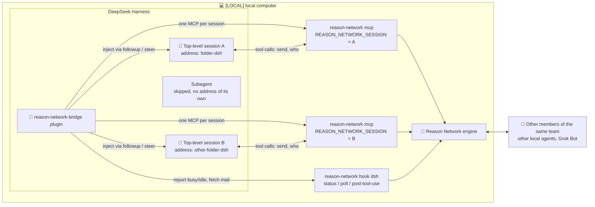
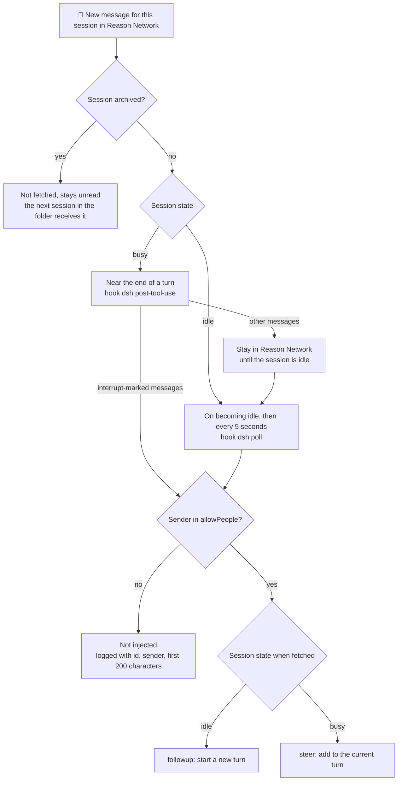

# reason-network-bridge (dsh plugin)

**English** | [简体中文](README.zh-CN.md)

Execution location: all commands, app actions, and file paths in this guide belong to `[LOCAL]`, the user's local computer (Mac). This plugin is not installed on `[BOT-CLOUD]`, the Bot's cloud computer. `[GROK-UI]` means the Grok Bot interface operated by the user; all three labels match the main guide.

This host plugin lets DeepSeek Harness (dsh) sessions receive Reason Network messages automatically, like Claude Code, Codex, and pi. It has no package dependencies; it resolves the required dsh modules from the installed app at runtime.

Reason Network's built-in setup supplies a shared MCP address and requires sessions to check their inbox. This plugin adds a separate address for each session and automatic wake-ups.

How the plugin, sessions, and Reason Network fit together:



## Behavior

- Mounts a Reason Network MCP for each top-level session, skipping subagents, with `REASON_NETWORK_SESSION=<dsh-session-id>`. Each gets an address based on the folder name plus `-dsh`, visible in `reason-network who`.
- When idle: runs `reason-network hook dsh poll` immediately on becoming idle and every five seconds thereafter; a new message starts a turn with `followup`.
- When busy: runs `hook dsh post-tool-use` near the end of a turn and injects interrupt-marked messages with `steer`.
- Archived sessions stop receiving, unmount their MCP, and release the address. Messages remain unread for the next session using the address in that folder. Unarchiving restores reception.
- Delivers messages only when the sender's person name exactly matches an entry in `allowPeople`. In this setup, that name equals the team name. Without the allowlist, the plugin refuses to load. Rejected messages are logged with id, sender, and the first 200 body characters.
- Logs to `~/.dsh/logs/reason-network-bridge.log`, mode 600, rotating after 1 MB.

How a message reaches a session:



## Install (macOS desktop)

First install, open, and configure DeepSeek Harness desktop and confirm it works independently. The installer searches `~/Applications/DeepSeek Harness.app` and then `/Applications/DeepSeek Harness.app`; for another location, run `DSH_APP="/actual/path/DeepSeek Harness.app" dsh/mac-install.sh <team-name>`. Python from the main guide is required; plugin tests use the app's runtime, with no separate Node installation.

First install the Mac side using the [main guide](../README.md), then run from the distribution root:

```bash
dsh/mac-install.sh <team-name>
```

The script runs tests with the app's runtime, backs up `~/.dsh/cordis.patch.yml` to `~/.dsh/backup-reason-network-bridge/`, copies the plugin to `~/.dsh/plugins/`, saves the original Reason Network MCP block for the uninstaller, and replaces it with the configuration below. It fills `<mac-home>` with the user's actual absolute home path. If a step fails after backup, it restores the patch. **Quit dsh completely (⌘Q) and reopen it**; the desktop app does not hot-reload plugins.

To update an installed bridge, run `dsh/mac-install.sh --plugin-only` (`./update.sh` does this for you). It runs the tests, backs up the installed plugin and replaces only that file; `~/.dsh/cordis.patch.yml` and your bridge settings are left as they are. If any step fails, the previous plugin is restored. Then quit and reopen dsh.

```yaml
- insert:
    - id: reason-network-bridge
      name: '<mac-home>/.dsh/plugins/reason-network-bridge.mjs'
      config:
        serverName: reason-network
        command: '<mac-home>/.local/bin/reason-network'
        allowPeople:
          - '<team-name>'
```

With `serverName: reason-network` and `command` present, engine setup and upgrades recognize the existing integration and do not reinsert the original block. It is expected for `doctor` to show dsh as skipped. Optional settings: `pollMs` (default 5000), `hookTimeoutMs`, `toolCallTimeoutMs` (default 660000), `mountTimeoutMs`, and `logFile`.

## Verify

- Run `reason-network who`. Each dsh session should have its own line resembling `<folder>-dsh  dsh … turn`. Although it reports `turn`, the plugin handles idle messages within roughly five seconds.
- Send `reason-network send <team-name>/<folder>-dsh "Self-test: please confirm receipt"`. It should appear as a user message with a trailing `From <team-name>… Reply if useful with …` line, and dsh should reply.
- Check the log for `attached session=…`, delivery via `followup …` or `steer …`, and allowlist rejections via `dropped …`.

## Known limitations

- Multiple sessions in one folder receive suffixes such as `<folder>-dsh-2`; messages to the unsuffixed address reach only the first.
- Messages are delivered near the end of a turn or while idle, not halfway through a tool call.
- Restart the app completely after changing the plugin file.
- Incoming messages trigger agent work. Keep `allowPeople` limited to your own identity. dsh's permissions and sandbox settings still apply.

## If the bridge stops working

The bridge replaces the engine's block instead of sitting next to it, because two blocks would mount two `reason-network` MCP servers in every session. The cost: while the bridge is installed, dsh's Reason Network access depends entirely on it. The bridge relies on DeepSeek Harness internals (its bundled MCP client and session events), so a dsh update can break it. When that happens, dsh sessions lose Reason Network entirely, including inbox checks.

On load, the bridge checks that this dsh provides what it needs. If something is missing, it logs `incompatible DeepSeek Harness (missing …)` or `incompatible session=…` to `~/.dsh/logs/reason-network-bridge.log`, together with the recovery step. If the bridge cannot load dsh's MCP client, the log line starts with `cannot load @deepseek-ai/dsh-mcp-client`. Either way, run the uninstaller below to return dsh to the engine's own integration.

## Uninstall

Run from the distribution root:

```bash
dsh/mac-uninstall.sh
```

It backs up `~/.dsh/cordis.patch.yml`, then swaps only the bridge block for the Reason Network block saved at install time. Older installations without a saved block use the earliest backup that contains one. It also removes the plugin file. Everything else in the patch, including changes made after installation, is left as is. If the bridge is not exactly one block between its BEGIN and END markers (for example, a marker was edited away or duplicated), it changes nothing and asks you to edit the file by hand. It also changes nothing if its temporary file `cordis.patch.yml.reason-network-bridge.tmp` is a symlink or not a regular file. If no saved block is found, it removes the bridge block and asks you to run `reason-network setup`, which also re-checks the other agents. Quit and reopen the app afterwards. dsh then uses one shared address per folder and checks its inbox only when the model asks.

`./uninstall.sh --level identity` and `--level all` run `dsh/mac-uninstall.sh --no-restore` before `setup --remove`, so they remove the bridge block without restoring anything. If that step fails, they stop before touching Reason Network. Level `identity` keeps the backups in `~/.dsh/backup-reason-network-bridge/` and the bridge log `~/.dsh/logs/reason-network-bridge.log`; level `all` removes both. `--level program` does not touch dsh.

## Files

- `reason-network-bridge.mjs`: plugin.
- `reason-network-bridge.test.mjs`: offline tests run before installation. Manually: `ELECTRON_RUN_AS_NODE=1 "/Applications/DeepSeek Harness.app/Contents/MacOS/DeepSeek Harness" dsh/reason-network-bridge.test.mjs`.
- `mac-install.sh`: installer; `--plugin-only` updates only the plugin file.
- `mac-uninstall.sh`: uninstaller.
