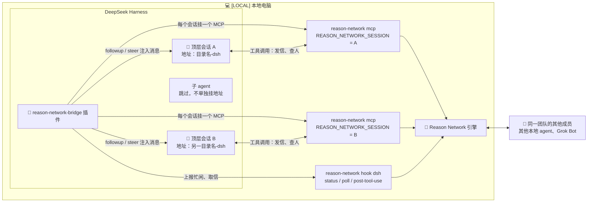
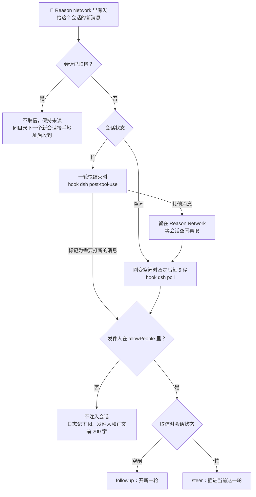

# reason-network-bridge（dsh 插件）

[English](README.md) | **简体中文**

执行位置：本指南中的所有命令、App 操作和文件路径都属于 `[LOCAL]` 用户本地电脑（Mac）。这个插件不安装在 `[BOT-CLOUD]` Bot 云电脑上。`[GROK-UI]` 表示用户操作的 Grok Bot 界面，三种标识与主指南一致。

这个插件让 DeepSeek Harness（dsh）的会话像 Claude Code、Codex、pi 一样，能即时收到 Reason Network 的消息。它是一个 dsh 主机插件，没有任何包依赖，需要的 dsh 模块在运行时直接从 App 安装包里解析。

为什么需要它：Reason Network 自带的 `setup` 只给 dsh 接了一个 MCP，所有会话共用同一个地址，而且消息只有会话自己去查收件箱才看得到。这个插件补上了两样东西：每个会话一个独立地址，以及自动唤醒。

插件、会话和 Reason Network 之间的关系：



## 做什么
- 给每个顶层 dsh 会话（子 agent 跳过）单独挂一个 Reason Network MCP，环境变量 `REASON_NETWORK_SESSION=<dsh 会话 id>`。这样每个会话都有自己的地址，格式是文件夹名加 `-dsh`，可以用 `reason-network who` 查看。
- 会话空闲时：刚变空闲的那一刻以及之后每 5 秒，跑一次 `reason-network hook dsh poll`；有新消息就用 `followup` 开一轮。
- 会话忙时：在一轮快结束的时候跑 `hook dsh post-tool-use`，只取那些标记为需要打断的消息，用 `steer` 插进当前这一轮。
- 会话被归档后就停止收信，它的 MCP 被卸掉，地址也让出来。期间的消息留在 Reason Network 里保持未读，同一个文件夹下一个新会话接到这个地址时会一并收到。取消归档后恢复收信。
- 只投递发件人团队名在 `allowPeople` 名单里的消息，而且要完全相等才算。没配 `allowPeople` 的话插件会拒绝加载。不在名单里的消息不会注入会话，只在日志里记下 id、发件人和正文前 200 字。
- 日志写在 `~/.dsh/logs/reason-network-bridge.log`，权限 600，超过 1 MB 自动轮转。

一条消息怎么进入会话：



## 安装（macOS 桌面版）
先安装、打开并配置好 DeepSeek Harness 桌面版，确认能独立使用。脚本依次查找 `~/Applications/DeepSeek Harness.app` 和 `/Applications/DeepSeek Harness.app`；如果安装在其他位置，运行时传入 `DSH_APP="/实际路径/DeepSeek Harness.app" dsh/mac-install.sh <team-name>`。需要主指南中的 Python；插件测试使用 App 自带运行时，无需另装 Node。

先按[主指南](../README.zh-CN.md)装好 Mac 侧，然后在发行版根目录运行：

```
dsh/mac-install.sh <team-name>
```

脚本会依次做四件事：用 App 自带的运行时跑一遍单测；把 `~/.dsh/cordis.patch.yml` 备份到 `~/.dsh/backup-reason-network-bridge/`；把插件拷到 `~/.dsh/plugins/`；最后把 patch 里 Reason Network 原来的 MCP 块另存一份留给卸载脚本用，再换成下面这一块，其中 `<mac-home>` 会使用用户实际的 home 绝对路径。任何一步失败都会自动把 patch 恢复原样。装完后要**完全退出 dsh（⌘Q）再重新打开**，因为桌面版不会热加载。

```yaml
- insert:
    - id: reason-network-bridge
      name: '<mac-home>/.dsh/plugins/reason-network-bridge.mjs'
      config:
        serverName: reason-network
        command: '<mac-home>/.local/bin/reason-network'
        allowPeople:
          - '<team-name>'
```

这一块里写了 `serverName: reason-network` 和 `command`，所以 Reason Network 的 `setup` 和 `upgrade` 会认为 dsh 的 MCP 已经接好，不会再把原来的块插回去；`doctor` 把 dsh 列为 skipped 也是预期行为。可选配置项有 `pollMs`（默认 5000）、`hookTimeoutMs`、`toolCallTimeoutMs`（默认 660000）、`mountTimeoutMs`、`logFile`。

## 验证
- 运行 `reason-network who`，每个 dsh 会话应各占一行，形如 `<目录>-dsh  dsh … turn`。显示 `turn` 是因为引擎不认识 dsh 这种 agent，实际上会话空闲时 5 秒内就会处理消息。
- 在终端发 `reason-network send <team-name>/<目录>-dsh "自测：请回复收到"`。这封信会作为一条 user 消息出现在 dsh 会话里，末尾多一行 `From <team-name>… Reply if useful with …`，然后 dsh 会自己回复。
- 看日志：每个会话挂载时记一条 `attached session=…`；收到消息时记 `followup …` 或 `steer …`；被名单过滤掉的记成 `dropped …`。

## 已知限制
- 同一个文件夹开多个会话时，后开的会叫 `<目录>-dsh-2`，发给 `<目录>-dsh` 的信只会进第一个会话。
- 工具调用进行到一半时不会投递，要等这一轮快结束或者会话空闲。
- 改了插件文件之后，要完全退出 App 再打开才生效。
- 外部消息会驱动 dsh 跑一轮，所以 `allowPeople` 里只放你自己的团队名。dsh 自己的权限和沙箱设置照常生效。

## 插件失效时

插件是替换引擎原来那块配置，不和它并存，因为两块同时存在，每个会话会挂上两个 `reason-network` MCP。代价是装了插件以后，dsh 能不能用 Reason Network 完全取决于插件。插件依赖 DeepSeek Harness 的内部实现（App 自带的 MCP 客户端和会话事件），dsh 升级后可能失效。一旦失效，dsh 会话会完全连不上 Reason Network，连自己查收件箱都不行。

插件加载时会先检查当前 dsh 是否具备所需能力。缺了什么，就在 `~/.dsh/logs/reason-network-bridge.log` 里记一条 `incompatible DeepSeek Harness (missing …)` 或 `incompatible session=…`，并附上恢复方法。如果加载不了 dsh 的 MCP 客户端，日志会以 `cannot load @deepseek-ai/dsh-mcp-client` 开头。遇到这两种情况，运行下面的卸载脚本，把 dsh 恢复成引擎官方的接法。

## 卸载

在发行版根目录运行：

```bash
dsh/mac-uninstall.sh
```

脚本会先备份 `~/.dsh/cordis.patch.yml`，然后只把插件那一块换回安装时保存的 Reason Network 原块。旧版本安装时没有单独保存原块的，就从最早一份含原块的备份里取。脚本同时删除插件文件。patch 里的其他内容，包括安装之后你自己做的修改，都不会动。如果插件配置不是恰好一组 BEGIN/END 标记（比如标记被删掉或重复了），脚本什么都不改，提示你手动编辑。如果哪里都找不到原块，脚本只删除插件那一块，并提示你运行 `reason-network setup`，它会顺带重新检查其他 agent 的接入。完成后完全退出并重开 App。之后 dsh 回到每个文件夹共用一个地址、只在模型主动查看时才收信的状态。

`./uninstall.sh --all` 会在 `setup --remove` 之前运行 `dsh/mac-uninstall.sh --no-restore`，只删除插件那一块，不写回原块。这一步失败时，`--all` 会停下来，不会动 Reason Network。备份和日志分别保留在 `~/.dsh/backup-reason-network-bridge/` 和 `~/.dsh/logs/`。

## 文件
- `reason-network-bridge.mjs`：插件本体。
- `reason-network-bridge.test.mjs`：单测。`mac-install.sh` 安装前会先跑它；也可以手动跑：`ELECTRON_RUN_AS_NODE=1 "/Applications/DeepSeek Harness.app/Contents/MacOS/DeepSeek Harness" dsh/reason-network-bridge.test.mjs`。
- `mac-install.sh`：安装脚本。
- `mac-uninstall.sh`：卸载脚本。
